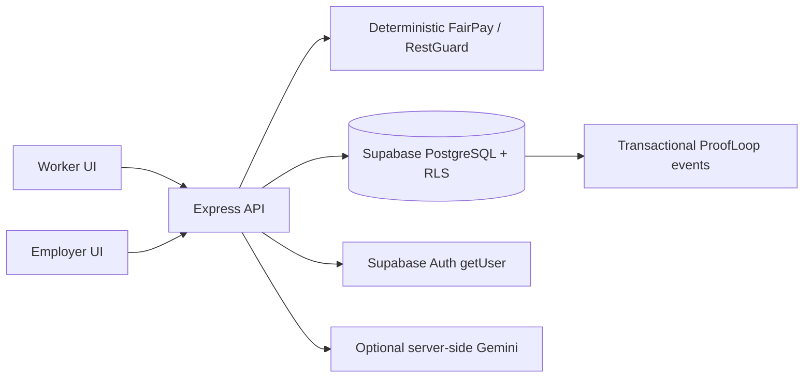

# Architecture and security model

React/Vite and Express form one modular monolith. Vercel serves the compiled frontend and exports Express through one Node function on the same origin. The portable local/container entry point also serves frontend and APIs together. Supabase PostgreSQL is the only application database; there is no local-storage business-data fallback. Browser local storage contains only language preference and the Supabase Auth session.

## Authentication and tenant authorization

Browser sign-in uses Supabase Auth. The server verifies every protected request with `auth.getUser(access_token)`, then fetches protected `organization_members` records. Roles never come from user-editable metadata or client-supplied role flags. All business queries and RPCs use the caller's access token and the publishable key. Membership-based RLS filters workers to their own shifts/pay/reviews and admins to their authorized tenants. `organization_members` cannot be edited through application roles.

Tables expose SELECT only to authenticated users, subject to RLS. Direct inserts/updates/deletes are revoked. Mutations go through small public SECURITY INVOKER wrappers calling guarded transactional functions in the unexposed `private` schema. Those private SECURITY DEFINER functions have an empty search path, schema-qualified references, explicit identity/membership checks and operation-specific validation. Anonymous callers have no execute grant. Roles cannot edit/delete audit events.

## ProofLoop and historical accuracy

Business writes and events commit atomically in PostgreSQL. Payroll corrections preserve previous and corrected amounts; workers must confirm an employer response before closing a pay review. Verified or payroll-linked shifts cannot be silently rescheduled. Confirmed/payroll-linked shifts retain their policy snapshot. Authorized policy edits record a version event and apply to unsnapshotted work, preserving historical expected pay. Hourly and prorated daily policies use the same deterministic engine.

History is append-only for application roles, not cryptographically immutable or tamper-proof. Database owners retain administrative powers. A record does not prove the truth of a work claim. Signed receipts are intentionally out of scope.

## Anonymous safety service

Safety submission does not read or attach employee identity. The server generates an 8-byte random reference and a separate 32-byte random access token using Node crypto. Only a SHA-256 token hash is persisted, in an unexposed private table. Tracking uses a POST body, never URL query credentials. Raw credentials appear only in the submission response and ephemeral UI state. They are not sent to Gemini or written to request logs. The reporter must save them; there is no account-based recovery.

A dedicated Supabase Auth gateway account performs only guarded submit/track RPCs. Its ID is allowed in `private.gateway_accounts` and has no organization memberships, SELECT access to private tables, or worker/payroll permissions. The account password remains server-side. No service-role/secret key is needed by the application runtime. Admin updates run as the verified admin identity and enforce sequential statuses.

Rate limits use shared private PostgreSQL buckets keyed by an HMAC of address and scope. Raw IP addresses are not stored in those buckets or attached to reports. The limiter is independent of function-instance memory and fails closed when unavailable. A short-lived gateway authentication cache is an optimization only. Infrastructure providers may maintain their own access logs. Report contents or infrastructure information can identify someone; absolute anonymity is not promised. Avoid collecting names, employee IDs, precise personal locations, or attachments.

## Deterministic engines

Shared TypeScript uses integer paise and BigInt integer-ratio rounding. It validates explicit-offset timestamps, correct overnight dates, whole-minute boundaries, breaks, rate bounds and configured IANA time zones. One component rounding step per regular/overtime amount is used. This is a configured policy calculator, not a legal wage assessment.

RestGuard checks long shifts, short/overlapping rest intervals per worker, repeated overtime within seven days and consecutive scheduled days. Warnings explain the exact policy. The what-if slider shifts start/end together; only explicit confirmation persists a change. Alerts are not medical diagnoses.

## AI and operational boundaries

The current official `@google/genai` SDK runs only on the backend. Model ID comes from `GEMINI_MODEL`. Request topics/languages and outputs are Zod validated; only minimized, deterministic pay facts are shared. No raw safety complaint, identity, token, or tracking secret is sent. The assistant has no tools and cannot change business records. Timeouts, provider failures and invalid output return reviewed-language guidance. Gemini is disabled until a key/model is configured.

Helmet CSP, body-size limits, Zod validation, safe generic errors, no-store API responses, non-root container execution and explicit secret separation are included. No file uploads or CSV imports are enabled. Public demos use a dedicated synthetic project and cannot delete records or change memberships. They permit bounded workflow edits within the synthetic tenants; do not co-locate production employee data.
