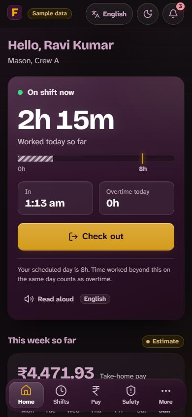
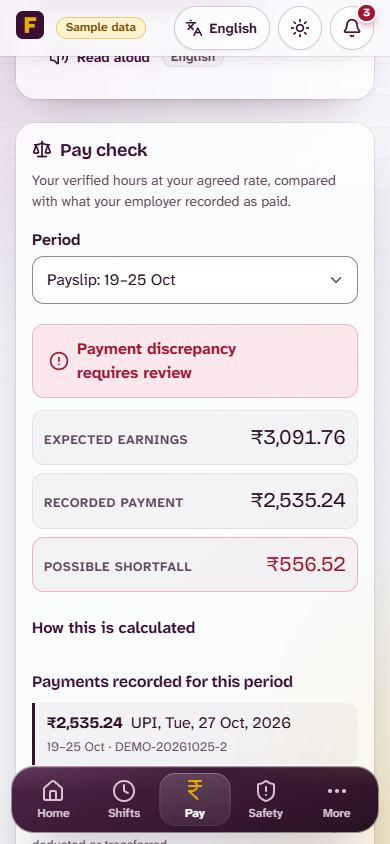
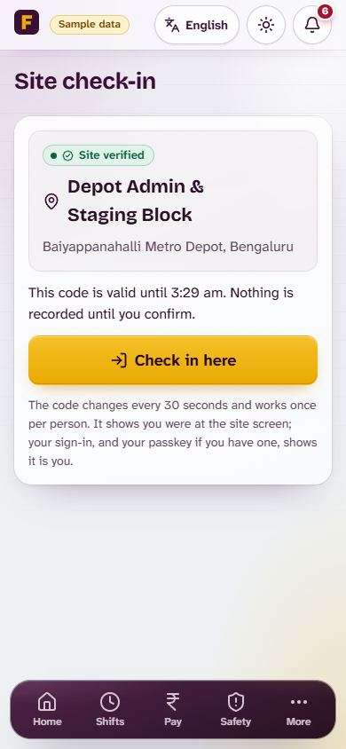
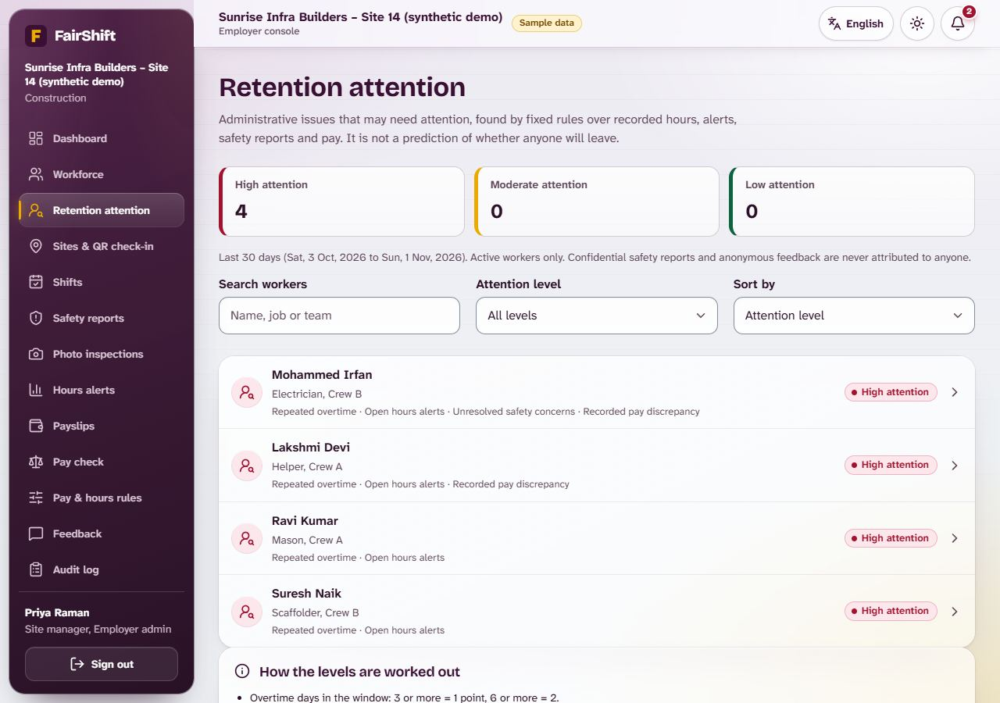

# FairShift

**Fair hours. Fair pay. Safe work.**

A workforce fairness platform for construction sites and campus support staff. Workers get proof of their hours, a clear view of their pay and a safe way to speak up. Employers get an honest picture of workforce health.

Prompt Wars 2026 x SRM ACM Student Chapter | Theme: UN SDG 8, Decent Work and Economic Growth

| | |
| :-- | :-- |
| **Name** | Yukith M Joseph |
| **Institution** | Presidency University |
| **Live demo** | <https://fairshift-nine-red.vercel.app> (any demo account, PIN `1234`) |
| **Source repository** | <https://github.com/Zynx095/promptwarsXACM> |

---

## Contents

1. [Problem statement](#1-problem-statement-as-given)
2. [Our solution](#2-our-solution)
3. [What makes it different](#3-what-makes-it-different)
4. [Tools used](#4-tools-used)
5. [How to run it](#5-how-to-run-it)
6. [Quality and verification](#6-quality-and-verification)
7. [Demo link](#7-demo-link)
8. [Key prompts](#8-key-prompts)

---

## 1. Problem statement (as given)

> **FairShift: Decent Work Platform.** Building fairer, safer, and more transparent workplaces for employee-intensive organisations.
>
> **Problem context: manual workforce management.** Large workforces still rely on paper registers, spreadsheets, and WhatsApp groups across key sectors: construction (daily shift workers on active sites), colleges and schools (campus support and facility staff), hospitals (round-the-clock care and sanitation teams) and factories (high-volume floor and line operators).
>
> **Why workers struggle today**
> - Opaque pay calculations: unclear salary breakdowns or uncounted overtime hours.
> - Fear of identification: hesitation to raise complaints or share honest feedback.
> - Unreported safety risks: workplace hazards ignored until actual injuries occur.
> - Lost career history: unrecorded skills force workers to restart from zero.
>
> **Employer blind spots:** zero workforce visibility (no clear view of overworked or unhappy staff), high attrition risk (unable to spot employees likely to quit early), delayed escalation (issues reach management only after becoming severe).
>
> **Accessibility needs:** regional languages (workers primarily communicate in native local tongues), limited literacy (interfaces must support voice and visual cues), basic smartphones (must run smoothly on low-end mobile devices).
>
> **The mission:** Make work fairer, safer, and more transparent for everyone. Empower workers with clarity and voice while giving employers actionable insights into workforce health. The platform must work across at least two distinct industries (e.g. construction site + college).
>
> **Deliverables:** a functional prototype with 3+ working features, two interfaces (one for workers, one for employers/admins), and 2+ industry use cases.

---

## 2. Our solution

FairShift is a mobile-first web app for frontline workers on **construction sites** and in **campus support services** (housekeeping, security, sanitation, maintenance), with a separate **employer console**.

**For the worker**

- Check in and out of a shift, optionally confirmed with a passkey and the phone's screen lock, or by scanning the site's **rotating QR code**.
- Receive a signed work receipt for every finished shift.
- See exactly how pay was worked out in the **Money Jar**: base, overtime and deductions, next to an *agreed vs worked vs paid* comparison.
- Check whether what was paid matches in the **Pay check**: verified hours at the agreed rate against the payments the employer recorded, with the calculation shown and any possible shortfall flagged.
- Generate a printable wage-discrepancy notice from that comparison.
- Report hazards openly or confidentially, with photos, and follow each report until the fix is photographed and the reporter confirms it.
- Keep a portable **Skill Passport** of training and experience.
- Use the whole app in six languages (English, Hindi, Kannada, Tamil, Telugu, Bengali) with read-aloud and voice dictation.
- Install it on the phone and keep working without signal: check-ins and reports are saved on the phone as *pending verification* and sent when the connection returns.
- Choose **Light**, **Dark** or **Night** appearance (or follow the phone).

**For the employer**

- Attendance, payroll and a live view of who is on shift.
- A safety queue with time-to-acknowledge and time-to-fix metrics.
- Alerts for excessive hours and missed rest periods.
- An append-only audit log of every change.
- A **retention attention** panel: fixed, visible rules over overtime, open alerts, record corrections, unresolved reports and pay gaps, with the reasons and suggested follow-up for each worker. It is not a prediction and never changes anyone's pay or status.
- A **rotating QR display** for each site's entrance, and a **Pay check** page to record payments and see who may be underpaid.

### Features at a glance

| Problem from the brief | What FairShift does |
| :-- | :-- |
| Opaque pay, uncounted overtime | Automatic overtime, Money Jar breakdown, agreed vs worked vs paid comparison, printable discrepancy notice citing Indian wage law |
| Disputed hours, edited timecards | HMAC-signed work receipts anchored in Merkle-tree checkpoints (**FairShift Proof**); every correction is audited |
| Fear of identification | Confidential reports store no reporter identity; **Safe Signal** surfaces a hazard pattern only once at least three reports agree |
| Hazards ignored or "fixed" on paper | **Accountability Loop** lifecycle with photo evidence and two-key closure (fix photo plus reporter confirmation) |
| Heat on outdoor sites | Heat-index check (NOAA Rothfusz) mapped to NDMA-style water, rest and shade guidance |
| Lost career history | Portable **Skill Passport** of training and experience |
| Fear of honest feedback | Ratings and comments to the employer, without the worker's name attached |
| Employer blind spots | Dashboard with who is on shift, hours this week, open safety reports, response metrics, excessive-hours and rest-period alerts, and an audit log |
| Regional languages, low literacy, basic phones | Six languages, read-aloud, dictation, large touch targets, lightweight client |
| Buddy punching | Optional WebAuthn passkey check-in; no biometric data leaves the phone. **Rotating site QR**: signed, site-bound, expires in 60 s by the server's clock and works once per worker |
| Underpayment nobody notices | **Possible pay shortfall indicator**: expected pay from verified hours vs recorded payments, in whole paise, with the arithmetic shown; not a legal finding |
| High attrition risk, delayed escalation | **Retention attention panel**: Low / Moderate / High attention from stated rules, each with its records and a follow-up; read-only and never punitive |
| Basic smartphones, weak site signal | Installable **PWA** with an offline outbox; nothing counts until the server confirms it |
| Two or more industries | One shared codebase configured for a construction company and a college campus, fully tenant-isolated |

### Screenshots

| Worker home | Money Jar | Safety report | Employer console |
| :-: | :-: | :-: | :-: |
|  |  |  |  |

**Final update**

| Night theme | Pay check | QR check-in | Retention attention |
| :-: | :-: | :-: | :-: |
|  |  |  |  |

All 32 earlier screenshots (phone, tablet and desktop) are in [`screenshots/`](screenshots/); the 11 final-update screenshots (themes, offline check-in, QR display and check-in, pay check, retention) are in [`screenshots/final-update/`](screenshots/final-update/), with captions in [`src/README.md`](src/README.md#15-screenshots).

---

## 3. What makes it different

Most workforce tools record what the employer says happened. FairShift is built around giving the worker evidence of their own.

- **Proof, not promises.** Each shift produces an HMAC-signed receipt. Receipts are anchored in Merkle-tree checkpoints, so a later edit to a timecard is detectable. This is **FairShift Proof**.
- **Two keys to close a hazard.** A report is closed only when the fix is photographed and the original reporter confirms it. Nobody can mark a hazard "fixed" on paper alone.
- **Anonymity by design.** Confidential reports store no reporter identity. **Safe Signal** shows a hazard pattern to the employer only after at least three reports agree, so one worker cannot be singled out.
- **Pay a worker can read in two seconds.** The Money Jar explains base pay, overtime and deductions visually, with read-aloud in the worker's language.
- **A pay check the worker can see.** Recorded payments are compared with verified hours, step by step, so a gap is visible to the worker and the employer before it becomes a dispute.
- **Honest by default.** The app does not overclaim. Where a feature depends on a setting, such as passkeys or cloud text-to-speech, the interface says what is and is not protected.

---

## 4. Tools used

| Tool | Used for |
| :-- | :-- |
| **Google Antigravity** | Initial application foundation: project setup, routing, shared UI and page shells |
| **Claude Code (Claude Opus)** | Core implementation from structured prompts: features, security hardening, tests, the mobile-first redesign, the glass visual system, read-aloud, photo evidence, passkeys and deployment |
| **Vercel** | Hosting of the live demo |
| **GitHub** | Version control |
| **Google Cloud Text-to-Speech and Vision** (optional) | Higher-quality read-aloud and image checks when API keys are configured |

**Tech stack:** React 19, TypeScript and Vite 8 on the client; Node.js 22, Express 5 and Zod 4 on the server; SQLite via `node:sqlite`; SimpleWebAuthn for passkeys; Vitest and Supertest for tests.

---

## 5. How to run it

### Option A: use the live demo

Open <https://fairshift-nine-red.vercel.app>. Every account uses PIN **`1234`**.

| Role | Organisation | Phone |
| :-- | :-- | :-- |
| Employer (admin) | Sunrise Infra Builders (construction) | `9000000100` |
| Worker | Sunrise Infra Builders (construction) | `9000000001` |
| Employer (admin) | Greenfield Institute of Technology (campus) | `9100000100` |
| Worker | Greenfield Institute of Technology (campus) | `9100000001` |

The demo runs on synthetic data that resets when the server restarts.

### Option B: run locally

Requires Node.js 22.13 or later and npm 10 or later.

```bash
cd src
npm ci
cp .env.example .env      # sets DEMO_MODE=true so synthetic data is created
npm run dev
```

Open <http://localhost:8080>.

| Command | What it does |
| :-- | :-- |
| `npm test` | Runs all unit and integration tests |
| `npm run build` | Produces a production build |
| `npm run check` | Runs format, lint, typecheck and tests together |

The full technical guide (architecture, security, configuration and deployment) is in [`src/README.md`](src/README.md). Deeper notes on the main ideas are in [`src/docs/`](src/docs/): `FAIRSHIFT_PROOF.md`, `SAFE_SIGNAL.md`, `ACCOUNTABILITY_LOOP.md`, `SECURITY.md` and `AUTHENTICATION.md`.

---

## 6. Quality and verification

- **Tests:** 450 unit, integration and client tests across 53 files, all passing for this version, covering pay and overtime rules, the pay shortfall indicator, receipts and proof, QR check-in (expiry, signatures, replay, wrong site), the retention rules, the offline outbox and service worker, the three themes, Safe Signal thresholds, authentication, tenant isolation and API behaviour.
- **Static checks:** `npm run check` runs formatting, linting and a strict TypeScript typecheck.
- **Security:** validated inputs (Zod) on every route, signed sessions, tenant isolation, payroll and CSV export hardening, and an append-only audit log.
- **Accessibility:** 44 px touch targets, read-aloud in all six languages, reduced-motion and no-blur fallbacks, and WCAG contrast checked by tests in Light, Dark and Night.
- **Builds:** typecheck, lint, formatting, the client and server builds and the Vercel production build all pass; the live demo was redeployed from this version.
- **Responsive:** verified in a real browser at phone, tablet and desktop sizes (see the screenshots).
- **Known limits:** the hosted demo uses SQLite on Vercel, so data is synthetic and resets on restart; a production deployment would use a persistent database or volume. A QR code proves the code was seen in the last minute, not the phone's location. Offline check-ins are timed when they reach the server. Offline mode was tested in a simulated service worker and headless Edge, not on physical phones. The new employer-console pages are English only; every worker screen is in all six languages. Full list: [`src/README.md`](src/README.md#13-known-limitations).

---

## 7. Demo link

- **Live app:** <https://fairshift-nine-red.vercel.app>
- **Source code:** <https://github.com/Zynx095/promptwarsXACM>

---

## 8. Key prompts

The prompts were long, structured briefs. Abridged versions are in [`prompts.md`](prompts.md). In order:

1. **Master implementation directive.** Build FairShift end to end (attendance, transparent payslips, safety reporting, anonymous feedback, employer dashboard, fatigue alerts, skill passport) for construction and campus staff, with shared business logic, real persistence, security and tests, and no fake functionality.
2. **Engineering audit.** Independently audit and harden the product (sessions, FairShift Proof, Safe Signal, Accountability Loop, payroll and CSV security, Money Jar, dispute notice, six languages, heat stress), then test every worker and admin workflow end to end.
3. **Mobile-first redesign.** A non-generic redesign of the worker app and employer console that keeps the brand colours, never overclaims (pay, proof, anonymity), meets accessibility targets and is verified in a real browser at seven screen sizes.
4. **Glass visual system.** A complete glass material system with contrast, reduced-motion and no-blur fallbacks enforced by tests.
5. **Feature completion.** Read-aloud that works in all six languages, camera-based safety inspection with two-key closure, and passkey (WebAuthn) check-in that never touches raw biometric data.
6. **Cleanup and deployment.** Reduce repository size, keep the SQLite design, deploy to Vercel and be honest about its persistence limits.
7. **Final update.** Practical non-AI features (rule-based retention attention panel, installable PWA with offline check-ins and reports, rotating signed QR check-in, pay shortfall indicator), Light, Dark and Night themes, UI polish, and documentation, delivered as one commit.
