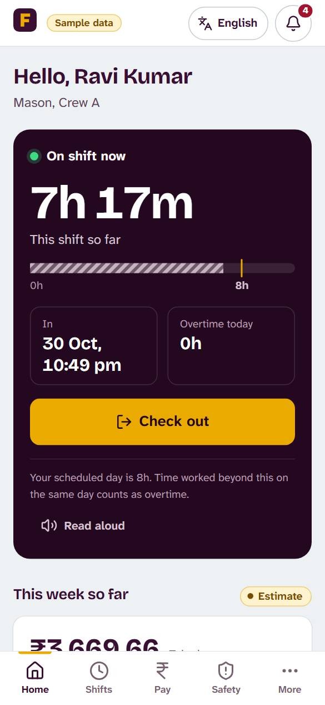
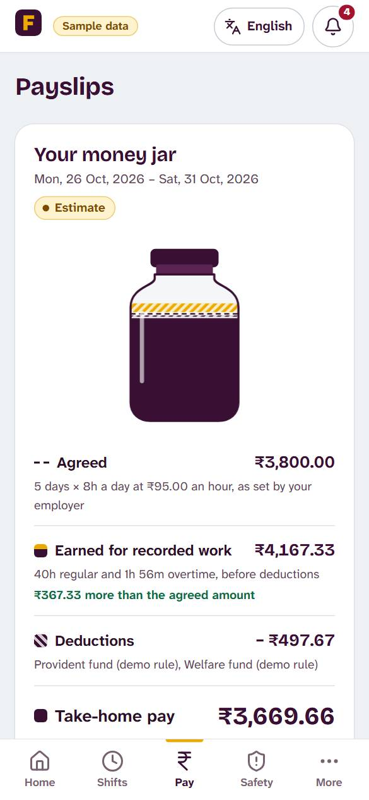
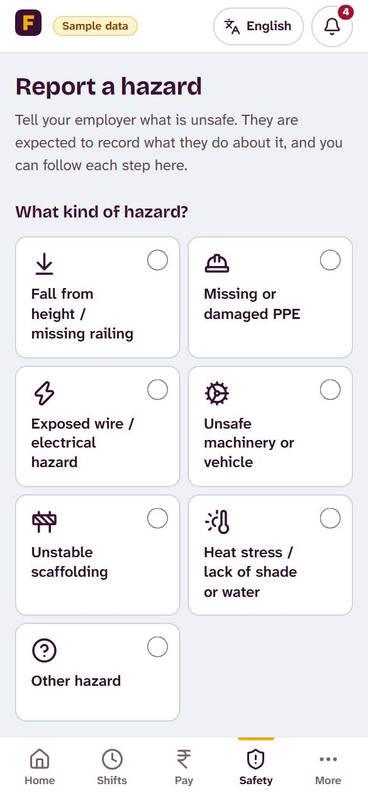
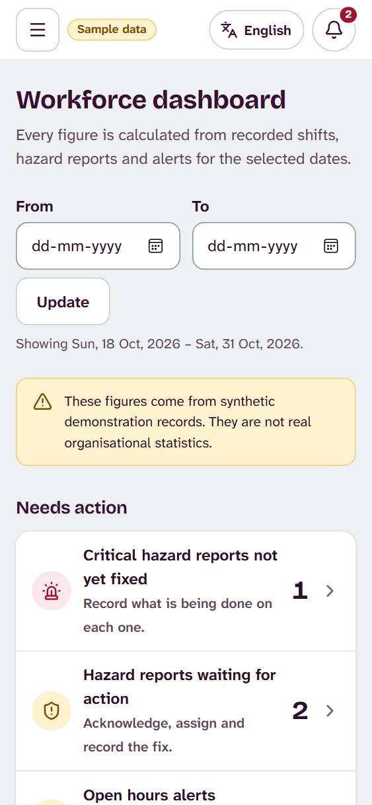

# FairShift: Fair hours. Fair pay. Safe work.

**Prompt Wars 2026 × SRM ACM Student Chapter · Theme: UN SDG 8, Decent Work and Economic Growth**

| | |
| :-- | :-- |
| **Name** | Yukith M Joseph |
| **Register number** | Presidency University |
| **Live demo** | <https://fairshift-nine-red.vercel.app> (sign in with any demo account, PIN `1234`) |
| **Source repository** | <https://github.com/Zynx095/promptwarsXACM> |

---

## 1. Problem statement (as given)

> **FairShift: Decent Work Platform.** Building fairer, safer, and more transparent workplaces for employee-intensive organisations.
>
> **Problem context: manual workforce management.** Large workforces still rely on paper registers, spreadsheets, and WhatsApp groups across key sectors: construction (daily shift workers on active sites), colleges and schools (campus support and facility staff), hospitals (round-the-clock care and sanitation teams) and factories (high-volume floor and line operators).
>
> **Why workers struggle today**
> - Opaque pay calculations: unclear salary breakdowns or uncounted overtime hours.
> - Fear of identification: hesitation to raise complaints or share honest feedback.
> - Unreported safety risks: workplace hazards ignored until actual injuries occur.
> - Lost career history: unrecorded skills force workers to restart from zero.
>
> **Employer blind spots:** zero workforce visibility (no clear view of overworked or unhappy staff), high attrition risk (unable to spot employees likely to quit early), delayed escalation (issues reach management only after becoming severe).
>
> **Accessibility needs:** regional languages (workers primarily communicate in native local tongues), limited literacy (interfaces must support voice and visual cues), basic smartphones (must run smoothly on low-end mobile devices).
>
> **The mission:** Make work fairer, safer, and more transparent for everyone. Empower workers with clarity and voice while giving employers actionable insights into workforce health. The platform must work across at least two distinct industries (e.g. construction site + college).
>
> **Deliverables:** a functional prototype with 3+ working features, two interfaces (one for workers, one for employers/admins), and 2+ industry use cases.

---

## 2. Our solution

FairShift is a mobile-first web app for frontline workers on **construction sites** and in **campus support services** (housekeeping, security, sanitation, maintenance), with a separate **employer console**. Workers check in and out (optionally confirmed with a passkey and the phone's screen lock), and every finished shift produces a signed work receipt. The **Money Jar** shows exactly how pay was calculated (base, overtime, deductions) next to an *agreed vs worked vs paid* comparison, and a wage-discrepancy notice can be generated from it. Workers report hazards openly or confidentially, with photos, and follow each report until the fix is photographed and the reporter confirms it (two-key closure). Everything works in six languages (English, Hindi, Kannada, Tamil, Telugu, Bengali) with read-aloud and voice dictation, while employers get attendance, payroll, safety queues, fatigue alerts and an audit log.

### Features at a glance

| Problem from the brief | What FairShift does |
| :-- | :-- |
| Opaque pay, uncounted overtime | Automatic overtime, Money Jar breakdown, agreed vs worked vs paid comparison, printable discrepancy notice citing Indian wage law |
| Disputed hours, edited timecards | HMAC-signed work receipts anchored in Merkle-tree checkpoints (**FairShift Proof**); every correction is audited |
| Fear of identification | Confidential reports store no reporter identity; **Safe Signal** only surfaces a hazard pattern once at least three reports agree |
| Hazards ignored or "fixed" on paper | **Accountability Loop** lifecycle with photo evidence and two-key closure (fix photo + reporter confirmation) |
| Heat on outdoor sites | Heat-index check (NOAA Rothfusz) mapped to NDMA-style water, rest and shade guidance |
| Lost career history | Portable **Skill Passport** of training and experience |
| Fear of honest feedback | Ratings and comments to the employer, without the worker's name attached |
| Employer blind spots | Dashboard with who is on shift, hours this week, open safety reports, time-to-acknowledge / time-to-fix metrics, excessive-hours and rest-period alerts, and an append-only audit log |
| Regional languages, low literacy, basic phones | 6 languages, read-aloud, dictation, large touch targets, lightweight client |
| Buddy punching | Optional WebAuthn passkey check-in; no biometric data leaves the phone |
| Two or more industries | One shared codebase configured for a construction company and a college campus, fully tenant-isolated |

### Screenshots

| Worker home | Money Jar | Safety report | Employer console |
| :-: | :-: | :-: | :-: |
|  |  |  |  |

All 32 screenshots are in [`screenshots/`](screenshots/).

---

## 3. Tools used

| Tool | Used for |
| :-- | :-- |
| **Google Antigravity** | Initial application foundation: project setup, routing, shared UI and page shells |
| **Claude Code (Claude Opus)** | Core implementation from structured prompts: features, security hardening, tests, the mobile-first UI/UX redesign, the glassmorphism visual system, read-aloud, photo evidence, passkeys and deployment |
| **Vercel** | Hosting of the live demo |
| **GitHub** | Version control |
| **Google Cloud Text-to-Speech / Vision** (optional) | Higher-quality read-aloud and image checks when API keys are configured |

**Tech stack:** React 19 + TypeScript + Vite 8 (client), Node.js 22 + Express 5 + Zod 4 (server), SQLite via `node:sqlite`, SimpleWebAuthn for passkeys, Vitest + Supertest for tests.

---

## 4. How to run it

**Option A: use the live demo.** Open <https://fairshift-nine-red.vercel.app>. Every account uses PIN **`1234`**:

| Role | Organisation | Phone |
| :-- | :-- | :-- |
| Employer (admin) | Sunrise Infra Builders (construction) | `9000000100` |
| Worker | Sunrise Infra Builders (construction) | `9000000001` |
| Employer (admin) | Greenfield Institute of Technology (campus) | `9100000100` |
| Worker | Greenfield Institute of Technology (campus) | `9100000001` |

The demo runs on synthetic data that resets when the server restarts.

**Option B: run locally.** Requires Node.js 22.13 or later and npm 10+.

```bash
cd src
npm ci
cp .env.example .env      # sets DEMO_MODE=true so synthetic data is created
npm run dev
```

Open <http://localhost:8080>. Useful commands: `npm test` (all unit and integration tests), `npm run build` (production build), `npm run check` (format, lint, typecheck and tests).

The full technical guide (architecture, security, configuration, deployment) is in [`src/README.md`](src/README.md), with design and audit documents in [`src/docs/`](src/docs/).

---

## 5. Demo link

- **Live app:** <https://fairshift-nine-red.vercel.app>
- **Source code:** <https://github.com/Zynx095/promptwarsXACM>

---

## 6. Key prompts

The full prompts are long structured briefs; abridged versions are in [`prompts.md`](prompts.md). In order:

1. **Master implementation directive:** build FairShift end to end (attendance, transparent payslips, safety reporting, anonymous feedback, employer dashboard, fatigue alerts, skill passport) for construction and campus staff, with shared business logic, real persistence, security, tests and no fake functionality.
2. **V4.1 engineering audit:** independently audit and harden the product: sessions, FairShift Proof, Safe Signal, Accountability Loop, payroll/CSV security, Money Jar, dispute notice, six languages, heat stress; then test every worker and admin workflow end to end.
3. **V4.2 mobile-first UI/UX redesign:** a premium, non-generic redesign of the worker app and employer console that keeps the brand colours, never overclaims (pay, proof, anonymity), meets accessibility targets and is verified in a real browser at seven screen sizes.
4. **V4.3 Glassmorphism V2:** a complete glass material system (primary, secondary, floating, interactive glass, lighting, backgrounds) with contrast, reduced-motion and no-blur fallbacks enforced by tests.
5. **V5.0 feature completion:** read-aloud that really works in all six languages, camera-based safety inspection with two-key closure, and passkey (WebAuthn) check-in that never touches raw biometric data.
6. **Final cleanup and deployment:** reduce repository size, keep the existing SQLite design, deploy to Vercel and be honest about its persistence limits.
