# FairShift — Decent Work, Counted Fairly

**Aman Maskara · RA2311003010804**
PromptWars × ACM SRM Student Chapter 2026 · Vibe Coding Hackathon (solo)

| | |
|---|---|
| **Live app** | **<https://fairshift-ashy.vercel.app>** — no sign-up, tap a demo person on the home page |
| **Demo video** | [Watch on Google Drive](https://drive.google.com/file/d/1mYvWr_FC0UfZsGwW3Y78NjM019QS_X0R/view?usp=sharing) |
| **Source (GitHub)** | <https://github.com/amanmaskara04/fairshift.git> (also in [`src/`](src)) |
| **Key prompts** | [`prompts.md`](prompts.md) |
| **Screenshots** | [`screenshots/`](screenshots) |
| **Project story** | [LinkedIn post](https://www.linkedin.com/posts/amanmaskara_promptwars-acmsrmist-sdg8-share-7520755833773740032-Ts7K/) |

---

## Problem statement (as given)

**FairShift: Decent Work Platform**
*Building fairer, safer, and more transparent workplaces for employee-intensive organisations.*
Theme: UN SDG 8 — Decent Work and Economic Growth

**The problem context — manual workforce management.** Large workforces still rely on paper registers, spreadsheets, and WhatsApp groups across key sectors:
- **Construction:** daily shift workers on active sites.
- **Colleges & Schools:** campus support and facility staff.
- **Hospitals:** round-the-clock care and sanitation teams.
- **Factories:** high-volume floor and line operators.

**Worker pain points — why workers struggle today.**
- **Opaque pay calculations:** unclear salary breakdowns or uncounted overtime hours.
- **Fear of identification:** hesitation to raise complaints or share honest feedback.
- **Unreported safety risks:** workplace hazards ignored until actual injuries occur.
- **Lost career history:** unrecorded skills force workers to restart from zero.

**Systemic gaps — employer blind spots and user needs.**
- *For employers:*
  - **Zero workforce visibility:** no clear view of overworked or unhappy staff.
  - **High attrition risk:** unable to spot employees likely to quit early.
  - **Delayed escalation:** issues reach management only after becoming severe.
- *Accessibility needs:*
  - **Regional languages:** workers primarily communicate in native local tongues.
  - **Limited literacy:** interfaces must support voice and visual cues.
  - **Basic smartphones:** must run smoothly on low-end mobile devices.

**The mission — your hackathon challenge.** Make work fairer, safer, and more transparent for everyone. Empower workers with clarity and voice while giving employers actionable insights into workforce health.
**Cross-industry requirement (2+ sectors):** your platform must work across at least two distinct industries (e.g., Construction Site + College).

**Example features.**
1. **Shift tracking:** QR or location check-in with automatic overtime.
2. **Clear payslips:** simple salary breakdown in the worker's native language.
3. **Safety reporting:** voice or text hazard reports with status tracking.
4. **Honest feedback:** anonymous reviews on managers and working conditions.
5. **Skill passport:** portable digital record of training and experience.
6. **Fatigue alerts:** flags excessive hours or back-to-back shifts.
7. **Admin dashboard:** tracks attendance trends, complaints, and quit risks.
8. **Voice & local:** multilingual voice support for low-end smartphones.

**Deliverables.**
- **3+ working features:** a functional prototype (custom ideas welcome).
- **2 UIs (dual interfaces):** one for workers, one for employers/admins.
- **2+ industry use cases:** a short explanation of cross-sector adoption.

**Evaluation rubric.**

| Judging criterion | Core focus area |
|---|---|
| 1. Real-World Impact | Tangible improvement to worker safety and employer visibility |
| 2. Relevance to SDG 8 | Direct alignment with Decent Work and Economic Growth |
| 3. Inclusivity & Ease of Use | Accessible for regional languages, low literacy, and basic phones |
| 4. Technical Implementation | Clean code quality, security, and working dual interfaces |
| 5. Feasibility & Scalability | Practical adoption across two or more distinct industries |

---

## My solution

**FairShift** is a voice-first phone app in English, हिन्दी, தமிழ் and తెలుగు for daily-wage and shift workers, with a dashboard for their employers.
Workers check in with a QR code (even offline), see every rupee checked against what was actually paid, report hazards by speaking, speak up anonymously, and turn their attendance into welfare eligibility and a signed work certificate.
Employers see who is on duty, who is overworked or likely to quit, and which hazards are overdue, so problems reach them before they become severe.
It runs construction sites and hospitals on the same code; *the AI understands what people say, and tested code computes every number.*

## What it covers

- **Every hour is recorded.** Workers check in with a rotating QR, and it works offline.
- **Pay is checked.** Every rupee is checked against what was actually paid; FairShift shows a *possible shortfall* with the arithmetic, and the employer can *pay the gap*.
- **Hazards are reported by speaking.** Deadlines escalate automatically, and a fire always offers *Call 112*.
- **Workers speak up safely.** Feedback is anonymous, and issues reach management only when 5 workers sign.
- **Attendance becomes proof.** It turns into welfare-scheme eligibility and a signed work certificate.

On the employer side, quit risk comes with its reasons, fatigue is flagged before it becomes a hazard, and the overview opens on what needs attention first. Campus and factory profiles are configured too, ready for a third and fourth industry.

**What the brief asked for, and what it got:**

| Asked for | FairShift |
|---|---|
| 3+ working features | **14**: all 8 example features, plus pay-gap detection with *Pay the gap*, welfare eligibility with a signed work certificate, *Safe in numbers* issues, a Help tab with verified helplines, hazard deadlines with escalation, and an AI weekly brief |
| 2 UIs | **Worker app** `/w` (phone first) and **employer dashboard** `/a` (Overview, Hazards, People, Feedback, Payroll, Sites, QR kiosk) |
| 2+ industries | **Construction** (BuildRight, Chennai) and **hospital** (City Care, Lucknow) live. Pay basis, rosters, fatigue rules, hazard types, escalation chains and welfare schemes are all configuration, so a new industry is one config file |

The full mapping of every point of the brief and every judging criterion to code is in [`src/README.md`](src/README.md#the-brief-point-by-point).

**Quality, in numbers:**
- 340 unit tests and 36 end-to-end tests, all passing, at 98% line coverage (CI fails below 95%)
- 34 of 34 live security probes pass, and `npm audit` shows 0 production vulnerabilities
- axe reports 0 accessibility violations
- every page loads in under 400 ms on phone and desktop (typically 150–200 ms, measured on the live demo)

## How it's built

### Architecture

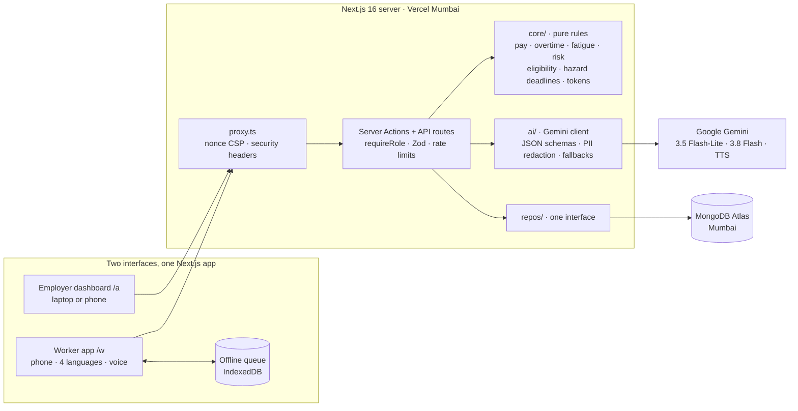

- **Frontend:** React 19 Server Components, so phones download little JavaScript. Small client islands handle voice, the QR scanner and forms; a service worker gives an offline shell and check-in queue.
- **Backend:** every change goes through a Server Action or API route that checks the session and role, validates input with Zod and applies a rate limit.
- **Core logic** (`src/core`): pure TypeScript with no database or network access. Every rupee, hour, deadline, eligibility and risk score is computed here and unit-tested.
- **AI** (`src/ai`): Gemini turns speech and text into structured JSON (hazard type, how urgent, next steps) and rewords explanations. It never produces a number, and every feature has a rule-based fallback.
- **Data:** one repository interface with two implementations: MongoDB in production, in memory for tests and keyless local runs.

### Security

| Area | How it works |
|---|---|
| **Authentication** | HMAC-signed session cookie: `httpOnly`, `Secure`, `SameSite=Lax`, 5-day expiry, compared in constant time. PINs and passwords are hashed with scrypt and a random salt. Login is limited to 5 tries per 15 minutes, per account and per IP |
| **Role-based access** | `requireRole("worker" \| "admin")` runs first on every page, Server Action and API route. A worker can never render a manager page; anonymous calls get 401 |
| **Tenant isolation** | Every action that takes a record id checks it belongs to the caller's organisation. A test makes one company's manager try every action on another company's records: all refused, nothing changed |
| **QR check-in** | Each site's QR is HMAC-signed with a per-site secret and changes every 30 seconds. A code is accepted for one window either side, so a photo of it stops working within about a minute; an offline scan is accepted for up to 12 hours. The same check-in sent twice (for example from the offline queue) is recorded once |
| **Signed links** | Skill passports and work certificates are HMAC-signed with the link type built into the signature, so one kind can't be used as another. Passports expire after 30 days |
| **Privacy** | Feedback is shown only in groups of 5+; co-signed issues stay hidden below 5 signers; signers are never stored. Names and phone numbers are removed before anything reaches AI or storage |
| **Browser and data** | A per-request nonce Content Security Policy, HSTS, `nosniff`, COOP `same-origin`. Same-origin and size checks on JSON routes. CSV exports neutralise spreadsheet formulas. Secrets only from environment variables |

The full threat model, with the code and test for each control, is in [`src/SECURITY.md`](src/SECURITY.md).

### Testing evidence

| Suite | Tests | What it proves |
|---|---|---|
| Core rules | 158 | Pay, overtime, pay check, fatigue, quit risk, eligibility, hazard deadlines, urgency, anonymity threshold, signed tokens: boundaries, rounding, error paths |
| Server and services | 110 | Each feature's workflow, the batched admin pages, **security** (cookies, role checks, tampered links, origin and size checks), **tenant isolation** |
| AI | 25 | Fallbacks, guard rails (no invented phone numbers, numbers in rewordings must match), PII removal |
| Design, languages, admin, device | 47 | Colour contrast meets WCAG AA; all 4 languages have every key; CSV safety; read-aloud, speech and the offline queue |
| **End to end** | 36 | Both interfaces on a production build, phone viewport, with axe accessibility scans (0 violations) |
| **Live security probes** | 34 | Read-only attacks on the deployed site: anonymous and forged access, cross-site requests, oversized bodies, tampered links, cookie flags |

**Coverage** (unit, enforced in CI: the build fails below 95% of lines): **98% lines**, 97% statements, 97% functions, 91% branches. By area: core rules 99%, services 97%, the security and session code at or near 100%. Every push runs lint, a format check, typecheck, unit tests with the coverage limit, a dependency audit, all end-to-end tests, and a Docker build with a container smoke test. [CI runs](https://github.com/amanmaskara04/fairshift/actions).

### Design decisions and trade-offs

| Decision | Why | Trade-off accepted |
|---|---|---|
| **AI understands, code computes** | Pay and deadlines must be exact and explainable; a model can be wrong about a number | More code to write: every AI feature also needs a rule-based fallback |
| **QR check-in, not GPS** | No location permission, works offline, and the rotating code must be scanned at the site within about a minute | Needs a printed QR or a kiosk phone at each site; location check-in is on the roadmap |
| **Web app (PWA), not a native app** | No app store, installs from a link, one codebase for workers and managers | No background notifications on every phone |
| **Server Components, no chart or animation libraries** | Small pages for ₹7,000 phones on slow networks | Charts and animations hand-built in HTML, SVG and CSS |
| **One repository interface** | Keyless local runs and fast tests in memory; MongoDB in production; another database later | An extra layer to maintain |
| **Groups of 5 for feedback and issues** | Workers can't be identified by elimination | Very small teams see no feedback until 5 respond |
| **No payment gateway** | FairShift checks wages, it doesn't move money; a gateway would weaken the strict security policy | *Pay the gap* records a payment rather than making it |
| **Pay screens open on last month for the first 7 days** | Wages for a month are due within 7 days after it ends (Payment of Wages Act, s. 5), so that is the pay check that matters at the start of a month | Workers and managers tap one tab to see the month in progress |
| **Strict security headers over Lighthouse points** | COOP and CSP protect users | Some local Lighthouse runs can't measure the page with these headers on, so scores were measured another way |

## Tools used

| Purpose | Tools |
|---|---|
| Building it (prompting) | **Claude Code** (main coding agent: research, planning, build, review), **Google Antigravity** (phase build tasks from detailed task prompts) |
| AI inside the app | **Google Gemini API**: Gemini 3.5 Flash-Lite and 3.8 Flash (speech and text understanding, structured JSON), Gemini 3.8 Flash-Lite TTS (read-aloud in Tamil and Telugu) |
| App | Next.js 16, React 19, TypeScript, Tailwind CSS, next-intl (4 languages), Zod, PWA with an offline queue |
| Data and hosting | MongoDB Atlas (Mumbai), Vercel (Mumbai); a Google Cloud Run container and one-command deploy script are included |
| Quality | Vitest, Playwright with axe-core, ESLint, Prettier, GitHub Actions CI |

**About hosting:** Google Cloud credits could not be provided, and the organisers allowed deployment on any platform, so the live demo runs on Vercel in Mumbai. The project still includes a Cloud Run–ready `Dockerfile`, which CI builds and smoke-tests on every push, and a one-command deploy script (`scripts/deploy-cloudrun.sh`).

## How to run it

Needs Node.js 20.9 or newer (24 recommended).

```bash
cd src
npm install
npm run dev          # http://localhost:3000
```

**No API key and no database are needed.** The app seeds demo data relative to today and uses a rule-based fallback for every AI feature. To configure it, copy `.env.example` to `.env.local`:

| Variable | Needed | Purpose |
|---|---|---|
| `GEMINI_API_KEY` | Optional | Live AI. Without it, every AI feature uses its rule-based fallback |
| `MONGODB_URI`, `MONGODB_DB` | Optional | Persistent database. Without them, in-memory demo data |
| `DEMO_MODE` | Optional | `true` shows one-tap demo logins and re-seeds the demo data daily |
| `SESSION_SECRET` | **Production** | Signs login cookies (32+ random characters) |
| `FEEDBACK_HMAC_SECRET` | **Production** (unless demo) | One-way keys for anonymous feedback, issue signing and private hazard tracking |
| `QR_SIGNING_SECRET`, `PASSPORT_SECRET`, `CRON_SECRET` | Optional | QR codes, passport and certificate links, the scheduled escalation sweep |

Production build and deployment:

```bash
npm run build && npm start        # production server on http://localhost:3000
vercel deploy --prod              # live demo (Vercel, Mumbai); set the variables above in the project settings
MONGODB_URI='…' bash scripts/deploy-cloudrun.sh <gcp-project-id> <gemini-api-key>   # or Google Cloud Run
```

In production, sessions, links and anonymous keys are never signed without their secrets: the app raises an error instead of using a default.

Then tap a demo person on the home page:

| Demo login | Who |
|---|---|
| **Ramesh** (code `1001`, PIN `1234`) | Mason, construction, Tamil |
| **Sunita** (code `2001`, PIN `1234`) | Ward attendant, hospital, Hindi |
| **Priya** (`priya@buildright.demo` / `demo1234`) | Construction employer |
| **Dr. Arjun** (`arjun@citycare.demo` / `demo1234`) | Hospital employer |

These are public demo accounts that exist only in the seeded demo data.

Tests and checks:

```bash
npm test                          # 340 unit tests
npx playwright install chromium   # once, before the first end-to-end run
npm run e2e                       # 36 end-to-end tests on a production build, with accessibility scans
npm run lint && npm run typecheck
```

## Demo link

- **Live app:** <https://fairshift-ashy.vercel.app>
- **Demo video:** [Watch on Google Drive](https://drive.google.com/file/d/1mYvWr_FC0UfZsGwW3Y78NjM019QS_X0R/view?usp=sharing)

## Key prompts

The full set, with what each prompt changed and who wrote it, is in **[`prompts.md`](prompts.md)**. The most important:

1. **Research first:** *"check … which are the best projects that have won older prompt wars and what they have done … and also read my docs to get a knowledge about what we have to do to win."* This set the bar: code quality, security, testing and accessibility, not just features.
2. **Plan before code:** *"build karne ka proper docs bana de, and next js arch pe banaenge. ui ka proper research kar, architecture ka research kar, and then build plan bana."* This produced a spec, a design system, an architecture and a phased plan.
3. **Antigravity task prompts** (written by the coding agent from my plan, run by me): *"Money and hours come only from `src/core`. Gemini never produces a number. … Every Server Action calls `requireRole(...)` first and validates input with Zod."* These rules became the architecture.
4. **The upgrade prompt** (one long prompt I gave the coding agent): *"Show a 'Possible shortfall: ₹X' card … the arithmetic in plain words … Always say 'possible', never accuse."* This brought FairPay Sentinel, the Benefits Unlocker and *Safe in numbers*.
5. **Testing the live app as a worker:** *"in danger when i am using voice command to report fire , its marking it low rank issue . the issue severity if understood by ai would be better…"* Now a fire is always critical, with a one-tap Call 112.
6. **Quality bar:** *"do full test and security audit … make sure all tests passed . act as proper testing engineer."* This added the tenant-isolation and security tests, the coverage gate and the live security probes.
7. **Release gate** (drafted with the agent, sent by me): *"Act as a release engineer … Verify against these exact targets and report a pass/fail table: … line coverage ≥ 95%, enforced by CI … npm audit --omit=dev: 0 vulnerabilities … npm run probe passes 34/34 … Every page … load under 400 ms."* All six targets passed before submission.

## Screenshots

| Worker (phone) | | |
|---|---|---|
| 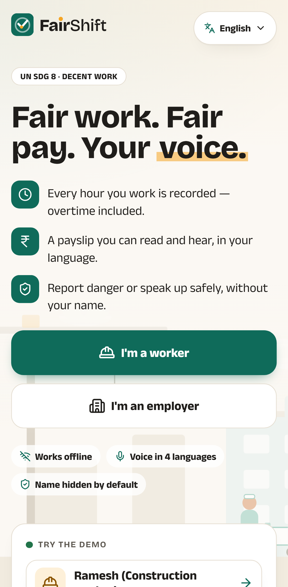 | 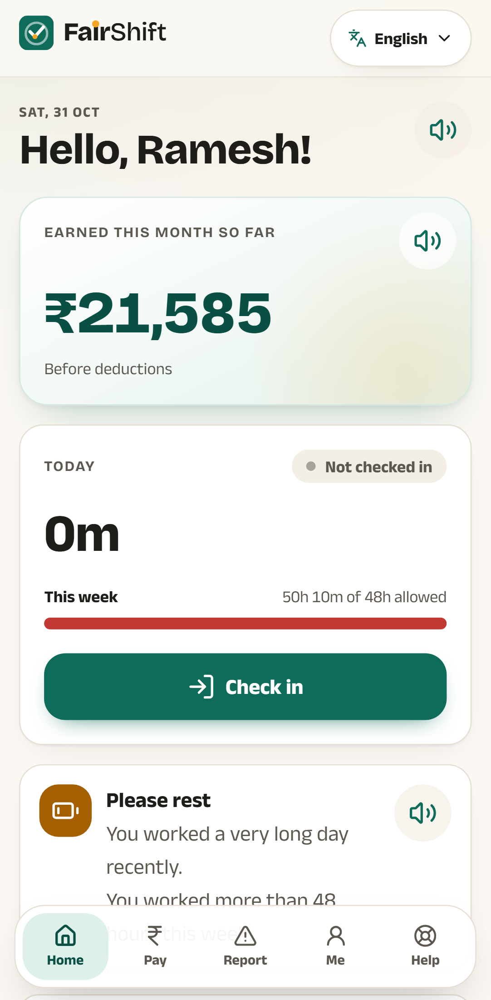 | 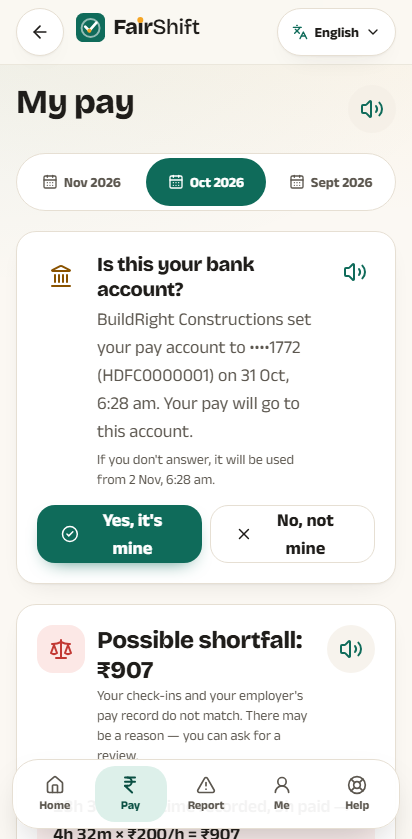 |
| 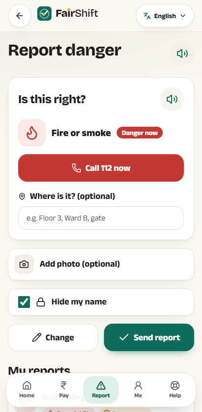 | 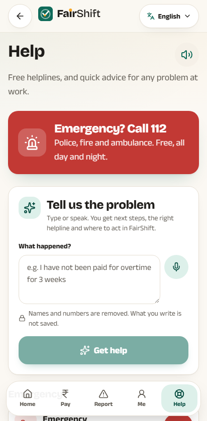 | 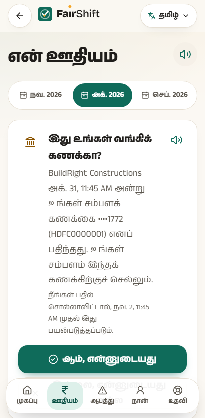 |
| 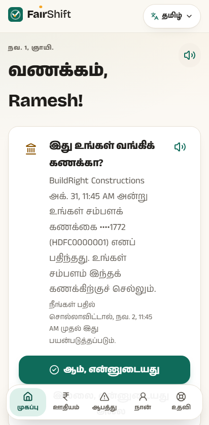 | 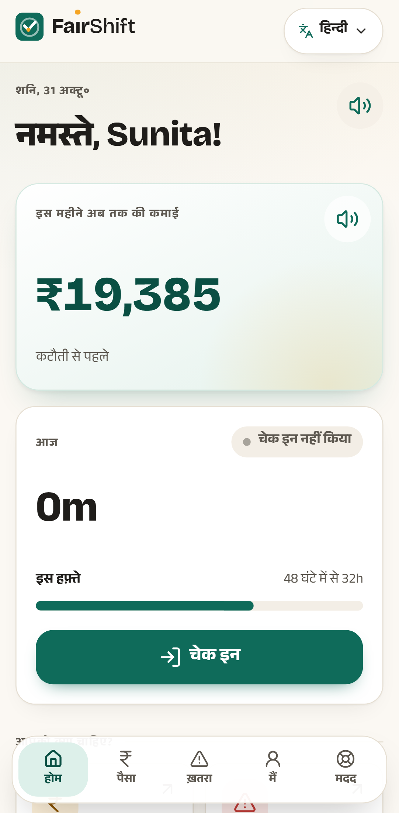 | 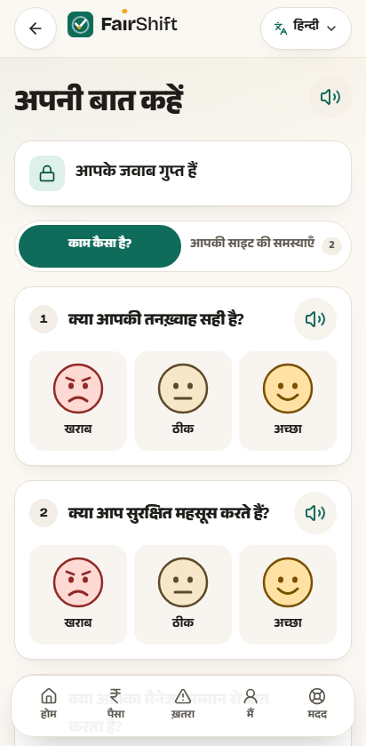 |

| Employer (laptop) | |
|---|---|
| 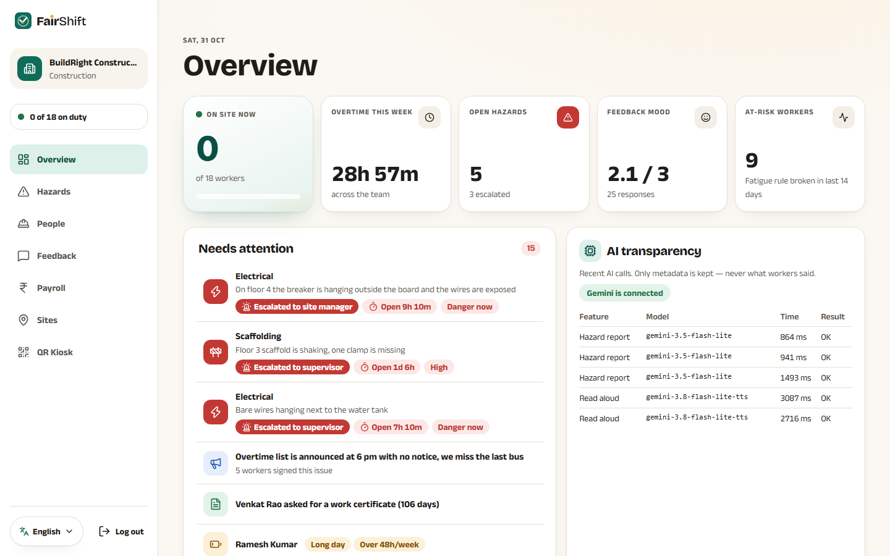 | 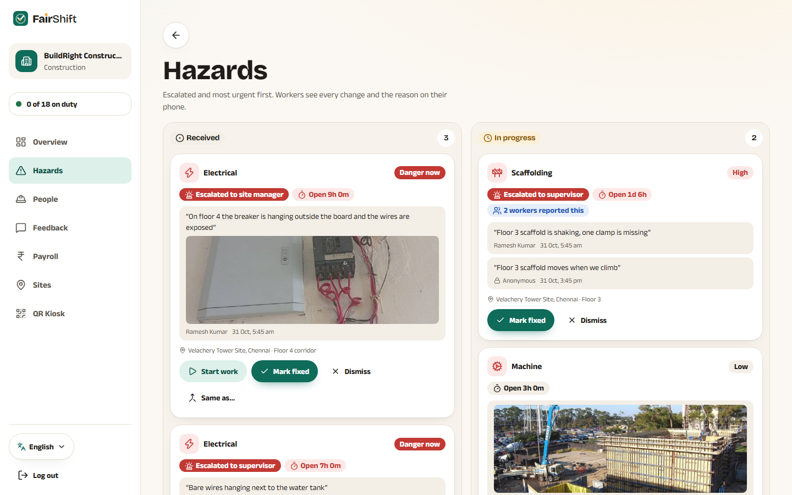 |
| 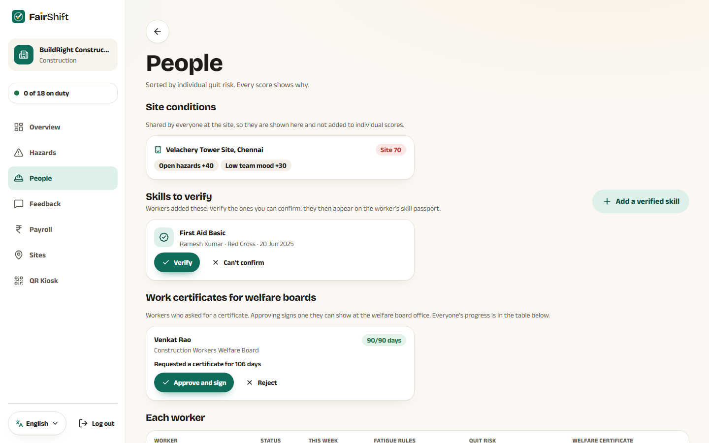 | 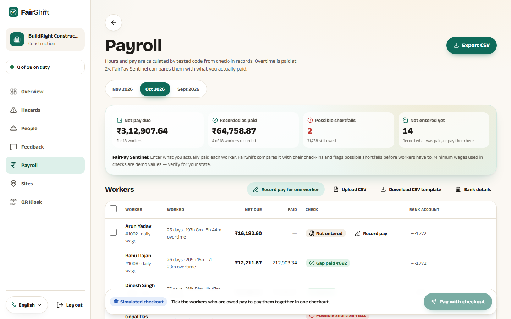 |

All screenshots are in [`screenshots/`](screenshots), taken from the live app on 31 October 2026.

## Limitations: built vs not built

| Built and working in the live demo | Not built yet (roadmap) |
|---|---|
| Everything listed under *My solution* and *What it covers*, in both interfaces and both industries | **Location check-in:** sites store a geofence, but check-in is QR only |
| AI features with rule-based fallbacks | **Keypad phones:** no IVR or missed-call reporting yet, so a smartphone browser is needed |
| Construction and hospital, seeded end to end | Campus and factory are configured, but not seeded with demo data |
| | **Real payroll integration:** paid amounts are entered or imported from CSV, not read from a payroll system |
| | **WhatsApp or SMS alerts** |

Also note:
- Minimum-wage figures and scheme rules are **demo values**, labelled in the app; verify them per state before real use.
- Rate limits are counted per server instance; a real deployment needs a shared store.
- The live demo is shared: a visitor can change demo data (for example, *Pay the gap*). It resets once a day.
- Hosted on Vercel, not Cloud Run, as the organisers allowed; the Cloud Run setup is included but not deployed.

## Security note

The upload contains no API keys, passwords or `.env` files. `.env.example` is an empty template, and every secret is read from environment variables on the server. The demo logins above are public test accounts that exist only in seeded demo data.
