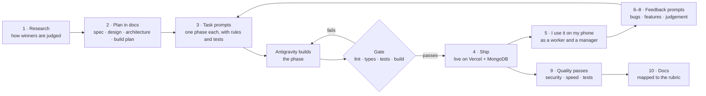

# Key prompts — FairShift

These are the prompts that built FairShift, copied from my sessions and grouped by build stage, roughly in the order I used them. Some were in Hinglish, so an English gloss follows them. Short follow-ups such as "continue" or "deploy" are left out, and so is anything that contained a credential. Three kinds of prompt appear here, and each is labelled:

- **My prompts:** what I typed, word for word, typos included.
- **Task and upgrade prompts:** long build prompts that I gave the agents, reviewed and ran. Where they came from is stated where each one appears.
- **Drafted with the agent, sent by me:** two late prompts (§9) where I asked the agent to help me turn a vague question into measurable targets, then sent and ran them.

The last section, *How I would write it today*, is hindsight. It is marked as such and was not used to build the app.

## Contents

- [How I worked](#how-i-worked)
- [Who did what](#who-did-what)
- [Techniques](#techniques-in-the-prompts-i-wrote-and-directed)
- [Problem statement → prompt → feature](#problem-statement--prompt--feature)
- **Build stages:** [1 Research](#1-research--learn-what-wins) · [2 Plan](#2-plan--docs-before-code) · [3 Build](#3-build--task-prompts-for-google-antigravity) · [4 Ship](#4-ship-early) · [5 Use it like a worker](#5-use-it-like-a-worker--prompts-from-testing-on-my-phone) · [6 Upgrade](#6-the-upgrade-prompt--from-covers-the-examples-to-solves-the-problem) · [7 Judgement](#7-product-judgement--asking-before-adding) · [8 Bug bash](#8-bug-bash--one-prompt-a-dozen-fixes-and-a-new-feature) · [9 Quality](#9-quality-bar--security-speed-testing) (incl. the release gate) · [10 Docs](#10-documentation-for-the-judges)
- [What didn't work](#what-didnt-work-and-how-my-prompting-changed)
- [How I would write it today](#how-i-would-write-it-today-hindsight)

---

## How I worked

The loop in the middle is the core of the method. Each prompt produced a phase; tests had to pass before it shipped; then I used the live app on my own phone and turned what went wrong into the next prompt.

## Who did what

| Who | Role | Shown in |
|---|---|---|
| **Me** | Set the goals and constraints, chose what to build and what to leave out, tested every change on my phone and laptop, reported problems, and decided when a phase was done | §1, §2, §4, §5, §7, §8, §9, §10 |
| **Coding agent** | Researched, wrote the planning docs, turned the plan into Antigravity task prompts, reviewed, fixed and tested | §2, §3, §6, §9 |
| **Google Antigravity** | Built the foundation and the worker features from the task prompts | §3 |
| **Google Gemini (inside the app)** | Understands speech and text, judges how urgent a hazard is, rewords pay explanations, reads aloud, suggests next steps. It never produces a number | §3, §8 |

## Techniques in the prompts I wrote and directed

| Technique | What it means here | Where |
|---|---|---|
| **Research before building** | Find out how projects are judged before deciding what to build | §1 |
| **Plan in documents first** | Spec, design system, architecture and build plan written before any code | §2 |
| **Context up front** | The build prompts open with what is being built and where (§3); the upgrade prompt also names the users and how the app will be judged (§6) | §3, §6 |
| **Decisions fixed in advance** | "Decisions (already made — do not deviate)" stops the agent from re-deciding the architecture | §3 |
| **Explicit non-goals and scope control** | A "Not your job" list in each task; "wait dont do anything in pitch as of now" | §3, §9 |
| **Hard rules as guardrails** | "Gemini never produces a number"; "every action calls `requireRole` and validates with Zod"; "every string in 4 languages" | §3, §6 |
| **Tests first, with thresholds** | Named test cases and a coverage bar (≥ 95% on the core) written into the build prompt | §3 |
| **Phase gates and no regressions** | Lint, typecheck, tests and a build after every phase; "do not remove or break existing features"; "make sure that nothing crashes" | §6, §9 |
| **Rubric injection** | The judging criteria pasted into prompts so every change is weighed against them | §6, §9 |
| **Observed, reproducible bug reports** | Exact screen, action and symptom, from using the live app on my phone | §5, §8 |
| **Decision rules instead of orders** | "either optimise or remove it if it will increase latency"; "should we do it or leave it" | §5, §7 |
| **Ask before building** | "will it help me earn points", "dont add it right away", "just tell time dont start anything", so the agent advises and estimates before changing anything | §7 |
| **Challenge the first answer** | "what different did we do" → "but everyone has done same thing": pushing until the difference was real | §7 |
| **Measurable definition of done** | Six pass/fail targets (zero warnings, tests green, coverage ≥ 95%, 0 vulnerabilities, 34/34 probes, every page < 400 ms) before submitting | §9 |
| **Options and trade-offs before building** | "Propose 2–3 options with the trade-offs … Wait for my choice before building" | §9 |
| **Measure, then target the weakest score** | The first AI evaluation scored code quality lowest (89), so the next prompts targeted code quality and verification | §9 |
| **Trade-offs stated as constraints** | "dont compromise security … for lighthouse"; "same backend"; "1 branch and under 10 mb" | §5, §9 |

## Problem statement → prompt → feature

Every point of the official brief, the prompt text that drove it, and what it became.

| The brief | Prompt that drove it (real text) | Feature | § |
|---|---|---|---|
| **Pain: opaque pay**, uncounted overtime | *"Add a second source: what the employer actually paid … show a 'Possible shortfall: ₹X' card … the arithmetic in plain words"* | FairPay Sentinel, *Pay the gap* | 6, 8 |
| **Pain: fear of identification** | *"anonymity.ts (k=5 gate)"*; *"At 5, the issue becomes escalated"* | Feedback shown only in groups of 5+; co-signed issues; signers never stored | 3, 6 |
| **Pain: unreported safety risks** | *"its marking it low rank issue . the issue severity if understood by ai would be better"*; *"Automatic escalation: a missed deadline escalates through supervisor → site manager → safety officer/HR"* | Voice reports, severity judged by AI with code minimums, deadlines and escalation, *Is it really fixed?* | 6, 8 |
| **Pain: lost career history** | *"the 'lost career history' pain point is about experience too … Add a verified work history section built from attendance"* | Skill passport with work history and a 30-day signed link; signed work certificate | 6 |
| **Blind spot: zero workforce visibility** | *"in the admin menu , you can also show how many workers are currently on duty out of total workers"* | Live on-duty count, *Needs attention*, attendance and overtime charts | 3, 8 |
| **Blind spot: high attrition risk** | *"risk.ts (explainable weighted quit-risk 0–100 with reasons[])"*; *"weight individual signals (overtime trend, missed days, pay disputes)"* | Explainable quit risk, site factors kept separate | 3, 6 |
| **Blind spot: delayed escalation** | *"Escalated hazards jump to the top of Admin → Overview 'Needs attention'"* | Hazard deadlines by severity, auto-escalation, issues escalate at 5 signers | 6 |
| **Need: regional languages** | *"Provide real Hindi, Tamil and Telugu translations (short, simple words — low-literacy users)"* | 4 languages in native scripts, with a test that every key exists in all four | 3 |
| **Need: limited literacy** | *"Every screen gets a SpeakButton … Status is shown with icon + word, never colour alone"* | Read-aloud everywhere, voice input, icons and faces | 3 |
| **Need: basic smartphones** | *"the ui ux is very bad on android phone"*; *"latency and loading time of every page on both mobile and desktop is as low as possible"* | Phone-first UI, offline check-ins, every page under 400 ms on a phone (typically 150–200 ms) | 5, 9 |
| **Feature 1: shift tracking** | *"camera QR scan … Offline queue … Idempotent by clientOpId"* | Rotating QR check-in from a kiosk, works offline, automatic 2× overtime | 3 |
| **Feature 2: clear payslips** | *"'Why this amount?': a deterministic, translated explanation … shown and spoken"* | Payslip explained line by line, in 4 languages, read aloud | 3, 6 |
| **Feature 3: safety reporting** with status tracking | *"Age timer: every open hazard shows how long it has been open"* | Report by voice or icon, status page, private tracking number | 6, 8 |
| **Feature 4: honest feedback** on managers | (the k=5 gate above) | Weekly faces, including *"Is your manager respectful?"*, plus comments with names removed | 3 |
| **Feature 5: skill passport** | (the work-history text above); *"give an option to add skill"* | Worker adds skills, employer verifies, signed share link | 6, 8 |
| **Feature 6: fatigue alerts** | *"shows a fatigue banner … when checkFatigue (sector rules, last 14 days) returns alerts"* | Long day, short rest, nights in a row, weekly hours | 3 |
| **Feature 7: admin dashboard** | *"/a layout: sidebar (Overview, Hazards, People, Feedback, Payroll, Sites, QR kiosk)"* | Employer dashboard with trends, complaints and quit risk | 3 |
| **Feature 8: voice and local** | (the languages and SpeakButton rules above) | Voice in and out, in 4 languages | 3 |
| **Deliverable: 2 UIs** | *"/w layout (requireRole('worker')) … /a layout (requireRole('admin'))"* | Worker app `/w` and employer dashboard `/a` | 3 |
| **Deliverable: 2+ industries** | *"Org 1 BuildRight Constructions, sector construction … Org 2 City Care Hospital, sector hospital"*; *"add a hospital admin demo login so both sectors are shown on the employer side"* | Construction and hospital live; campus and factory profiles | 3, 6 |
| **Deliverable: 3+ working features** | All of the above | 14 working features | — |
| **Judging rubric** | Pasted in full into the final-build prompt | Every change weighed against it | 9 |

---

## 1. Research — learn what wins

**My prompt:**

> check from github and linkedin and from internet that which are the best projects that have won older prompt wars and what they have done in it to take ideas from the projects and also read my docs to get a knowledge about what we have to do to win this promptwars

**What it changed:** winners are scored on code quality, security, efficiency, testing, accessibility and problem alignment, not only on features. That set the rule *tests and security from day one*.

## 2. Plan — docs before code

**My prompt:**

> build karne ka proper docs bana de, and next js arch pe banaenge. ui ka proper research kar, architecture ka research kar, and then build plan bana, and docs folder mei daalde. sab kuch confirm and verify krna

*(Make proper build docs; we'll build on Next.js. Research the UI properly, research the architecture, then make a build plan and put everything in the docs folder. Confirm and verify everything.)*

**What it changed:** a product spec, a UI/UX design system, an architecture document, a phased build plan and a verification log existed *before* any code was written.

## 3. Build — task prompts for Google Antigravity

**Task prompts**, written by the coding agent from my plan and docs, reviewed and run by me one phase at a time.

**Task A (foundations + core engine): decisions fixed in advance**

> ## Decisions (already made — do not deviate)
> - **Data layer:** define repository interfaces in `src/server/repos/types.ts`. Implement ONLY an in-memory backend now, seeded on first use. Expose one accessor `getRepos()`.
> - **i18n:** next-intl WITHOUT URL routing; locale from cookie `locale` (`en`|`hi`|`ta`|`te`). Provide real Hindi, Tamil and Telugu translations (short, simple words — low-literacy users).

**Task A: two interfaces**

> - `/w` layout (requireRole('worker')): header with app name + 🔊 placeholder button + language switch; bottom nav (Home, Pay, Report, Me) with icon + label, 48px+ targets, `aria-current`.
> - `/a` layout (requireRole('admin')): sidebar (Overview, Hazards, People, Feedback, Payroll, Sites, QR kiosk), top bar with org name + logout.

**Task A: two industries in the seed data**

> - Org 1 **BuildRight Constructions**, sector `construction`, site "Velachery Tower Site, Chennai". Org 2 **City Care Hospital**, sector `hospital`, sites "Ward A" and "Ward B", Lucknow.
> - 3 weeks of shifts relative to "now": include Ramesh with overtime days (10–11h), Sunita with 3 consecutive night shifts and one <11h rest gap, one worker with several missed days.

**Task A: pure core engine and tests first**

> ### 4. Core engine — PURE TypeScript in `src/core/`, no I/O, no `Date.now()` inside functions (pass `now`)
> `overtime.ts` (daily vs weekly, return the larger = more favourable to worker) · `pay.ts` (ALL money as integer paise) · `fatigue.ts` · `risk.ts` (explainable weighted quit-risk 0–100 with `reasons[]`) · `qr-token.ts` (HMAC rotating token) · `hazard-rules.ts` (fall-from-height / electrical / needle-stick never below 'high') · `anonymity.ts` (k=5 gate)
>
> ### 5. Tests (write them first for core)
> coverage thresholds: `src/core/**` ≥ 95 … ≥ 40 cases total, including: midnight-crossing night shift, weekly OT beats daily OT and vice versa, paise rounding, QR token expired/tampered/offline grace, k-anonymity below/at threshold … and an axe check with 0 violations.
>
> ## Not your job
> - No Firebase, Firestore, Gemini or any network/AI calls in this task. … Do not run the shadcn CLI, do not add new dependencies, do not deploy.

**Task B (worker features): hard rules**

> - Every Server Action and Route Handler calls `requireRole(...)` first and validates input with Zod. Return generic error codes, never stack traces.
> - **Money and hours come only from `src/core`.** Gemini never produces a number.
> - All user-visible text goes through next-intl. Add keys to ALL FOUR files. Every screen gets a `SpeakButton` that reads its main content.
> - Tap targets ≥ 48px (primary ≥ 64px). Status is shown with icon + word, never colour alone. One primary action per screen.

**Task B: shift tracking and fatigue**

> - **Offline queue** (IndexedDB): when `navigator.onLine` is false or the action fails with a network error, store `{type, payload, clientOpId, createdAt}` … Flush on the `online` event … Idempotent by `clientOpId`: replaying the same op does nothing.
> - The home status card … shows a fatigue banner (icon + text) when `checkFatigue` (sector rules, last 14 days) returns alerts for this worker.

**What it changed:** these rules became the architecture.
- *The AI decides meaning, the code computes.*
- Every mutation is guarded.
- Every screen can be read aloud in four languages.
- Both interfaces and both industries existed from the first phase.

## 4. Ship early

**My prompt:**

> deploy it on vercel and mongo db . we have to switch the services . and do it fast within 10 mins

**What it changed:** a MongoDB implementation went in behind the same repository interface, so the live demo had real data within the hour (MongoDB Atlas, Mumbai). Google Cloud credits were not available, and the organisers allowed any host.

## 5. Use it like a worker — prompts from testing on my phone

**My prompts**, each from using the live app:

> button click on website is causing issues . there is a lot of delay when i am clicking the button . add a hover effect on the buttons and fix the click issue on all pages

> for my fairshift project which we created and deployed on vercel , not the ppt , the ui ux is very bad on android phone . please align it and fix it for both laptop and phone . if you can make ui and ux better , please do it

> clicking on i am worker or i am employer on home page sometimes automatically redirects to ramesh demo page . fix that

> on fairshift desktop language selection page , the English box is smaller than other 3 languages
> 'on site now' feature works correctly on overview page but doesn't update on left menu , either optimise or remove it if it will increase latency or page loading
> on the people page on desktop, work certificate for welfare boards , every name is shown which looks odd . better to show it below with the table . only approvals to show on top. optimise this is thing on mobile too.

> change full ui ux from scratch with the same backend and make it the best frontend of hackathon winner theme

That last prompt was too vague: it produced a redesign I later replaced (see *What didn't work*). The detailed version came two days later, as **Part B of the upgrade prompt** (§6). Excerpts:

> ## PART B — Major UI redesign (light theme)
> Goal: modern, warm, friendly and premium, but **light enough for a ₹7,000 Android phone**.
>
> **Motion rules for everything below:** Animate only `transform` and `opacity`. Respect `prefers-reduced-motion`: replace with simple fades or no motion. Pause looping animations when the tab is hidden. No video files and no heavy animation libraries. Use CSS, inline SVG … Native View Transitions where supported.
>
> **B1. New design system:** CSS variables on `:root` … `--bg #FBF8F3` warm paper background · `--primary #0F6B5A` deep teal-green: buttons, active states (white text on it) · `--accent #F5A524` marigold "safety vest" highlights (dark text on it, never white) … must keep WCAG AA contrast. Soft layered shadows, 16–20px card radius … Tap targets of at least 48px.
>
> **B2. Fonts:** must support **Latin, Devanagari, Tamil and Telugu** consistently. **UI and body:** the **Anek** family (Anek Latin, Anek Devanagari, Anek Tamil, Anek Telugu). It was designed as one multi-script family, so all four languages look like the same brand. **Display headings and wordmark:** **Bricolage Grotesque**. **Money and numbers:** `font-variant-numeric: tabular-nums` so amounts line up.
>
> **B3. Logo:** a rounded-square badge in `--primary` containing a clock face whose two hands form a **check mark ✓** ("every hour, fairly counted"), with a small marigold dot at the centre … a subtle draw-on animation on the landing page only.
>
> **B4. Animated worker background:** a hand-made **inline SVG illustration** … a mason laying bricks, a crane slowly swinging a load, a worker in a hard hat walking across, a nurse pushing a cart, a factory worker at a machine, drifting clouds and a sun … 2–3 depth layers (parallax) … **Budget:** keep the SVG under ~60KB. Use CSS keyframes, no Lottie or video. On reduced motion, show a static scene.
>
> **B5. Welcome moment:** a greeting in the chosen language with the worker's name ("नमस्ते, Ramesh" / "வணக்கம், Ramesh"), letters staggering in … Tap anywhere to skip. Plays once per login session.
>
> **B6. Page transitions:** the outgoing page scales to ~0.97 and fades; the incoming page scales from ~0.98 to 1 … 250–320ms … **direction-aware** … The header and nav bar stay persistent. Use React `ViewTransition`.
>
> **B8. Feedback faces:** replace the static system emojis with **custom SVG face components** … **Idle:** a gentle breathing/blink loop … **On tap, each reacts in its own character:** 😟 brows furrow, a wobble, a small tear drops …

**What the app uses today:**

| | In the app |
|---|---|
| **Theme** | One light theme, *"Warm paper"*: paper background `#FBF8F3`, white cards, deep teal `#0F6B5A` for actions, marigold `#F5A524` "safety vest" highlights. Red, green, amber and blue for status. Danger and success were darkened from the prompt's values, and an amber warning colour was added, so that every text colour passes WCAG AA, which a unit test checks. Cards use a 20px radius and soft layered shadows |
| **Fonts** | **Anek** (Latin, Devanagari, Tamil, Telugu: one family, so all four languages look like one brand) for text; **Bricolage Grotesque** for headings and the wordmark; tabular figures for money. Self-hosted through `next/font`, with only Latin preloaded so pages stay light |
| **Logo** | A clock whose hands form a check mark, with a marigold centre dot; the hands sweep into place on the home page |
| **Landing scene** | A hand-made inline SVG (about 9.6 KB of code) showing a mason laying bricks, a crane swinging a load, a worker walking, a nurse with a trolley, a factory press with smoke, a sun and clouds, with parallax layers. Pure CSS keyframes |
| **Motion** | About 40 CSS keyframe animations, including: • a word-by-word headline reveal • letters rising in the welcome greeting • direction-aware page transitions through React's native `ViewTransition` • menu and sheet pop-ins • a QR scan line • check-in success with a ring pulse • a live "on duty" dot • meters that fill • reactive feedback faces (breathe, blink, furrow, tear, bounce, sparkle) |
| **Rules kept** | Only `transform` and `opacity` animate; reduced-motion users get short fades; loops pause when the tab is hidden; no animation, 3D or chart library; light haptic taps (`navigator.vibrate`) |
| **From my animations folder** | I shared a folder of animation references (3D, background, hero, text and page-transition effects). The headline's **word-by-word reveal** is adapted from its *Text Animations/12* (a GSAP SplitText effect), rebuilt as pure CSS and split by word, never by letter, so Hindi, Tamil and Telugu letters are never broken apart. Two other adaptations, a canvas background (*Background Animations/5*) and a hero effect (*Hero Animations/1*), were used in an earlier version and later replaced by the lighter SVG scene. The 3D and WebGL effects were left out: too heavy for a ₹7,000 phone |

**What it changed:**
- Instant press feedback on every control, and a phone-first layout.
- An old demo session can no longer hijack *I'm an employer*; an end-to-end test now guards this.
- The menu's live count updates on every page without slowing pages down: the decision rule I gave was *optimise, or remove it if it adds latency*.
- Only pending approvals sit at the top of People; everyone else's progress moved into the table.
- A complete redesign on the same backend.

## 6. The upgrade prompt — from "covers the examples" to "solves the problem"

**Upgrade prompt:** one long prompt (about 25,000 characters) that I gave the coding agent. Its Part C lists fixes found in a live audit of the deployed app.

**Opening: context, users and how it will be judged**

> You are working on **FairShift**, my submission for Prompt Wars 2026 (SRM ACM). The problem statement is UN SDG 8 "Decent Work": a platform for employee-intensive workplaces (construction sites, hospitals, colleges, factories) with a **worker interface** and an **employer/admin interface**, working across at least two industries. … The app will be **judged by an AI** on code quality, security, efficiency, testing, accessibility and problem alignment, and by humans on real-world impact, SDG 8 relevance, inclusivity (regional languages, low literacy, **low-end Android phones**), technical implementation and cross-industry feasibility. Every change must respect that.
>
> ## How to work
> 1. **Explore first** … then write a phased plan. 2. Implement **phase by phase**; after each phase run lint, typecheck, tests and a production build. 3. **Do not remove or break existing features** … 4. Every new user-facing string in all 4 languages. 5. Keep pay, eligibility and threshold logic in **pure, deterministic, unit-tested functions**. AI may only *phrase* explanations, and always needs a template fallback.

**Outline**

> **PART A — Four new features:** A1 FairPay Sentinel · A2 Benefits Unlocker · A3 "Safe in numbers" co-signed complaints · A4 "Earned so far" counter
> **PART B — Major UI redesign (light theme)** · **PART C — Fixes** from a live audit of the deployed app · **PART D — Quality bar** the AI evaluator checks

**Opaque pay (A1)**

> Right now the payslip is calculated from FairShift's own attendance, so it can never disagree with itself. Add a second source: **what the employer actually paid.** … show a **"Possible shortfall: ₹X"** card above the payslip. It shows the arithmetic in plain words ("13h 32m overtime recorded, 9h paid → 4h 32m × ₹200 = ₹907"), a read-aloud button, and a **"Request review"** button. Always say "possible", never accuse.

**Delayed escalation (Part C)**

> **Automatic escalation:** a missed deadline escalates through supervisor → site manager → safety officer/HR, set per sector. Escalated hazards jump to the top of Admin → Overview "Needs attention" with an "Escalated" badge. … **The worker closes the loop:** when a report is marked fixed, the worker sees **"Is it really fixed?"** … **Pure functions** `getHazardAge`, `isOverdue` and `nextEscalationLevel`, with unit tests: deadline boundaries, a reopen restarts the timer, a dismiss without a reason is rejected.

**Lost career history (Part C)**

> **Work history in the Skill Passport.** It currently only lists certificates, but the "lost career history" pain point is about experience too. Add a **verified work history** section built from attendance … The worker chooses what to share before showing the QR code … add an `issuedAt` and `expiresAt` to the signed passport token (e.g. 30 days).

**Attrition risk and two industries (Part C)**

> **Quit-risk scores** currently add the same site-wide "+15 open hazards, +11 team mood" to every worker, so everyone scores 38–46. Show site-level factors separately and weight individual signals (overtime trend, missed days, pay disputes) for the individual score.
> … use 30–40 workers across a construction site **and** a hospital. **Add a hospital admin demo login** so both sectors are shown on the employer side.

**What it changed:**
- **New features:** FairPay Sentinel, the Benefits Unlocker with signed work certificates, *Safe in numbers* issues and the *earned so far* counter.
- **Safety:** hazard deadlines with auto-escalation and fix confirmation.
- **Career history:** a work history in the passport, shared by an expiring signed link.
- **Quit risk:** scores that differ by person, with site factors kept separate.
- **Industries:** a hospital employer login, so both industries show on the employer side.

## 7. Product judgement — asking before adding

**My prompts:**

> in my fairshift project , why are we showing [the AI transparency panel] . do we really need to show it or is it extra . will it help me earn points

> should we add upi payment gateway or leave it

> will adding phonepe play upi for app demo cause security test failures

> why is there no option to add skill , there is option only to verify it
> should we do it or leave it

> can i add a novelty factor to my project which no one has done , if so tell what can i add . dont add it right away

> how much time will it take if you will change full ui ux from scratch with the same backend and make it the best frontend of hackathon winner theme . just tell time dont start anything

> everyone has same problem statement and used agents that gave everyone same thing . what different did we do

> but everyone has done same thing

> should i keep https://fairshift-ashy.vercel.app/pitch or remove it . what impact will it have on my app and hackathon points

I didn't accept the first answer: I pushed back ("but everyone has done same thing") until the difference was something the other entries did not have. I also asked for the cost before committing to work ("just tell time dont start anything").

**What it changed:**
- Two days later, the upgrade prompt (§6) added four features that go beyond the brief's examples: FairPay Sentinel, the Benefits Unlocker, *Safe in numbers* and *earned so far*.
- The AI transparency panel stayed: it builds trust and shows how AI is used.
- A payment gateway was **left out**. FairShift checks wages rather than moving money, and a gateway would weaken the strict security policy.
- *Add a skill* was built after weighing it.

## 8. Bug bash — one prompt, a dozen fixes and a new feature

**My prompt**, after a full session of using the app as each demo person:

> on fairshift admin overview page in desktop , when we scroll down , the left menu option also goes up . this issue is not there in any other page rather than this . fix this.
> on fairshift admin page in desktop , the language drop down goes down so we cant select language as its out of reach of desktop . fix the position and optimise it as per your choice.
> in mobile the fairshift icon shrinks when using admin mode and navigating to menu.
> in mobile worker secion when going to hazard , in my reports the icons duration and status are covering the font of issue . please correct that also .
> the following issues are universal .
> in danger when i am using voice command to report fire , its marking it low rank issue . the issue severity if understood by ai would be better rather than depending on manual terms as there could be multiple scenarios .
> the merge issue is also not well optimised . how can someone merge scaffolding and heat issue together . does it make sense??
> there is option only to verify skill as admin . give an option to add skill in the section you want wherever its most suitable .
> in payroll section , enter for one worker is not optimised . its very confusing to fill manually . give options or sliders of how much the admin want to pay … also , when its shown to worker about pay gaps , and the admin pays the worker , remove the pay gap .
> in the admin menu , you can also show how many workers are currently on duty out of total workers .
> you can also add emergency helpline numbers for workers and an ai resolution to there issues. brainstorm this feature and do it yourself.

Each line names a page, a device, an action and what went wrong, and says which problems are universal. That is how it got a dozen fixes in one pass.

**What it changed:**
- Four layout bugs fixed on desktop and mobile.
- Gemini judges severity from what is happening, and code can only raise it: **fire is always critical, with a one-tap Call 112**.
- Merges only for the same danger at the same site.
- Workers add skills and employers verify them.
- Payroll presets and hour sliders, and **"Pay the gap"** clears the worker's shortfall.
- A live on-duty count in the menu.
- A new **Help** tab with verified national helplines and AI next steps.

## 9. Quality bar — security, speed, testing

**My prompts:**

> dont compromise security performance for lighthouse . do other changes

> github should be 1 branch and under 10 mb only . code quality , security , effeciency , testing , accessibility . i am going to submit the final build . make sure all of these are in place and are top notch as a hackathon winner . the most important thing is documentation . make sure it is up to the mark .

*(This prompt also carried the five judging criteria, pasted in full.)*

> just do one last thing , make sure that latency and loading time of every page on both mobile and desktop is as low as possible . it should not take too much time to respond

> yes please work on all 3 . make sure that nothing crashes becuase everything is working very fine and latency is also very minimum as of now .

> do full test and security audit and make it in the best possible form possible . make sure all tests passed . act as proper testing engineer .

> wait dont do anything in pitch as of now . check if all of my docs are updated for final submission .

**Measure, then act on the weakest number.** The first AI evaluation scored the build 96.75/100, with **code quality the lowest at 89**. I used that score to decide what to prompt next:

> as an ai evaluate me based all metrics i have given so for along with docs

> is it possible to increase code quality even more . do 3 and 4 right now

> how many tests passed

> have you done penetration testing andd all also , is it needed

**What it changed:**
- **Code quality,** the lowest score, became the next target:
  - the whole codebase formatted, with a check in CI
  - the largest pages split into focused components
  - unit coverage raised from 78% to 98% of lines, with a gate in CI
- **Penetration testing:** asking whether it was needed produced a clear line between what was tested (34 read-only probes against the live site, plus attack tests in code) and what was deliberately not done (scanners and brute force against the live demo, which would have broken it for judges).
- **Security:** the strict security policy was kept even where it cost Lighthouse points. A tenant-isolation test suite proves one employer can never touch another's records. The audit found an unused dependency with known vulnerabilities, and it was removed.
- **Speed:** organisation-wide pages load in two database round trips; every page loads in under 400 ms on a phone, typically 150–200 ms.
- **No regressions:** the code-quality refactor changed rendering only, and was checked by every test before it shipped.
- **Testing:** 323 unit and 35 end-to-end tests pass, with coverage gated at 98% of lines, and 34 security probes run against the live site.

**Release gate before submission.** I asked the coding agent to help me turn my vague "is everything done?" into measurable targets, then sent this prompt and had it run:

> Act as a release engineer before I submit FairShift. Do not change any feature code. Verify against these exact targets and report a pass/fail table:
> 1. npm run lint, typecheck and format:check: zero warnings.
> 2. All unit tests and all end-to-end tests pass; line coverage ≥ 95%, enforced by CI.
> 3. npm audit --omit=dev: 0 vulnerabilities.
> 4. The live site at fairshift-ashy.vercel.app: /api/health reports ok with MongoDB and AI configured; npm run probe passes 34/34.
> 5. Every page, measured on a phone profile and a desktop profile (best of 3): load under 400 ms.
> 6. The GitHub repo has exactly 1 branch and is under 10 MB, and no API key, connection string or .env file is in the code or its history.

**What it changed:** a release decision based on evidence instead of a feeling. All six targets passed:
- lint, typecheck and formatting clean
- 323/323 unit and 35/35 end-to-end tests, with 98% line coverage enforced in CI
- 0 production vulnerabilities
- health OK, and 34/34 live security probes
- all 36 page measurements under 400 ms (slowest 306 ms)
- 1 branch, 1.28 MB, no secrets in the code or its history

**Protecting the demo for judges.** A visitor pressed "Pay ₹907" on the live demo, so Ramesh's screen showed ₹167 and contradicted my demo script. Same process: drafted with the agent, sent by me:

> On the live demo, any visitor can press "Pay ₹907". Today someone did, so Ramesh's Pay screen now shows ₹167 and contradicts my README and demo script until the daily reset. Judges must always see the story the docs describe. Propose 2–3 options with the trade-offs (security, effort, risk to the demo) and recommend one. Constraints: demo mode only, no new dependencies, the strict security policy unchanged, all tests green, and a new test proving that a judge's actions cannot break the demo for the next judge. Wait for my choice before building.

**What it changed:**
- **Three options compared:** a private copy per judge, an automatic reset after quiet periods, and a "Reset demo" button, each weighed on security, effort and risk.
- **My decision:** not to change seeding and login just before submission. The demo resets daily, and an untested change to the live demo was the bigger risk.

## 10. Documentation for the judges

**My prompt:**

> check if all of my docs are updated with all new features along with features focusing which mentioned in fairshift problem statement and promptwars . check everything including the architecture of docs .

**What it changed:**
- The README maps every judging criterion and every point of the brief to a feature and its code.
- The architecture diagram shows both interfaces.
- `SECURITY.md` is a threat model.

---

## What didn't work, and how my prompting changed

| What went wrong | What I learned | How the next prompt changed |
|---|---|---|
| **Vague goals caused rework.** "Make it the best frontend of hackathon winner theme" produced a redesign that I later replaced with a second, fully specified one | A superlative is not a spec: the agent cannot know what "best" means to me | The upgrade prompt (§6) described the redesign piece by piece (design system, fonts, logo, transitions, language menu, Back behaviour) |
| **Fixed rules misjudged danger.** Saying "fire" by voice was filed as a *low* severity hazard, because severity came from fixed category rules | Fixed rules cannot cover how people actually describe danger | §8 asked for the AI to judge severity from what is happening, with code allowed only to *raise* it; now a fire is always critical, with Call 112 |
| **The first UI broke on a real Android phone**, and buttons felt slow to respond | Desktop previews hide phone problems | I tested every change on my own phone and reported exact screens and symptoms (§5, §8) |
| **Google Cloud deployment was blocked**: the CLI was missing, then billing was not enabled, and no credits were available | Ship early on a host that works and keep the code portable | Deployed on Vercel and MongoDB Atlas within the hour (§4), and kept a Cloud Run–ready container and deploy script |
| **Some features looked right but failed in use**: an old demo session hijacked "I'm an employer", duplicate merges joined unrelated hazards, and manual pay entry was confusing | Passing tests do not prove a good experience | Bug reports became concrete ("how can someone merge scaffolding and heat issue together"), and the fixes were locked in with tests (heat is never merged into scaffolding; an old demo session cannot hijack "I'm an employer") |
| **Speed versus security.** A strict security header got in the way of the Lighthouse audit | A score is not worth a weaker app | I set the rule "dont compromise security … for lighthouse" and kept the header |
| **Asking "is it done?" after the work** instead of defining done at the start | Verification belongs in the prompt, not after it | Later prompts set the bar up front: "make sure all tests passed", "make sure that nothing crashes"; the release-gate prompt then set six measurable pass/fail targets before submission (§9) |

## How I would write it today (hindsight)

*These rewrites were not used to build the app. They show how I would improve my weakest prompts now.*

**1. "change full ui ux from scratch … make it the best frontend of hackathon winner theme"**

> Redesign the UI on the same backend. Users: daily-wage workers on ₹7,000 Android phones, often with low literacy. Keep every route and feature. Done means: one primary action per screen; tap targets ≥ 48px; Lighthouse accessibility 100 on `/`, `/w` and `/a`; no new animation or chart libraries; every string still in all 4 languages; all tests green. Show me three screens before changing the rest.

**2. "make sure that latency and loading time of every page … is as low as possible"**

> Measure every page on a phone profile and a desktop profile, best of 3, against the live site. Target: every page under 300 ms to load, the server answering in under 200 ms. Fix the slowest pages first, without weakening any security header. Report a before/after table per page.

**3. "do full test and security audit … act as proper testing engineer"**

> Act as a test engineer and a security reviewer. Done means:
> - every server action and API route is checked for role, organisation scope, Zod validation and rate limits;
> - a test proves one organisation cannot read or change another's records;
> - line coverage is ≥ 95% overall, and the threshold is enforced in CI;
> - `npm audit --omit=dev` shows 0 issues;
> - a read-only probe of the live site covers auth, cross-site requests, oversized bodies and tampered links.
>
> Do not write test data to the live site. Report every finding, the fix, and the test that locks it in.

**What I take from this:**
- **Define done before starting.** A target, a limit and a way to check it.
- **Describe the user and the device,** not just the feature.
- **Test on the real device,** and report bugs as page, action and symptom.
