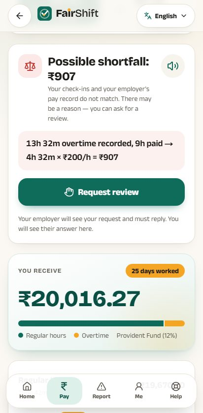
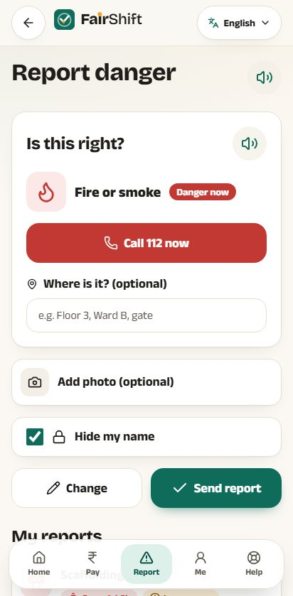
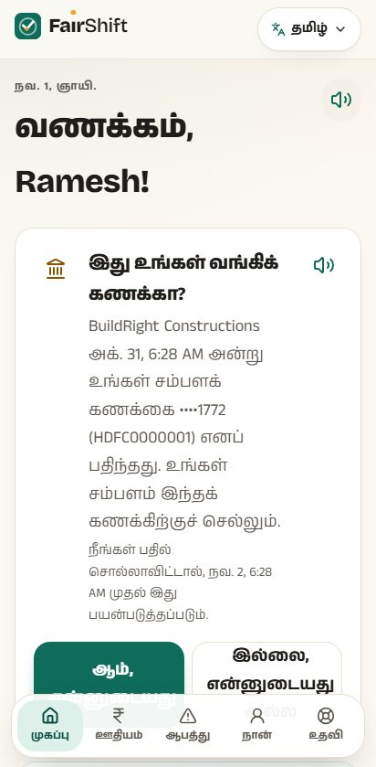
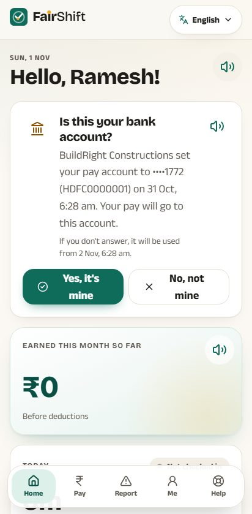
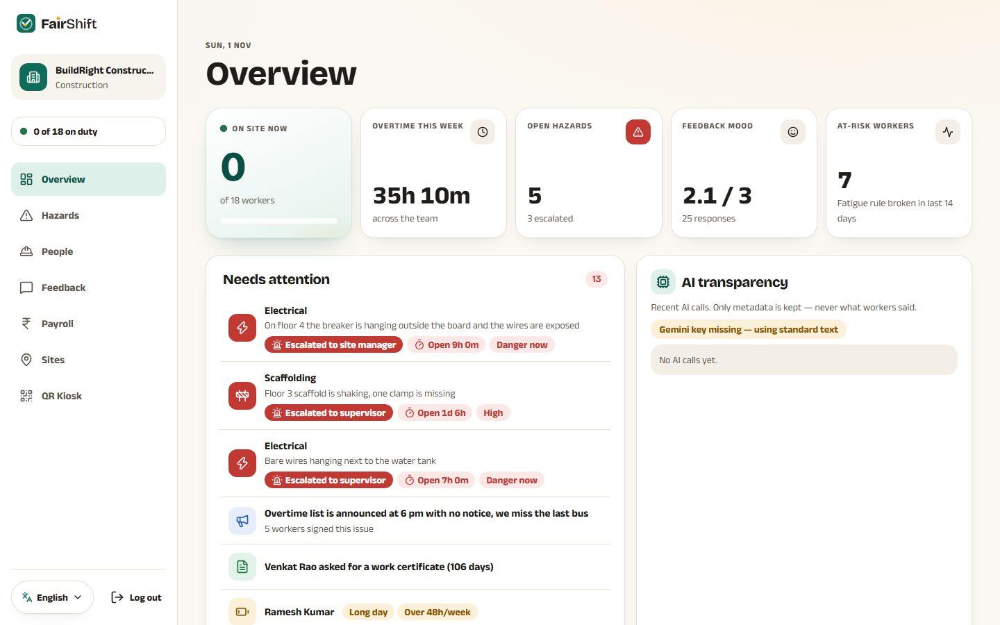
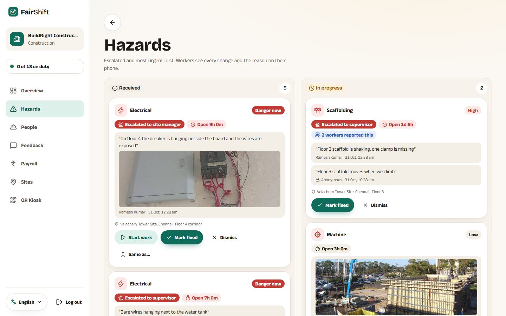
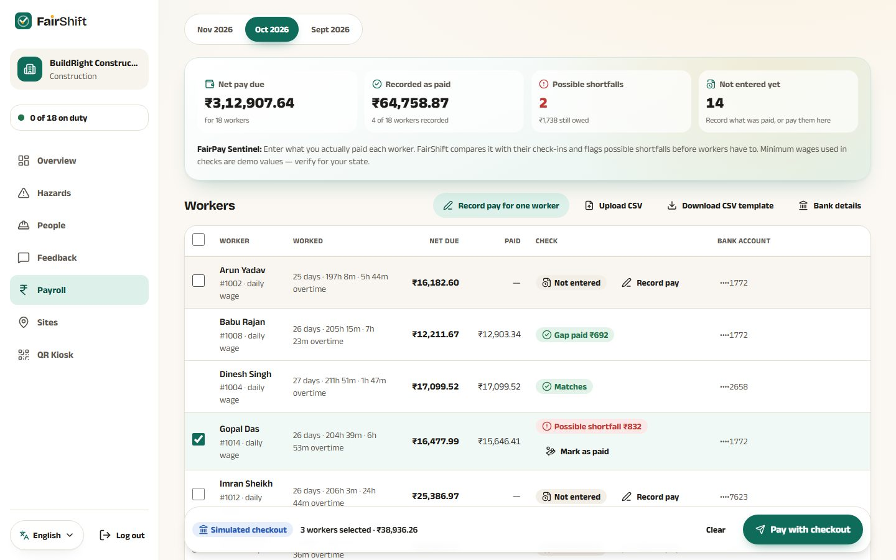
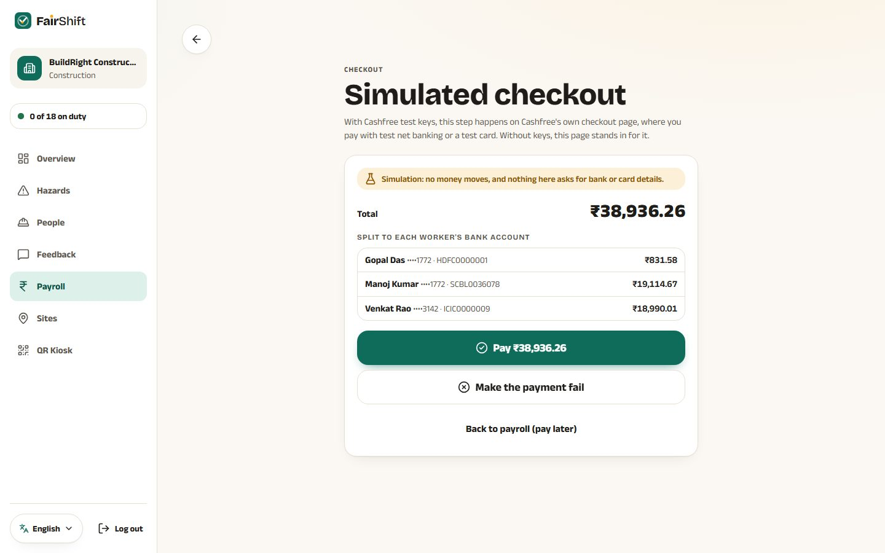
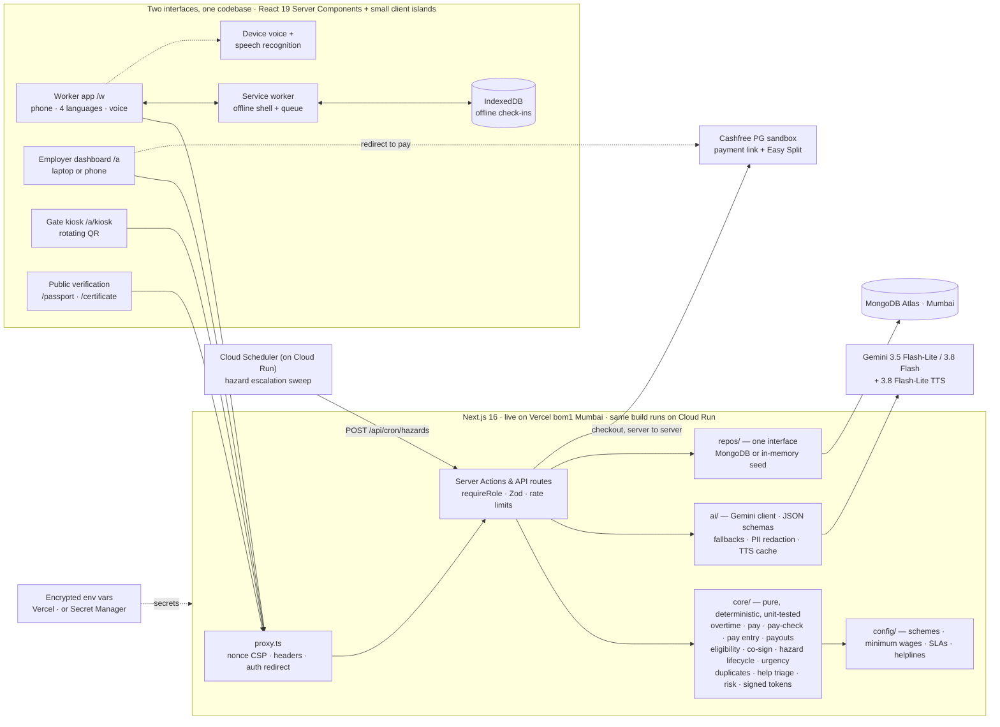

# FairShift — Decent Work, Counted Fairly

> **Prompt Wars 2026 × SRM ACM · UN SDG 8 (Decent Work & Economic Growth)**
> A voice-first, four-language workplace app for daily-wage and shift workers, and an honest early-warning dashboard for the employers who want to treat them fairly. One codebase, two working interfaces, **construction sites and hospitals**.

[](https://github.com/amanmaskara04/fairshift/actions/workflows/ci.yml)


-0%20vulnerabilities-2e8b57)


| | |
|---|---|
| **Live demo** | <https://fairshift-ashy.vercel.app> (Mumbai region, MongoDB Atlas Mumbai, live Gemini) |
| **Demo video** | [Watch on Google Drive](https://drive.google.com/file/d/1mYvWr_FC0UfZsGwW3Y78NjM019QS_X0R/view?usp=sharing) |
| **Pitch deck** | [`/pitch`](https://fairshift-ashy.vercel.app/pitch) in the app |
| **Project story** | [LinkedIn post](https://www.linkedin.com/posts/amanmaskara_promptwars-acmsrmist-sdg8-share-7520755833773740032-Ts7K/) |
| **Security model** | [`SECURITY.md`](SECURITY.md): threats, controls, code and tests |
| **Hosting** | Live on **Vercel** (Mumbai). The organisers could not provide Google Cloud credits and allowed any host; the same build is **Cloud Run-ready** (container + one-command deploy, smoke-tested in CI). [Details](#deployment) |

**Contents:** [See it](#see-it) · [Judging criteria](#judging-criteria--evidence) · [The brief, point by point](#the-brief-point-by-point) · [Pain points](#pain-point--feature--code) · [Two sectors](#two-sectors-one-product) · [Architecture](#architecture) · [AI](#ai-decides-meaning-code-computes) · [Security](#privacy-and-security-by-design) · [Accessibility](#accessibility-and-inclusivity) · [Testing](#testing) · [Design trade-offs](#design-decisions-and-trade-offs) · [Deployment](#deployment) · [Roadmap](#roadmap)

**One tap in, no sign-up.** Open the app and tap a demo person:

| Demo login | Who | Shows |
|---|---|---|
| **Ramesh** · code `1001`, PIN `1234` | Mason, BuildRight Constructions, Chennai · Tamil | QR check-in, *earned so far*, **₹907 possible overtime shortfall**, **“Is this your bank account?”** (his employer changed it yesterday), BOCW progress **72/90 days**, voice hazard report (say “fire” → *Danger now* + **Call 112**), **Help** tab |
| **Sunita** · code `2001`, PIN `1234` | Ward attendant, City Care Hospital, Lucknow · Hindi | Night-shift fatigue warning, feedback faces, **“Me too” on a 4-of-5 issue → escalates live**, ESIC & e-Shram eligibility |
| **Priya** · `priya@buildright.demo` / `demo1234` | Construction employer | **X of 18 on duty**, escalated hazards, **Payroll**: FairPay Sentinel, then tick workers and **pay them all in one checkout**, co-signed issues, skill and certificate approvals, payroll CSV, QR kiosk |
| **Dr. Arjun** · `arjun@citycare.demo` / `demo1234` | Hospital employer | The same dashboard with hospital rules, wards and escalation chain |

The app runs **with no API key and no cloud account**: seeded data (generated relative to *today*) and a deterministic fallback for every AI feature.

## See it

| Worker app (phone) | | |
|---|---|---|
|  |  |  |
| **FairPay Sentinel:** ₹907 of overtime, with the arithmetic | **Fire is always critical:** one-tap Call 112 | **Four languages:** here, Tamil |
|  | | |
| **The worker approves bank changes:** “not mine” blocks it | | |

| Employer dashboard (laptop) | |
|---|---|
|  |  |
| **Needs attention:** escalated hazards first | **Hazard board:** escalation, photos, history |
|  |  |
| **Payroll:** one list, from *Matches* to *Possible shortfall*; tick who is owed | **One checkout** for everyone ticked, split to each bank account |

---

## Judging criteria → evidence

| Criterion | Focus | What FairShift does | Try it / read it |
|---|---|---|---|
| **1. Real-World Impact** | Tangible improvement to worker safety and employer visibility | **Safety:** voice/photo hazard reports with severity deadlines and **auto-escalation** (supervisor → site manager → safety officer); fire and other emergencies are always *critical* with a one-tap **Call 112**; a **Help** tab with 8 verified national helplines and AI next steps; sector fatigue rules. **Visibility:** live *on duty* count, escalated hazards first, explainable quit risk, pay shortfalls flagged before they become disputes | Ramesh → Report / Help · Priya → Overview · [`core/hazard-lifecycle.ts`](src/core/hazard-lifecycle.ts) · [`config/helplines.ts`](src/config/helplines.ts) |
| **2. Relevance to SDG 8** | Decent Work and Economic Growth | **Target 8.5** (equal pay for work of equal value): every hour recorded, overtime at 2×, minimum-wage check, **FairPay Sentinel** compares hours with what was paid, and the employer pays every gap in **one checkout**. **Target 8.10** (access to banking): pay goes straight to each worker's own bank account, and the worker is asked before any change to it is used. **Target 8.8** (labour rights, safe workplaces): hazards fixed on deadline, *safe in numbers* co-signed issues, anonymous feedback, welfare-board eligibility and a **signed work certificate** | Ramesh → Pay (₹907) · Priya → Payroll → *Pay with checkout* · [Pain point table](#pain-point--feature--code) |
| **3. Inclusivity & Ease of Use** | Regional languages, low literacy, basic phones | **English, हिन्दी, தமிழ், తెలుగు** in native scripts (parity test on every key); **read-aloud on every screen**, voice input, icon-first big buttons (≥48px); **works offline** (check-ins queue in IndexedDB); installable PWA, no app store; SVG-only visuals for a ₹7,000 phone; WCAG AA, **axe: 0 violations** | Landing → *I'm a worker* → தமிழ் · [Accessibility](#accessibility-and-inclusivity) |
| **4. Technical Implementation** | Clean code, security, working dual interfaces | **Worker app (`/w`) and employer dashboard (`/a`)**, both end-to-end tested. Pure, tested rules in [`src/core`](src/core) (95% coverage gate); *AI decides, code computes*; nonce CSP, role + org check on every mutation, Zod, rate limits, HMAC-signed tokens, **bank accounts encrypted at rest**; **416 unit + 39 Playwright tests, 98% line coverage (CI gate: 95%)**, 43 black-box security probes | [Architecture](#architecture) · [`SECURITY.md`](SECURITY.md) · [Testing](#testing) |
| **5. Feasibility & Scalability** | Practical adoption across two or more distinct industries | **Construction and hospital** live, with **campus and factory** profiles: every difference (pay basis, roster, fatigue rules, hazard types, escalation chain, welfare schemes) is configuration. Runs without AI or a database; one container, one command to deploy; a site needs only a printed or kiosk QR | [Two sectors, one product](#two-sectors-one-product) · [Feasibility](#feasibility-and-scalability) |

## At a glance

- **Problem.** India's unorganised workers (over 90% of the workforce) cannot prove their hours, cannot read their payslips, fear speaking up, lose their work history when they change jobs, and miss welfare they are entitled to because claiming it needs paperwork they do not have.
- **Solution.** A phone app in their own language that **records every hour, checks every rupee against what was actually paid, lets workers raise issues safely in numbers, gets them help in a crisis, and turns verified attendance into welfare eligibility and a signed work certificate**. Employers get an honest early-warning dashboard, and pay everyone owed in one checkout split to each worker's own bank account.
- **Why it is trustworthy.** *The AI decides meaning, the code computes.* Every rupee, hour, deadline, eligibility and risk score comes from pure, unit-tested TypeScript in [`src/core`](src/core). Gemini understands speech, judges urgency, matches similar complaints, rewords explanations and reads aloud, and each of those has a deterministic fallback.
- **Google technology.** Live: Gemini 3.5 Flash-Lite / 3.8 Flash (structured JSON output), Gemini 3.8 Flash-Lite TTS (Tamil/Telugu read-aloud), Google Fonts (self-hosted). Ready to switch on: Cloud Run, Secret Manager, Cloud Build and Cloud Scheduler ([Deployment](#deployment)).

## The brief, point by point

Every requirement in the official problem statement (*FairShift: Decent Work Platform*, Prompt Wars 2026 × SRM ACM), with where to see it working.

**Deliverables**

| Asked for | FairShift |
|---|---|
| **3+ working features** | 15 working features (the 8 examples below plus the 7 in *Beyond the brief*), all covered by unit and end-to-end tests |
| **2 UIs: workers and employers** | **Worker app `/w`** (phone first: Home, Pay, Report, Me and Help tabs, with Check in and Speak up from Home) and **employer dashboard `/a`** (Overview, Hazards, People, Feedback, Payroll, Sites, QR kiosk) |
| **2+ industries, with a short cross-sector explanation** | **Construction** and **hospital** seeded end to end; **campus** and **factory** profiles included. See [Two sectors, one product](#two-sectors-one-product) |

**The eight example features**

| # | Example in the brief | In FairShift | Try it |
|---|---|---|---|
| 1 | **Shift tracking:** QR or location check-in with automatic overtime | Rotating signed QR from a gate kiosk or printed poster, works offline (queued, synced later); overtime at 2× computed per the site's rules. Sites store a geofence; location check-in is on the [roadmap](#roadmap) | Ramesh → Check in · Priya → Sites → QR kiosk |
| 2 | **Clear payslips** in the worker's language | Payslip with every line explained, *“Why this amount?”*, *Explain in simple words* (AI rewording, numbers locked), read aloud in 4 languages; plus **FairPay Sentinel** comparing hours with what was paid | Ramesh → Pay |
| 3 | **Safety reporting** by voice or text, with status tracking | Speak in any of 4 languages or tap a hazard icon, add where and a photo; a status page with age timer, deadline, escalation and *“Is it really fixed?”*; anonymous reports tracked by a private number | Ramesh → Report |
| 4 | **Honest feedback:** anonymous reviews of managers and conditions | Weekly faces for *pay*, *safety* and *“Is your manager respectful?”* plus a comment (names removed), shown only in groups of 5+; **co-signed issues** visible only at 5 signers | Sunita → Speak up · Priya → Feedback |
| 5 | **Skill passport:** portable record of training and experience | Verified work history from attendance, skills the worker adds and the employer verifies, shared by a **signed link that expires in 30 days**; employer-signed **work certificate** | Ramesh → Me |
| 6 | **Fatigue alerts:** excessive hours, back-to-back shifts | Sector rules (long days, short rest, nights in a row, weekly hours) on the worker's home and the manager's People board | Sunita → Home · Priya → People |
| 7 | **Admin dashboard:** attendance trends, complaints, quit risk | Attendance by day, overtime by week, live on-duty count, *Needs attention* list, feedback and issues, pay disputes, **explainable quit risk** | Priya → Overview / People |
| 8 | **Voice and local** for low-end smartphones | English, हिन्दी, தமிழ், తెలుగు; voice input and read-aloud everywhere; icon-first, ≥48px targets; installable PWA, offline, SVG-only visuals | Any screen → language menu, 🔊 |

**Employer blind spots and accessibility needs**

| The brief says | FairShift answers with |
|---|---|
| Zero workforce visibility | Live *on duty* count, fatigue board, weekly mood, attendance and overtime charts, *Needs attention* first |
| High attrition risk | Quit risk from overtime trend, missed days and pay disputes, with the reasons shown and site conditions kept separate |
| Delayed escalation | Hazard deadlines by severity with **auto-escalation** up the sector's chain; issues reach management the moment 5 workers sign; pay shortfalls flagged before they become disputes |
| Regional languages | 4 languages in native scripts, a parity test on every key, AI that understands speech in any of them |
| Limited literacy | Voice in, voice out, icons and faces instead of forms, numbers explained in plain words |
| Basic smartphones | Every page loads in under 400 ms on a phone profile, typically 150–200 ms (measured on the live demo); offline check-ins; no chart or animation libraries |

**Sectors named in the brief:** construction ✅ live · hospitals ✅ live · colleges & schools (campus profile) · factories (factory profile). A new sector is one configuration file.

**Beyond the brief:** FairPay Sentinel (possible shortfalls with the arithmetic) · **pay everyone in one checkout, safely**: tick the workers who are owed, pay the total once on Cashfree's sandbox checkout, and each share is split to the worker's own bank account; account numbers are encrypted at rest and the worker approves any change · Benefits Unlocker (BOCW, e-Shram, ESIC, PM-SYM) with a signed work certificate · *Safe in numbers* co-signed issues · Help tab with verified helplines and AI next steps · hazard deadlines, escalation and fix confirmation · AI weekly brief and an AI transparency panel for managers.

## Pain point → feature → code

| Pain point (from the problem statement) | FairShift feature | Where |
|---|---|---|
| Unrecorded hours and unpaid overtime | QR check-in (rotating HMAC token, offline queue), payslip with 2× overtime, *“Why this amount?”* | [`core/overtime.ts`](src/core/overtime.ts) · [`core/pay.ts`](src/core/pay.ts) · [`w/checkin`](src/app/w/checkin) |
| “The payslip says one thing, I was paid another” | **FairPay Sentinel**: compares attendance with what the employer recorded as paid; *Possible shortfall ₹907* with the arithmetic; one-tap review request → dispute workflow. Employers record pay from presets and hour sliders (exact to the minute, so *Paid in full* always matches); the gap is paid in the checkout, or *marked as paid* if it was settled outside FairShift (amount computed on the server either way) so the shortfall disappears for the worker. **One checkout for several workers** (the month's pay, or exactly the gap) is split to each worker's bank account, and each payment is written to their pay record once Cashfree confirms it | [`core/pay-check.ts`](src/core/pay-check.ts) · [`services/pay-check.ts`](src/server/services/pay-check.ts) · [`services/payouts.ts`](src/server/services/payouts.ts) · [`w/pay`](src/app/w/pay/page.tsx) |
| “Someone could send my pay to another account” | Bank accounts are stored **encrypted** (AES-256-GCM, bound to the worker) and shown only as ••••1191. Any account the employer enters or changes waits for the worker: **“Is this your bank account?”** in their language, read aloud; *No, not mine* blocks it until the employer enters it again; no answer, it becomes payable after 48 hours so nobody is left unpaid. Every change is kept in a history | [`server/bank-crypto.ts`](src/server/bank-crypto.ts) · [`core/payouts.ts`](src/core/payouts.ts) · [`worker/bank-confirm-card.tsx`](src/components/worker/bank-confirm-card.tsx) |
| Wages below the legal minimum | Minimum-wage check per state/sector/skill (demo table, clearly labelled) | [`config/minimum-wage.ts`](src/config/minimum-wage.ts) |
| Missed welfare benefits, no proof of days worked | **Benefits Unlocker**: BOCW board, e-Shram, ESIC, PM-SYM eligibility from verified days; progress ring; how-to-apply sheet; **HMAC-signed work certificate** approved by the employer | [`config/schemes.ts`](src/config/schemes.ts) · [`core/eligibility.ts`](src/core/eligibility.ts) · [`certificate/[token]`](src/app/certificate) |
| Fear of retaliation for speaking up | Anonymous weekly feedback (groups of 5+), and **“Safe in numbers”** co-signed issues: invisible to management until 5 workers sign; signers never stored | [`core/cosign.ts`](src/core/cosign.ts) · [`services/issues.ts`](src/server/services/issues.ts) |
| Unsafe sites, hazards ignored for days | Voice/photo hazard reports in 4 languages; **age timers**, severity deadlines, **auto-escalation**; dismiss needs a reason; *“Is it really fixed?”* closes the loop; duplicates merged only for the same danger at the same site; **fire is critical in every sector**, and urgent words (fire, trapped, unconscious…) in 4 languages can only raise severity | [`core/hazard-lifecycle.ts`](src/core/hazard-lifecycle.ts) · [`core/hazard-duplicates.ts`](src/core/hazard-duplicates.ts) · [`core/hazard-urgency.ts`](src/core/hazard-urgency.ts) · [`config/hazard-sla.ts`](src/config/hazard-sla.ts) |
| Nowhere to turn in a crisis | **Help** tab: one-tap 112; verified national helplines (fire 101, ambulance 108, women 181, Tele-MANAS 14416, e-Shram, ESIC, EPFO); *“Tell us the problem”* gives urgency, next steps in the worker's language, the right helpline and where in FairShift to act | [`config/helplines.ts`](src/config/helplines.ts) · [`core/help-triage.ts`](src/core/help-triage.ts) · [`ai/help.ts`](src/ai/help.ts) |
| Fatigue, long shifts, night work | Sector fatigue rules (10h day, 11h rest, 3 nights in a row, 48h week) on the worker home and the manager board | [`core/fatigue.ts`](src/core/fatigue.ts) · [`core/sectors`](src/core/sectors) |
| Lost career history when changing jobs | **Skill passport**: verified work history from attendance; the worker adds a skill and the employer verifies it; the worker chooses what to share through a **signed link that expires in 30 days** | [`core/work-history.ts`](src/core/work-history.ts) · [`services/skills.ts`](src/server/services/skills.ts) · [`core/signed-token.ts`](src/core/signed-token.ts) |
| Employers learn too late | Live **on duty** headcount; explainable individual quit risk (overtime trend, missed days, pay disputes) with **site conditions shown separately** | [`core/risk.ts`](src/core/risk.ts) · [`a/people`](src/app/a/people/page.tsx) |
| Low literacy, many languages, cheap phones | 4 languages in native scripts, read-aloud everywhere (device voice → Gemini TTS fallback), voice input, big targets, offline, light SVG-only visuals | [`messages/`](src/messages) · [`lib/speak.ts`](src/lib/speak.ts) · [`api/tts`](src/app/api/tts/route.ts) |

## Two sectors, one product

| | Construction (BuildRight, Chennai) | Hospital (City Care, Lucknow) |
|---|---|---|
| Pay basis | Daily wage | Monthly salary |
| Roster | Mon–Sat, Sunday rest | Rotating rest day, night shifts |
| Fatigue rules | 10h day, 11h rest, 6 days, 48h week | 3+ nights in a row, 11h rest, 12h day, 48h week |
| Hazard types | Fire, fall, scaffolding, electrical, heat, PPE, machinery | Fire, needle-stick, biohazard, patient aggression, slip, lifting, PPE |
| Escalation chain | Supervisor → site manager → safety officer | Ward in-charge → nursing superintendent → safety officer / HR |
| Welfare schemes | BOCW board (90 days of building work), e-Shram, PM-SYM | ESIC, e-Shram, PM-SYM |

Everything that differs is **configuration** ([`core/sectors`](src/core/sectors), [`config/`](src/config)); campus and factory profiles are included.

## Feasibility and scalability

- **A new industry is a config file**, not a fork: a sector profile sets pay basis, roster, fatigue thresholds, hazard categories, escalation chain and schemes. Four profiles exist; two are seeded end to end.
- **Low adoption cost.** Workers need only a phone browser (installable PWA, no app store, works offline). A site needs a printed QR or any old phone as a kiosk. Employers can import what they paid from a CSV template, so FairShift fits beside existing payroll.
- **Degrades gracefully.** Without `GEMINI_API_KEY` every AI feature falls back to deterministic rules; without `MONGODB_URI` the app runs on an in-memory store. The demo works on a laptop with no accounts.
- **Cheap to run.** Server Components, no chart library, cached TTS, the fastest Gemini model first, and AI only where it adds meaning. The server is stateless, so it scales out as serverless functions on Vercel today or as one container on Cloud Run; data is org-scoped and indexed.
- **Ready for more languages.** Anek already covers Kannada, Bengali, Marathi and Odia scripts; a new locale is a JSON file checked by the parity test.

## Architecture



Escalation also runs on every hazard page read, so deadlines hold even without the scheduler; that is how the live Vercel demo runs it.

### AI decides meaning, code computes

| AI feature | What Gemini does | If Gemini is unavailable | Guard rail |
|---|---|---|---|
| Voice hazard report | Speech/text → category, severity judged from what is happening, location (JSON schema) | Phone speech recognition + keyword classifier in 4 scripts | Category must be in the sector's list; code can only raise severity: floors in `core/hazard-rules.ts`, urgent words in `core/hazard-urgency.ts` |
| *“Tell us the problem”* (Help) | Urgency, topic, up to 4 next steps in the worker's language, helpline ids, in-app action | Keyword triage + translated template steps | Text PII-scrubbed and never stored; helplines only from the fixed list; digits stripped from model text; an emergency in the words always shows 112 first |
| *“Explain in simple words”* | Rewords the exact payslip sentences | Template sentences (always shown first) | Rejected if a single number changes |
| Weekly brief | 3–5 actions from **totals only** | Deterministic template | No names, comments or per-worker rows are sent |
| “Is it one of these?” | Matches a new issue to existing ones across languages | Keyword-overlap similarity | Only already-scrubbed issue texts are sent |
| Read aloud (Tamil/Telugu on desktop) | Gemini TTS, cached per sentence | “Audio not available on this device” | Public route speaks only language names; everything else needs a session |

Every call is logged (feature, model, latency, fallback, content-free error) **in the database**, so the admin's *AI transparency* panel survives serverless restarts. `GET /api/health` reports `ai: configured | missing_key`.

## Privacy and security by design

Full threat model with code and test pointers: **[`SECURITY.md`](SECURITY.md)**.

- **Groups of 5.** Feedback is shown only for groups of 5+ responses; co-signed issues are invisible to management until 5 workers sign, and *not even a count* leaks below the threshold ([`core/anonymity.ts`](src/core/anonymity.ts), [`core/cosign.ts`](src/core/cosign.ts)).
- **Signers are never stored.** Double voting and double signing are blocked with `HMAC(secret, worker + week/issue)`, a one-way key that is useless without the server secret.
- **PII scrubbing** of names (every worker and admin in the org), phone numbers, emails and long ids before anything is stored or sent to AI ([`ai/redact.ts`](src/ai/redact.ts)).
- **Anonymous hazard reports** get a private tracking reference (`FS-7KQ2MZ`); only its HMAC is stored, so the reporter can confirm a fix without being identifiable.
- **Signed, expiring links.** Skill passports and work certificates use HMAC-SHA256 tokens with the token *kind* bound into the MAC; passports expire after 30 days.
- **Every mutation** is a Server Action or API route with `requireRole` (worker vs admin, org-scoped), **Zod** validation and **rate limits**. Money is always computed on the server (*Mark as paid* and the checkout never trust an amount from the browser; the browser only says who).
- **Bank accounts.** Stored only encrypted (AES-256-GCM with the worker id bound in, key from `BANK_ENCRYPTION_KEY`, rotation supported) and decrypted in one place: the split sent to the payment provider. Pages see the last 4 digits. Any change waits for the worker's confirmation; a checkout pays only the account on screen; the browser is only ever redirected to an `https` Cashfree page and the outcome is confirmed with Cashfree server to server.
- **Headers.** Per-request nonce CSP with `strict-dynamic`, HSTS, `nosniff`, `frame-ancestors 'self'`, COOP `same-origin`, no `x-powered-by`; same-origin and body-size checks on JSON routes; CSV export neutralises formula injection.
- **Secrets** come only from environment variables (Vercel's encrypted environment on the live demo, Secret Manager on Cloud Run); in production a missing secret raises an error instead of falling back to a default. `npm audit --omit=dev`: 0 vulnerabilities, checked in CI (see [`SECURITY.md`](SECURITY.md#dependencies) for build-time tooling).

## Accessibility and inclusivity

- **Four languages** (English, हिन्दी, தமிழ், తెలుగు), every string translated, enforced by a test that all locale files have the same keys and placeholders. `<html lang>` follows the language; the language menu changes it **in place without a history entry**.
- **Anek**, one multi-script font family, so Latin, Devanagari, Tamil and Telugu look like one brand; Indic text is never split letter by letter in animations (that breaks conjuncts).
- **Read-aloud on every screen** with a server TTS fallback, **voice input** for hazards, help, comments and issues, big targets (≥48px), haptic taps.
- **WCAG AA** contrast verified by [`tests/unit/design/contrast.test.ts`](tests/unit/design/contrast.test.ts); visible focus rings; ARIA radiogroups, menus with full keyboard support, `aria-live` for check-in, reports and reviews; **axe scans in the e2e suite on every key screen**.
- **Motion with care:** only `transform`/`opacity` animate; `prefers-reduced-motion` turns movement into short fades; loops pause when the tab is hidden.
- **Back that behaves like an app:** tabs, steps, sheets and form submissions never add history entries.
- **Honest limit: feature phones.** FairShift needs a smartphone browser; it is built for low-end Android (₹7,000 class), not keypad phones. Workers with keypad phones are not covered yet; **IVR / missed-call reporting** is the first item on the [roadmap](#roadmap). Voice input uses the phone's own speech recognition; where it is missing, every voice step also has a tap or type path.

## Performance on a ₹7,000 phone

Server Components by default; client JS only for interactive islands. The animated scene is **inline SVG + CSS keyframes** (no Lottie, no video, no animation library; page transitions use React 19's native `<ViewTransition>`). Admin charts are server-rendered HTML (no chart library). Fonts are self-hosted with only Latin preloaded. Batched queries avoid N+1 round trips; the menu's live headcount loads off the critical path from a query that reads only open shifts. The service worker precaches the shell; check-ins work offline. Measured on the live demo (31 October 2026, best of 3): every page loads in under 400 ms on both a phone and a desktop profile, typically 150–200 ms. An earlier Lighthouse run (mobile, 30 October) scored 96–100 for performance and 100 for accessibility, best practices and SEO on the main pages.

## Testing

```bash
npm test             # 416 unit tests (Vitest): core engine, services, security, AI fallbacks, i18n parity, contrast
npm run coverage     # with coverage gates: whole codebase (lines 95%) and src/core (95% on every measure)
npm run e2e          # 39 Playwright tests on a production build, with axe scans
npm run probe        # 43 read-only black-box security probes against a deployment (default: the live demo)
npm run lint && npm run typecheck && npm run format:check
```

| Layer | What it proves | Where |
|---|---|---|
| **Core rules** (pure functions) | Pay, overtime, pay check, *Paid in full* to the paisa, fatigue, risk, eligibility, hazard lifecycle, urgency, co-sign threshold, payouts and bank-change rules, signed tokens: boundaries, rounding and every error path | [`tests/unit/core`](tests/unit/core) |
| **Services** (in-memory store) | Each feature's workflow end to end, plus the batched admin pages giving exactly the per-worker answers | [`tests/unit/server`](tests/unit/server) |
| **Security** | Session cookie flags and forgery, `requireRole` redirects, signed-link tampering, expiry and kind confusion, origin and size checks, tracking-cookie injection, secrets required in production; bank encryption (tampering, a value moved to another worker, key rotation, key required in production) | [`security.test.ts`](tests/unit/server/security.test.ts) · [`bank-crypto.test.ts`](tests/unit/server/bank-crypto.test.ts) |
| **Tenant isolation** | A valid manager of one organisation is refused on every record of another (hazards, skills, disputes, payments, payouts, bank details, certificates, issues) and nothing changes | [`tenant-isolation.test.ts`](tests/unit/server/tenant-isolation.test.ts) |
| **Device glue** | Read-aloud voice choice and server fallback, speech recognition setup, offline check-in queue (ordering, partial sync, offline, errors) | [`tests/unit/lib`](tests/unit/lib) |
| **End to end** | Both interfaces on a production build, phone viewport, axe accessibility scans; paying three workers in one checkout, the worker confirming their bank account in their own app, a checkout left unpaid and cancelled | [`tests/e2e`](tests/e2e) |
| **Black-box probes** | Headers, auth, cross-site requests, oversized bodies, tampered links, cookie flags, worker → manager APIs, checkout routes, bank accounts never in the page in full or encrypted | [`scripts/security-probe.mjs`](scripts/security-probe.mjs) |

Coverage (unit): **98% lines, 97% statements, 97% functions, 92% branches**, enforced in CI. Not unit-measured, by design: thin Server Action wrappers (covered by e2e), seed data, canvas image compression (browser only) and the MongoDB adapter (same `Repos` contract as the tested in-memory store).

CI ([`.github/workflows/ci.yml`](.github/workflows/ci.yml)) runs lint, format check, typecheck, unit tests with the coverage gates, `npm audit`, the full e2e suite, then **builds the Docker image and smoke-tests the container** (health check + CSP header).

Highlights: overtime underpaid / regular underpaid / below minimum wage / exact match / ₹1 rounding tolerance / missing record · paying the gap clears the shortfall, refuses other organisations and survives pay-record corrections · eligibility at 89, 90, 91 days and the 12-month window · double-sign blocked, the 4→5 threshold, admin sees nothing below it, PII removed · fire is critical in every sector, “fire exit” is not a fire · heat is never merged into scaffolding · hazard deadline boundaries, reopen restarts the timer, dismiss without a reason rejected · help triage never invents a phone number and always puts 112 first in an emergency · expired and tampered tokens rejected, role-escalation payloads rejected · an old demo session cannot hijack *I'm an employer* · the Back-button path (Home → Pay ×2 months → Report → Me and back) · *Paid in full* matches to the paisa for every worker not yet entered · a changed bank account can't be paid until the worker confirms or 48 hours pass, and *not mine* blocks it · a checkout is refused whole if any worker can't be paid, and each paid share is recorded exactly once.

## Engineering quality → evidence

| Area | What we did | Where to look |
|---|---|---|
| **Code quality** | Pure `core/` with no I/O; one repository interface; config over code; typed end to end; Server Actions hold only guarded mutations; ESLint (React Compiler rules) with zero warnings | [`src/core`](src/core), [`src/config`](src/config), [`src/server/repos/types.ts`](src/server/repos/types.ts) |
| **Security** | Nonce CSP, role + org checks on every mutation (tested across tenants), Zod everywhere, rate limits, HMAC guards and signed tokens, bank accounts encrypted at rest and worker-approved bank changes, secrets only from encrypted env vars, 0 production audit findings, black-box probe script | [`SECURITY.md`](SECURITY.md), [`proxy.ts`](src/proxy.ts), [`server/actions`](src/server/actions) |
| **Efficiency** | Organisation-wide pages load in two batched round trips (payroll, certificates), open-shift-only headcount, idempotent hazard sweep, cached TTS, server-rendered charts, SVG-only visuals | [`services/workforce.ts`](src/server/services/workforce.ts), [`ai/tts.ts`](src/ai/tts.ts) |
| **Testing** | 416 unit + 39 e2e + 43 black-box probes; 98% line coverage (CI gate: 95% of lines, and 95% on every measure for the core); security and tenant-isolation suites; container smoke test | [`tests/`](tests), [`.github/workflows/ci.yml`](.github/workflows/ci.yml) |
| **Accessibility** | AA contrast test, axe in e2e, keyboard menus and radiogroups, live regions, reduced motion, 4 languages + voice | [`tests/e2e`](tests/e2e), [`globals.css`](src/app/globals.css) |
| **Problem alignment** | Worker + employer interfaces, construction + hospital, every pain point in the brief mapped above | [Pain point table](#pain-point--feature--code) |

## Design decisions and trade-offs

| Decision | Why | Trade-off accepted |
|---|---|---|
| **AI understands, code computes** | Pay and deadlines must be exact and explainable; a model can be wrong about a number | Every AI feature also needs a rule-based fallback |
| **QR check-in, not GPS** | No location permission, works offline, and the rotating code must be scanned at the site within about a minute | Needs a printed QR or a kiosk phone per site; location check-in is on the roadmap |
| **Web app (PWA), not a native app** | No app store, installs from a link, one codebase for workers and managers | No background notifications on every phone |
| **Server Components, no chart or animation libraries** | Small pages for ₹7,000 phones on slow networks | Charts and animations hand-built in HTML, SVG and CSS |
| **One repository interface** | Keyless local runs and fast tests in memory; MongoDB in production | An extra layer to maintain |
| **Groups of 5 for feedback and issues** | Workers can't be identified by elimination | Very small teams see no feedback until 5 respond |
| **Hosted checkout by redirect, with Easy Split** | The employer pays once on Cashfree's own page (a payment link) and the total is split to each worker's bank account; FairShift only redirects there, so no payment script runs on its pages and the strict security policy stays | One payment for the batch: it is paid or not paid as a whole. Sandbox only (or a built-in simulation without keys); going live needs the employer's KYC and a KYC'd Cashfree vendor per worker |
| **The worker approves bank changes, with a 48-hour fallback** | The worker is asked before a changed account is used, and *not mine* blocks it outright | A worker who never opens the app is paid into the new account after 48 hours; they can still object until then |
| **Pay screens open on last month for the first 7 days** | Wages for a month are due within 7 days after it ends (Payment of Wages Act, s. 5), so that is the pay check that matters at the start of a month | Workers and managers tap one tab to see the month in progress |
| **Strict security headers over Lighthouse points** | COOP and the nonce CSP protect users | Some local Lighthouse runs can't measure the page with these headers on |

## Getting started

```bash
npm install
cp .env.example .env.local     # optional: add GEMINI_API_KEY for live AI
npm run dev                    # http://localhost:3000
```

| Script | Does |
|---|---|
| `npm run dev` / `build` / `start` | Next.js development / production build / server |
| `npm test` / `coverage` / `e2e` | Unit tests / with coverage gates / Playwright + axe |
| `npm run probe [url]` | Read-only security probes against a deployment |
| `npm run lint` / `typecheck` / `format:check` | ESLint (zero warnings) / TypeScript / Prettier |
| `npm run icons` | Regenerates favicon and PWA icons from the logo geometry |

| Variable | Needed | Purpose |
|---|---|---|
| `GEMINI_API_KEY` | Optional | Live AI. Without it, every AI feature uses its rule-based fallback |
| `MONGODB_URI`, `MONGODB_DB` | Optional | Persistent database. Without them, in-memory demo data |
| `DEMO_MODE` | Optional | `true` shows one-tap demo logins and re-seeds the demo data daily |
| `SESSION_SECRET` | **Production** | Signs login cookies (32+ random characters) |
| `FEEDBACK_HMAC_SECRET` | **Production** (unless demo) | One-way keys for anonymous feedback, issue signing and private hazard tracking |
| `QR_SIGNING_SECRET`, `PASSPORT_SECRET`, `CRON_SECRET` | Optional | QR codes, passport and certificate links, the scheduled escalation sweep |
| `BANK_ENCRYPTION_KEY` | **Production** (unless demo) | Encrypts workers' bank account numbers at rest (32+ random characters). `BANK_ENCRYPTION_KEY_PREVIOUS` keeps an old key readable while rotating |
| `CASHFREE_APP_ID`, `CASHFREE_SECRET_KEY` | Optional | Cashfree payment gateway **test** keys for the checkout (Easy Split must be enabled on the account). Without them, demo mode shows a simulated checkout; outside demo mode paying is off |

Every environment variable is documented in [`.env.example`](.env.example). Without `MONGODB_URI` the app uses an in-memory store seeded relative to today. With it, MongoDB is seeded on first connection and, in demo mode, re-seeded once per IST day so the demo never shows a stale week.

## Deployment

### Live demo: Vercel

The brief asked for Google Cloud. The organisers could not provide free Google Cloud credits and allowed teams to deploy anywhere, so the live demo runs on **Vercel in Mumbai** (`bom1`, pinned in [`vercel.json`](vercel.json)), next to **MongoDB Atlas Mumbai**, with live Gemini. Secrets are Vercel encrypted environment variables (see [`.env.example`](.env.example)); `GET /api/health` reports the database, region and AI status.

```bash
vercel deploy --prod
```

### Google Cloud Run (ready)

Nothing in the code is tied to Vercel. The image is a multi-stage, non-root [`Dockerfile`](Dockerfile) using Next.js `output: "standalone"` with a health check; [`.dockerignore`](.dockerignore) and [`.gcloudignore`](.gcloudignore) keep secrets and build output out. CI builds and smoke-tests it on every push.

**One command** (creates secrets in Secret Manager, grants access, builds with Cloud Build, deploys to `asia-south1`, and schedules the hazard escalation sweep every 15 minutes):

```bash
MONGODB_URI='mongodb+srv://…' bash scripts/deploy-cloudrun.sh <gcp-project-id> <gemini-api-key>
```

Or by hand:

```bash
gcloud services enable run.googleapis.com cloudbuild.googleapis.com secretmanager.googleapis.com cloudscheduler.googleapis.com
printf '%s' "$GEMINI_API_KEY" | gcloud secrets create fairshift-gemini-key --data-file=-
# …likewise fairshift-mongodb-uri, -session-secret, -feedback-secret, -passport-secret, -cron-secret, -bank-key
gcloud run deploy fairshift --source . --region asia-south1 --allow-unauthenticated \
  --min-instances 1 --memory 1Gi --set-env-vars DEMO_MODE=true \
  --set-secrets GEMINI_API_KEY=fairshift-gemini-key:latest,MONGODB_URI=fairshift-mongodb-uri:latest,SESSION_SECRET=fairshift-session-secret:latest,FEEDBACK_HMAC_SECRET=fairshift-feedback-secret:latest,PASSPORT_SECRET=fairshift-passport-secret:latest,CRON_SECRET=fairshift-cron-secret:latest,BANK_ENCRYPTION_KEY=fairshift-bank-key:latest
curl https://<service-url>/api/health   # {"status":"ok","db":"mongodb","ai":"configured",…}
```

With credits, this is the intended production target: the same build, no code changes.

## Project structure

```
src/
  core/        Pure, deterministic rules: time, overtime, pay, pay-check, pay entry, payouts &
               bank-change rules, eligibility, co-sign, hazard lifecycle, urgency & duplicates,
               help triage, risk, fatigue, signed tokens, work history, nav stack
  config/      Data, not code: welfare schemes, minimum wages, hazard deadlines & escalation
               chains, verified helplines
  ai/          Gemini client, prompts, JSON schemas, fallbacks, PII redaction, TTS, AI log
  server/      Server Actions (Zod + requireRole + rate limits), services, repositories, seed,
               payment checkout (Cashfree or simulated), bank account encryption
  app/         Routes: (entry) landing·language·login · w/ worker · a/ admin · passport ·
               certificate · pitch · api
  components/  UI: design-system primitives, worker & admin pieces, welcome, entry scene, logo
  messages/    en · hi · ta · te
tests/         unit (Vitest: core · server · lib · ai · i18n · design) · e2e (Playwright + axe)
scripts/       deploy-cloudrun.sh · security-probe.mjs · gen-icons.mjs
docs/          screenshots/
```

## Roadmap

- **IVR / missed-call reporting** for feature phones: a missed call to a site number logs a hazard callback in the worker's language.
- **Location check-in** inside the site geofence (sites already store one) as an alternative to the QR.
- **WhatsApp bot** for payslips, shortfall alerts and issue signing.
- **More languages** (Kannada, Bengali, Marathi, Odia; Anek already covers their scripts).
- Live minimum-wage and scheme rules per state from official notifications; direct e-Shram/BOCW application hand-off.
- Union and NGO view: aggregate, k-anonymous trends across employers.
- **Live payments**: Cashfree production keys after the employer's KYC, each worker's KYC as a vendor, and payment webhooks alongside *Check status*.

## Limitations and disclosure

- Minimum-wage figures and scheme rules are **demo values**, labelled as such in the UI and in [`config/`](src/config); verify per state before real use. Helpline numbers were checked against official sources in October 2026.
- *Mark as paid* records a gap the employer settled outside FairShift. The checkout runs only in Cashfree's sandbox (or a simulation of it, which the live demo uses): no real money moves. Cashfree vendors are registered with sandbox placeholders for the email, phone and PAN FairShift does not collect; a real deployment needs the employer's KYC and each worker's.
- Demo mode exposes one-tap logins and re-seeds data daily; turn it off for a real deployment.
- Built with AI-assisted development (Claude Code); every rule is covered by tests and reviewed against the brief.

## License

[MIT](LICENSE).
