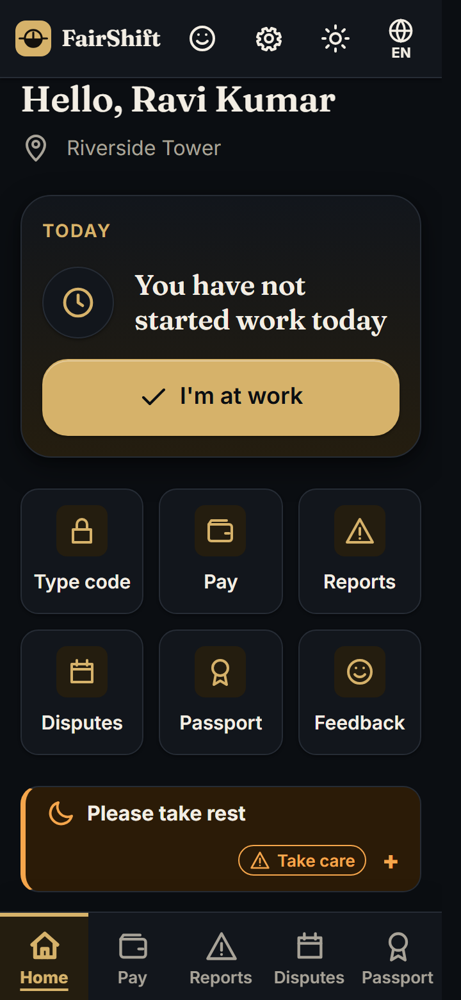
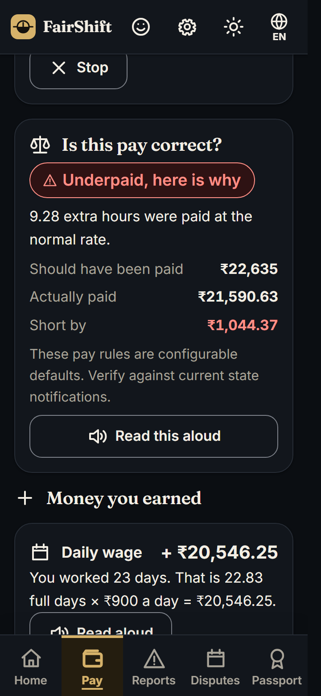
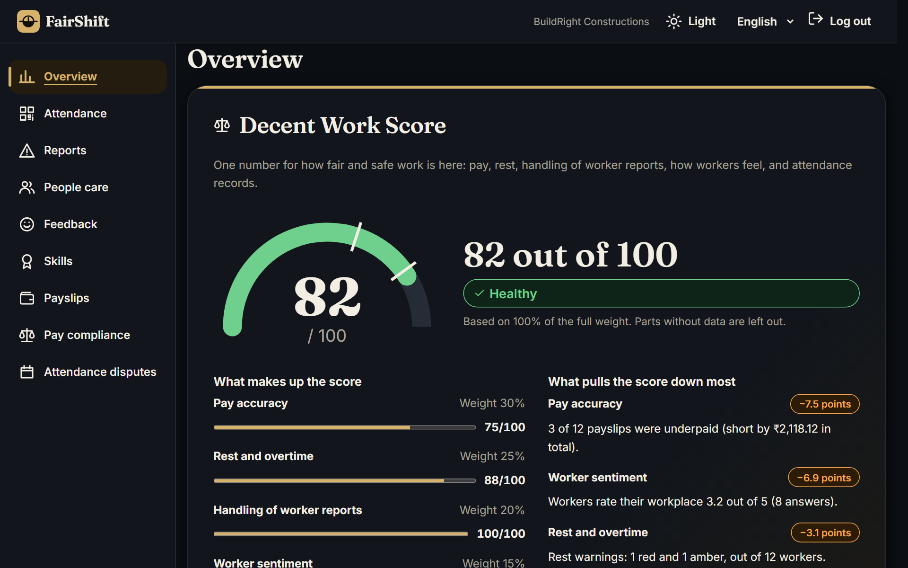
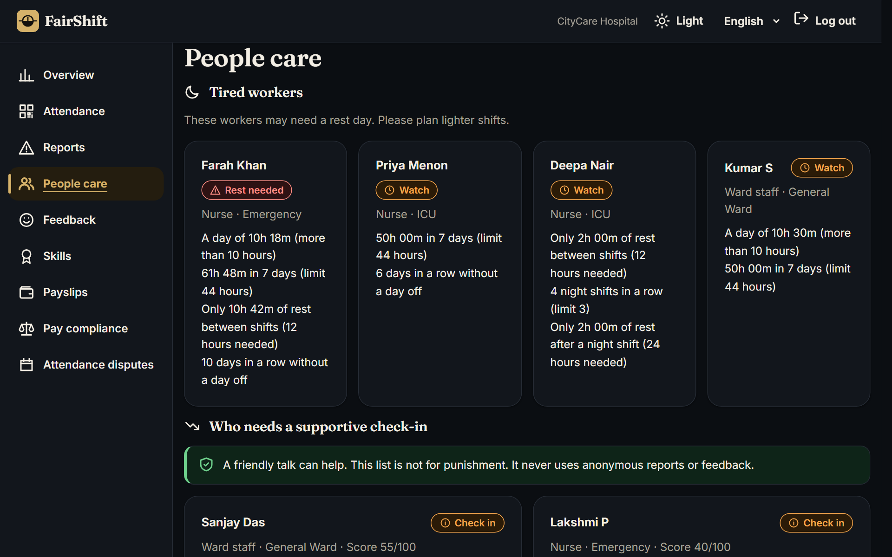

# FairShift: Decent Work Platform

**Prompt Wars 2026 × ACM SRM Student Chapter · Theme: UN SDG 8, Decent Work and Economic Growth**
Solo submission by **Dhruv Poonia** (RA2311003010849), SRM Institute of Science and Technology.

**Live demo:** https://fairshift-770848119516.asia-south1.run.app
**Code mirror:** https://github.com/DhruvPoonia101/fairshift

---

## 1. Problem statement (as given)

**FairShift: Decent Work Platform.** Building fairer, safer, and more transparent workplaces for employee-intensive organisations.

**Theme:** UN SDG 8 — Decent Work and Economic Growth

**The problem context: manual workforce management.** Large workforces still rely on paper registers, spreadsheets, and WhatsApp groups across key sectors:
- **Construction:** daily shift workers on active sites.
- **Colleges & Schools:** campus support and facility staff.
- **Hospitals:** round-the-clock care and sanitation teams.
- **Factories:** high-volume floor and line operators.

**Worker pain points.**
- **Opaque pay calculations:** unclear salary breakdowns or uncounted overtime hours.
- **Fear of identification:** hesitation to raise complaints or share honest feedback.
- **Unreported safety risks:** workplace hazards ignored until actual injuries occur.
- **Lost career history:** unrecorded skills force workers to restart from zero.

**Employer blind spots.**
- **Zero workforce visibility:** no clear view of overworked or unhappy staff.
- **High attrition risk:** unable to spot employees likely to quit early.
- **Delayed escalation:** issues reach management only after becoming severe.

**Accessibility needs.**
- **Regional languages:** workers primarily communicate in native local tongues.
- **Limited literacy:** interfaces must support voice and visual cues.
- **Basic smartphones:** must run smoothly on low-end mobile devices.

**The mission.** Make work fairer, safer, and more transparent for everyone. Empower workers with clarity and voice while giving employers actionable insights into workforce health. **Cross-industry requirement:** the platform must work across at least two distinct industries (e.g., Construction Site + College).

**Example features:** 1. Shift tracking (QR or location check-in with automatic overtime) · 2. Clear payslips (simple salary breakdown in the worker's native language) · 3. Safety reporting (voice or text hazard reports with status tracking) · 4. Honest feedback (anonymous reviews on managers and working conditions) · 5. Skill passport (portable digital record of training and experience) · 6. Fatigue alerts (flags excessive hours or back-to-back shifts) · 7. Admin dashboard (attendance trends, complaints, quit risks) · 8. Voice and local multilingual support for low-end smartphones.

**Deliverables:** 3+ working features · 2 UIs (one for workers, one for employers/admins) · 2+ industry use cases.

**Evaluation rubric:** Real-world impact · Relevance to SDG 8 · Inclusivity and ease of use · Technical implementation (clean code, security, working dual interfaces) · Feasibility and scalability across 2+ industries.

---

## 2. My solution

FairShift is two apps on one backend: a phone-first **worker app** and an **employer dashboard**, in English, Hindi and Tamil. It runs for **three industries from configuration alone** (construction, college and hospital), and it works with no API key and with no signal.

**For the worker, what FairShift does:**
- **Check in** by QR, typed code or one-tap "I'm at work". Overtime is counted automatically, and it works offline.
- **Understand pay:** an explained payslip (regular pay, overtime, PF, ESI, advances) read aloud, with a "Paid correctly" or "Underpaid, here is why" badge.
- **Fix mistakes:** contest a wrong attendance record and follow every step in a visible audit trail.
- **Speak up safely:** report a hazard or complaint with icons, voice or text, anonymously if wanted, and track it with a code.
- **Give honest feedback** on managers and working conditions, with no way to trace it back.
- **Keep a skill passport** of training and certificates, with a shareable link, so a worker never starts from zero.
- **Stay rested:** fatigue notices for long days, short rest between shifts and seven days in a row.
- **Use it on any phone:** installable, offline queue, three text sizes, high contrast, light and dark theme.

**For the employer, what FairShift does:**
- **See workforce health at a glance:** a Decent Work Score (0 to 100) with the biggest drivers dragging it down and a 14-day trend.
- **Know who is on site:** attendance, a rotating QR code per site, and a badge on check-ins recorded offline.
- **Act on reports early:** every report has a severity and a status, with resolution notes the worker can read.
- **Prevent burnout and attrition:** a "who needs a check-in" list of overworked or likely-to-quit staff, each with the reasons.
- **Hear the real mood:** anonymous feedback summaries, shown only when at least 3 people answered.
- **Catch underpayment:** a pay-compliance list with the shortfall for each flagged payslip.
- **Resolve attendance disputes** by approving or rejecting with a note, with every change audited.
- **Stay ahead of expiries:** alerts when staff certificates are ending soon.

**Why it works across industries:** one data model, with roles, shifts, sites, hazard categories, wage rules and fatigue rules all set in a sector config.

## 3. Tools used

- **Claude** (planning, prompt writing) and **Claude Code with Sonnet 5.5** (built and tested the app from my prompts)
- **Node.js 20 + Express**, vanilla HTML/CSS/ES-module JavaScript (no framework, no build step), `node:test`
- **Google Cloud Run + Cloud Build** (deployment), **Firestore** (optional persistent store)
- Optional **Gemini API** for feedback summaries (falls back to a rule-based summary without a key)
- Git and GitHub

## 4. How to run it

```bash
cd src
npm ci
cp .env.example .env        # Windows: copy .env.example .env
npm start                   # http://localhost:8080
```

- Open `http://localhost:8080` and use the **one-click demo accounts** (needs `DEMO_MODE=true`, which `.env.example` sets). Try the **Judge tour** button for a guided 3-step flow.
- Run the tests: `npm test` (452 tests, no credentials needed).
- Data store: in-memory by default. To use Firestore set `DATA_STORE=firestore` (see the Persistence section in `src/README.md`).
- No API keys are needed to run. `GEMINI_API_KEY` is optional.

## 5. Demo link

- **Live app:** https://fairshift-770848119516.asia-south1.run.app (press *Judge tour*, or choose a demo account for any sector)
- **Source:** https://github.com/DhruvPoonia101/fairshift

## 6. Key prompts

The full prompts are in [`prompts.md`](prompts.md). The ones that mattered most:

1. **Initial build brief:** two apps (worker and employer), 3+ features, 2+ industries, Node/Express with no build step, a repository interface so storage can be swapped, config-driven sectors, integer-paise money, anonymity by design, security and accessibility rules.
2. **Batch 1:** Firestore persistence behind a `DATA_STORE` flag (memory by default) and a third sector (CityCare Hospital) done purely through config.
3. **Batch 2:** wage and overtime compliance badge on every payslip, attendance disputes with an append-only audit trail, and the Decent Work Score.
4. **Batch 3:** offline-first worker app with a queue, idempotency keys and tracking codes generated on the phone.
5. **Premium redesign:** new design tokens, self-hosted fonts, fixed navigation, light/dark toggle and an original logo, without changing any logic.

---

## Screenshots

| | |
|---|---|
|  |  |
|  |  |
|  |  |
|  |  |
|  |  |

## Features

**Worker app:** check in by QR, typed code or "I'm at work" (automatic overtime, works offline) · explained payslip in integer paise with PF and ESI, read aloud · "Paid correctly / Underpaid" badge with reasons · contest a day's attendance with a visible audit trail · safety and complaint reports with icons, voice and an anonymous tracking code · anonymous feedback · skill passport with a shareable link · fatigue and rest notices · English, Hindi, Tamil · installable PWA with offline queue · text size, high contrast, light/dark theme.

**Employer app:** Decent Work Score (0 to 100) with the biggest drivers and a 14-day trend · attendance and QR for each site · reports with severity, status and resolution notes · People care (fatigue and explainable attrition risk) · anonymous feedback buckets (shown only with 3 or more answers) · pay-compliance list with shortfalls · attendance dispute review (approve or reject with a note) · skill and certificate expiry alerts.

**Platform:** three sectors from config · optional Firestore · offline-first · CSP and rate limiting · signed httpOnly cookies · per-organisation authorisation.

## Security and privacy

Helmet with a strict CSP, rate limiting, signed httpOnly SameSite cookies (separate worker and admin sessions), input validation that never echoes values, per-organisation authorisation on every route, signed daily QR codes, anonymous reports and feedback that store no identity, k-anonymity of 3 on feedback, no stack traces in responses, and no secrets in the repository (`.env` is git-ignored; `.env.example` has placeholders only).

## Known limitations

- Demo payments are seeded (production would import them from payroll); fatigue and wage rules are configurable demo defaults, not legal advice; anonymity is best-effort.
- `npm audit` reports 6 moderate advisories in transitive Firestore client dependencies (`glob`/`minimatch` chain). They are not loaded at runtime and need an upstream release.
- The Firestore adapter was verified on a live Cloud Run test deployment; the optional emulator test suite is skipped unless `FIRESTORE_EMULATOR_HOST` is set.

## Repository layout

```
students/RA2311003010849-DhruvPoonia/
├── README.md        this file
├── prompts.md       the prompts used to build it
├── screenshots/     app screenshots
└── src/             full project code (see src/README.md for developer docs)
```
