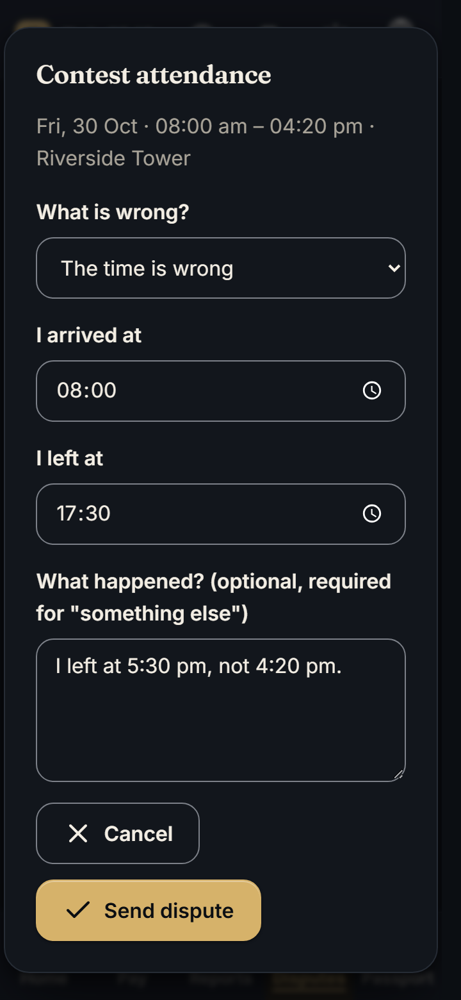
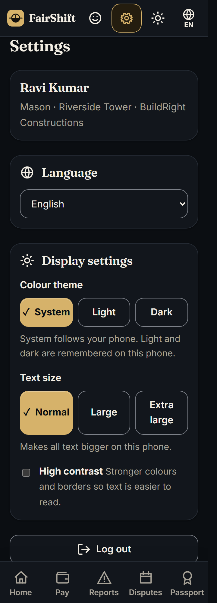
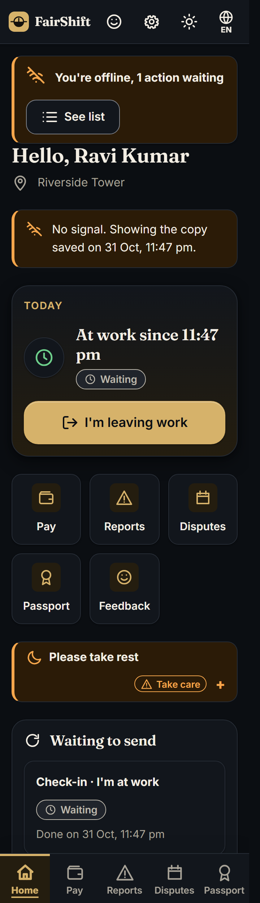
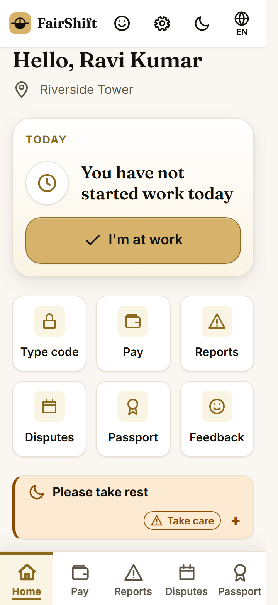
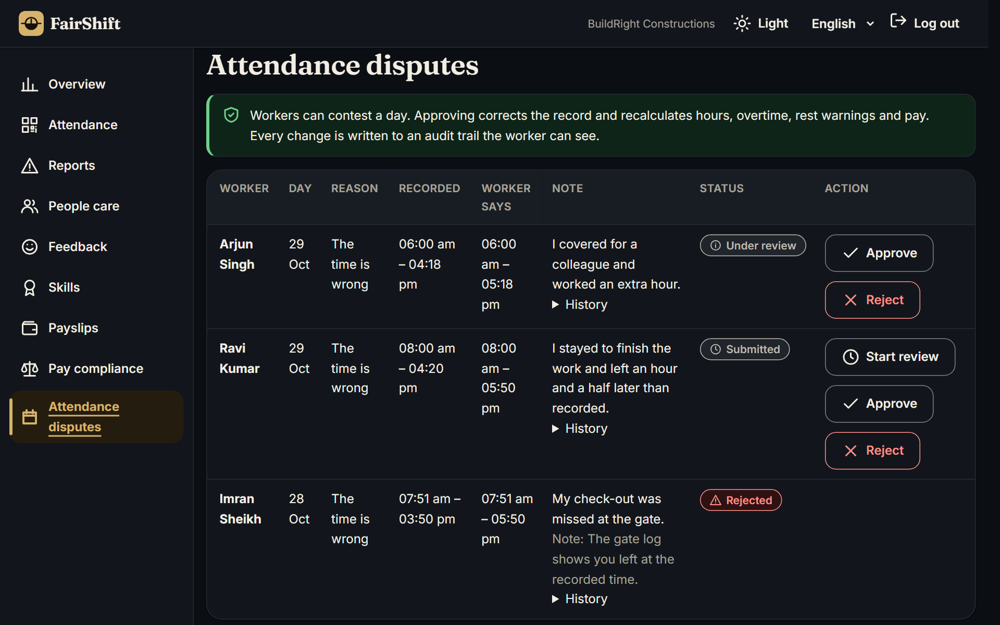
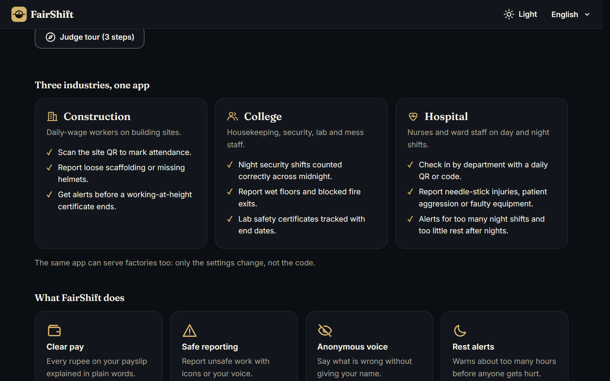

# FairShift

**Transparent pay, safe reporting and fair shifts for employee-intensive workplaces.**
Built for Prompt Wars 2026 x SRM ACM, theme **UN SDG 8: Decent Work and Economic Growth**.

Construction sites, colleges, hospitals and factories still run on paper registers, spreadsheets and WhatsApp.
Workers cannot see how their pay was worked out, fear being identified when they complain, report hazards only after
someone is hurt, and lose their skills record every time they change jobs. Employers cannot see who is overworked or
about to quit until it is serious. FairShift is one codebase with **one worker app** (mobile first, icon first, English /
Hindi / Tamil, read-aloud and voice input) and **one employer dashboard**, configured per industry.

## Screenshots

Taken from the running app with `DEMO_MODE=true` and the seeded demo data. Phone screens are 360 px wide. They are static files in `docs/screenshots/`. **Note:** they were taken before the light-only redesign (see "Design system and navigation"): the app now has one light theme, a new two-column homepage and coloured icons, so the dark screens here are out of date and will be re-shot.

### Worker app (phone)

| Home | Pay: last month, underpaid | Contest a day |
| --- | --- | --- |
|  |  |  |
| Fixed top bar (Feedback, Settings, language), a *today* card with **one** main button, a quick-actions grid, a slim expandable rest alert and the five-tab bottom bar. | The take-home pay, then **Underpaid, here is why**: what should have been paid, what was paid and the shortfall, with read-aloud. | Pick what is wrong, correct the time and add a note; the employer decides and every step goes to the audit trail. |

| Settings | No signal | Light theme |
| --- | --- | --- |
|  |  |  |
| Language, three text sizes, **High contrast**, and sign out; remembered on the phone. | **You're offline, 1 action waiting**: the check-in is saved with the time it was made and sent by itself later (see Offline mode). | The same Home screen in the light theme (the only theme now). |

### Employer dashboard and landing page

| Decent Work Score | Attendance disputes |
| --- | --- |
|  |  |
| The score is the hero of the Overview: the gauge, what makes it up and what pulls it down. The fixed left sidebar is shown from 900 px. | Approving a dispute corrects the record and recalculates hours, overtime, rest warnings and pay. |

| Hospital: People care | Landing page |
| --- | --- |
|  |  |
| The third sector, CityCare Hospital: nurses flagged for too many night shifts or too little rest. | Three industries from one codebase, and the **Judge tour** button. |

## Problem to feature mapping

| Pain point | Feature | Where in code |
| --- | --- | --- |
| Paper registers, disputed hours | **F1 Attendance**: daily rotating signed QR, 6-digit code, or "I'm at work" button with optional geofence; regular vs overtime computed per shift (works across midnight) | `src/services/attendance.js`, `src/services/qr.js`, `public/worker/home.js`, `public/admin/attendance.js` |
| "I don't know how my salary was calculated" | **F2 Transparent payslip**: every line (daily wage, overtime x2.0, PF 12%, ESI 0.75% only if gross <= Rs 21,000, advances) with icon, plain-words explanation, per-day table, read-aloud and a pre-filled "Something looks wrong" | `src/services/payroll.js`, `public/shared/payslip.js` |
| Fear of being identified | **F3 Grievance + hazard reporting**: icon categories, text or voice, optional anonymous mode that stores **no worker id**, random tracking code, open / in review / resolved with a visible note, rule-based severity | `src/services/grievance.js`, `public/worker/report.js`, `public/admin/grievances.js` |
| Hazards unreported until injury | Hazard categories per sector (scaffolding, electrical, PPE, heat, machinery / wet floor, chemical lab, fire exit...) with auto-suggested severity | `src/config/sectors.js`, `suggestSeverity()` |
| Burnout, unsafe hours | **F6 Fatigue alerts**: >10 h in a day, >48 h / >60 h in a week, <11 h rest, 7 days without a rest day; per-sector overrides and night-shift rules. Admin list plus a gentle "please rest" notice for the worker | `src/services/fatigue.js` |
| Employers see problems too late | **F7 Dashboard**: KPIs, 14-day inline-SVG trend, grievance table, fatigue list, explainable attrition-risk list ("who needs a supportive check-in") | `src/services/insights.js`, `src/services/attrition.js`, `public/admin/` |
| Cannot speak up about managers | **F4 Anonymous feedback**: emoji ratings stored with no worker id, no IP, day-only timestamp; admin sees a group only when it has >= 3 answers (k-anonymity) | `src/services/feedback.js` |
| "Was I paid what the rules say?" | **Wage and overtime compliance**: per-sector minimum wage and overtime multiplier; every payslip shows "Paid correctly" or "Underpaid, here is why" (icon + text, read-aloud); employers get a "Pay compliance" list with the shortfall | `src/services/compliance.js`, `src/services/payroll.js`, `public/shared/payslip.js`, `public/admin/compliance.js` |
| Wrong attendance records, no way to argue | **Attendance disputes**: contest a day (forgot check-out, wrong time, wrong place, other) within 14 days; employers approve (record corrected, hours / overtime / rest warnings / pay recalculated) or reject with a note; an append-only audit trail the worker can read | `src/services/disputes.js`, `src/services/audit.js`, `public/worker/records.js`, `public/admin/disputes.js` |
| "Is this a decent workplace?" in one number | **Decent Work Score** (0-100, admin overview): pay accuracy, rest and overtime, grievance handling, worker sentiment (k-anonymity respected), attendance accuracy; band, top 3 drivers, 14-day trend, "How is this calculated?" | `src/services/decentWork.js`, `src/services/scoreInputs.js`, `public/admin/overview.js` |
| Skills restart from zero | **F5 Skill passport**: training, certificates, experience, employer verification, expiry warnings, read-only share link `/p/:token` and print view | `src/services/passport.js`, `public/passport/` |
| Regional languages, low literacy, cheap phones | **F8**: en / hi / ta JSON dictionaries, voice input in `en-IN` / `hi-IN` / `ta-IN`, read-aloud, icon + text everywhere, <60 KB JS and ~10 KB CSS per page (gzipped on the wire: the server compresses its own static files, `src/middleware/static-gzip.js`), no framework or CDN | `public/i18n/`, `public/shared/i18n.js`, `public/shared/voice.js` |

## SDG 8 alignment

- **8.5 Decent work and equal pay for work of equal value**: every payslip line is explained and disputable in one tap; overtime is computed by one rule for everyone.
- **8.8 Safe and secure working environments**: hazard reporting by icon or voice, anonymous option with status tracking, fatigue limits, certificate expiry warnings (e.g. working at height).
- **8.5 and 8.8 together**: pay can be checked against the rules, hours cannot be changed without a visible audit entry, and one score shows an employer where work is least decent.
- **8.2 Productivity through diversification, technology and innovation** and **8.3 Decent job creation / formalisation**: replaces paper and WhatsApp with a verified attendance and skills record that workers carry to their next job, and lets small employers formalise records without ERP software.

## Three industries, one codebase

| | Construction (BuildRight Constructions) | College (Greenfield College) | Hospital (CityCare Hospital) |
| --- | --- | --- | --- |
| Who | Masons, electricians, helpers, scaffolders on contract-daily wages | Housekeeping, security, lab attendants, mess staff, gardeners | Nurses and ward staff on morning, evening and night shifts |
| Check-in | Site QR at each building site (150 m geofence) | QR per campus block (300 m geofence), night guards crossing midnight | QR per department: ICU, Emergency, General Ward (200 m geofence) |
| Hazards | Scaffolding / height, electrical, missing PPE, heat, machinery | Wet floor, chemical lab, electrical, hostel safety, blocked fire exit | Needle-stick, patient aggression, equipment fault, infection exposure |
| Fatigue rules | Defaults (48 / 60 h week, 11 h rest) | Defaults | Stricter, plus night rules: max 3 night shifts in a row, 24 h rest between a night shift and a day shift |
| Demo story | Fatigued scaffolder, new joiner who disputed a payslip, Working-at-Height certificate expiring | Fatigued mess worker, night guards, Chemical Lab Safety certificate expiring | Four nights then a morning shift, an overtime case, a red fatigue case, BLS certificate expiring |

Everything sector-specific lives in [`src/config/sectors.js`](src/config/sectors.js): roles and wages, hazard categories (with an optional minimum severity), shift patterns, departments / sites, geofence radius, overtime multiplier and the fatigue thresholds. The sign-in screen, demo logins, category pickers and the fatigue engine all read from it. A new sector (a factory, say) needs a config entry, translated labels in `public/i18n/*.json` and demo data in `src/store/seed.js`; no service or route code changes. The hospital numbers (12 h rest, 54 h week, 24 h rest after nights...) are **configurable defaults for the demo, not statements of what any law requires**.

## Architecture

```
server.js                start + graceful SIGTERM only
src/app.js               Express app factory (store, clock and limits injected, so it is testable)
src/config/              env.js, sectors.js, constants.js (named constants, no magic numbers)
src/store/               repository.js (contract), memory.js and firestore.js (implementations), index.js (DATA_STORE switch), seed.js
src/services/            attendance, qr, payroll, fatigue, attrition, grievance, feedback, passport, insights, idempotency
src/routes/              one file per resource
src/middleware/          auth (sessions + anonymous tokens), validate, security, errors, offline (idempotency + owner), static-gzip
src/lib/                 time, random, geo, errors, capture (what to believe about a phone's time), precache
public/                  index.html, worker/, admin/, passport/, shared/ (css + js), i18n/*.json, sw.js
public/shared/           base.css (design tokens and components), chrome.js (top bar, nav), prefs.js, queue.js (offline queue, pure), actions.js, tracking-code.js, outbox.js (IndexedDB + fetch), outbox-ui.js, offline-db.js
public/fonts/, logo.svg   self-hosted Inter and Fraunces (Latin variable woff2), the FairShift mark and PWA icons
scripts/                  copy-fonts.mjs, make-icons.py (dev tooling, not part of the running app)
tests/                   unit + API tests (node:test, no test framework)
```

- **Computed, not stored.** Hours, overtime, fatigue flags, payslips, compliance results and the Decent Work Score are computed from the raw records on every request (the score's 14-day trend replays the same records "as of" each day), so a corrected attendance record changes all of them at once with nothing to keep in sync.
- **Stateless process.** Nothing is kept on disk; all state sits behind the repository interface.
- **Multi-tenant by construction.** Every record has an `orgId`, every repository method takes it, and every route reads it from the signed session, never from the request.
- **Pluggable store.** Services and routes only see the repository contract in `src/store/repository.js` (`insert`, `get`, `update`, `query`, `findBy`, `deleteByOrg` per collection). `DATA_STORE=memory` (default) or `DATA_STORE=firestore` picks the implementation, and the same contract tests run against both (see Persistence). A Cloud SQL adapter would implement the same six methods with one table per collection and an `org_id` column.
- **Time.** All day-boundary logic is IST (UTC+05:30) in `src/lib/time.js`; services receive an injected clock, so tests are deterministic.
- **Money.** Integer paise only. The browser formats with `Intl.NumberFormat` (INR) in the user's locale.

## Security measures

- `helmet` with a strict CSP (`default-src 'self'`, no inline script or style, no external origins), `Permissions-Policy` limited to camera / microphone / geolocation for our own origin.
- Signed JWT in an `httpOnly`, `SameSite=Strict` cookie (`Secure` in production). Cross-site writes are also rejected by an Origin check and a JSON-only body rule.
- `express-rate-limit`: global limit plus tighter limits on login and report / feedback endpoints; `trust proxy` set for Cloud Run. Limits are per instance (in memory).
- 10 KB JSON body limit (the two report routes accept a photo of up to 200 KB on top of that: see "Report photos"); server-side validation of every field (type, length, enum, id, date) in `src/middleware/validate.js`; error responses list field names and reasons, never values.
- Authorization on every route: workers read only their own data, admins only their own org; checked by tests (cross-worker and cross-org requests).
- Output is always written with `textContent` / `createElement`, never `innerHTML` with user data.
- **Attendance changes are audited.** There is no endpoint that edits hours directly. The only way a record changes is an approved dispute, and the correction is written to the audit trail *before* the record is updated (if the audit write fails, nothing changes). Audit entries are only ever created, carry a SHA-256 digest of their content (`isIntact`), and the worker can read every entry about their own attendance. A dispute can be decided once: decisions on the same dispute are serialised in the process, the correction sets absolute times (so a retry is harmless), and the record must still match what it was when the dispute was filed.
- Filing a dispute is rate limited (the report limiter) and validated: category, plausible times (not in the future, at most 18 h, within a day of the record), a real change, and a site of the same org. Records outside the window (14 days by default, `disputeWindowDays` per sector) cannot be contested; one open dispute per record.
- Generic 500 responses (no stack traces), no request-body logging, no access log containing tracking codes (the code travels in a POST body).
- No secrets in the repo: `SESSION_SECRET` is generated at boot if absent, `ADMIN_PASSWORD` comes only from the environment (constant-time compare; login disabled if unset and `DEMO_MODE=false`), `.env.example` holds placeholders only, `.env` is git- and docker-ignored.
- `GEMINI_API_KEY` (optional) is sent in a header, never in a URL, and never logged.

## Accessibility measures

- WCAG AA colour contrast, verified by `tests/contrast.test.js` for the light theme (4.5:1 text, 3:1 borders and focus ring), 7:1 for the high-contrast variant, and 4.5:1 for every icon colour on its own tinted tile and on the white and ivory surfaces. Every token pair is tested; the thresholds are never relaxed, so a palette change that fails them fails the build.
- **Display settings** (worker app, **Settings**): three text sizes (normal, large, extra large) and a **High contrast** switch, remembered on the device in `localStorage` (`fairshift.prefs`) and applied before the first paint by `public/shared/prefs-boot.js`, so there is no flash. There is **one light theme**: no dark mode, no theme toggle, and an old saved "dark" choice from an earlier version is ignored. High contrast works on top of it and is tested at 7:1 (WCAG AAA) for text; it also turns the coloured icon tints into plain black on white and hides the decorative 3D scene. Logic and tests: `public/shared/prefs.js`, `tests/prefs.test.js` (the boot script is run against a fake page and compared with `prefs.js`).
- Navigation targets are 48 px or larger (tabs 68 px); the current page is shown by icon, label, weight, underline and an indicator bar, not colour alone. See "Design system and navigation" below.
- Every screen in both apps shows a loading skeleton (no layout shift), a friendly empty state, and an error state with a **Try again** button, in English, Hindi and Tamil (`public/shared/states.js`).
- Skip-to-content link, landmarks (`header`, `nav`, `main`), every input has a `<label>`, visible `:focus-visible` outline, `aria-current` on the active tab / section, `aria-live` regions for status and toasts.
- Fully keyboard operable: native `<dialog>` for modals (focus trap, Esc closes, focus returns), radio groups for category and rating pickers, no keyboard traps.
- 48 px minimum touch targets, `rem` units (text scales), works at 320 px width without horizontal scroll, respects `prefers-reduced-motion` and `prefers-color-scheme`.
- Status is never colour-only: every chip pairs an icon with a word; every screen is icon + text.
- Charts are inline SVG with a text label and a "show as table" alternative.

## Design system and navigation

Calm, premium, trustworthy, and light only: warm ivory background, deep ink-navy text, **saffron-gold** as the primary accent (never green), white surfaces with soft layered shadows. Each feature also has its own colour (see "Icon colours" below).

**Tokens.** All colours, spacing, radius, elevation and motion values are defined once at the top of `public/shared/base.css`; screens only use `var(--...)`.

| | Light (the only theme) |
| --- | --- |
| Background / surfaces | warm ivory `#FAF6EC`, white `#FFFFFF`, `#F6F0E2` |
| Text / muted | ink-navy `#121B33` / slate `#4F5669` |
| Accent (text, borders) | deep saffron `#8F5300` |
| Fills (buttons) | saffron-gold `#F5A623` with ink-navy text |

Status colours (success green, warning orange, danger red, neutral info) are always paired with an icon and a word. The browser colour (`theme-color` and the web manifest) is the ivory background.

**Icon colours.** Each feature has one tone: **pay** saffron, **report / danger** coral red, **speak up** teal, **skills and passport** indigo, **check-in** emerald, **rest** violet, **language** sky blue, **payroll / export** amber (`--ic-*` tokens in `base.css`). The icon sits in a rounded tile that is a 12% tint of its strong colour (`data-tone` on an element sets `--tone` and `--tone-soft`; `tests/contrast.test.js` checks every strong colour against its tile, the white and ivory surfaces at 4.5:1, and that each tile really is a 12% tint). They are used on the landing cards, the worker Home tiles and navigation, the employer sidebar and KPI tiles. Every pay or wallet icon is now a clean inline-SVG **rupee** glyph (`rupee` in `public/shared/icons.js`, no font needed): the Pay nav item, the Home "My pay" tile, payslip headings, the landing pay card and the employer Payroll item. Blue is allowed only for the language and skills tones; the test fails on any other vivid blue.

**Type.** Headings use **Fraunces** (display serif) and the interface **Inter**, both self-hosted variable woff2 files in `public/fonts` (Latin only, about 83 KB together, `font-display: swap`, no CDN, CSP unchanged). Body text is 16 px or larger with a 1.6 line height. Hindi and Tamil use the system font stack (Noto, Nirmala UI), which reads better than a Latin face with fallbacks. The `@fontsource-variable/*` packages are **devDependencies only**: `npm run fonts` (`scripts/copy-fonts.mjs`) copies the Latin files and their licences into `public/fonts`; nothing about fonts is a runtime dependency and the Docker image (`npm ci --omit=dev`) does not contain them. The fonts are cached for a week and are part of the offline precache.

**Logo.** `public/logo.svg` is an original mark: a clock face whose lower half is filled (the shift) with a balance arm through it (fairness), gold on ink. It is the top-bar logo, the favicon (`icon.svg`), the PWA icon (`manifest.webmanifest`: SVG, PNG 192 and 512, and a maskable 512 from `scripts/make-icons.py`) and it prints on the public passport. All of it is in the offline precache.

**Navigation** (both apps; `public/shared/chrome.js`, `public/worker/nav.js`)

- **Top bar** on every page, fixed to the top: logo and wordmark on the left; on the right the language selector (a compact globe button on phones, a normal select from 600 px) and sign-out (worker phones: in Settings).
- **Worker, 900 px and up:** a fixed left sidebar with icon and label for all seven destinations: **Home, Pay, Reports, Disputes, Passport**, then **Feedback** and **Settings**.
- **Worker, phones and small tablets:** a fixed bottom bar with five tabs (Home, Pay, Reports, Disputes, Passport); **Feedback** and **Settings** are labelled icon buttons in the top bar. There is no separate "Me" tab: **Settings** holds language, text size, high contrast and sign out. *Disputes* is the attendance-and-disputes screen (its address is still `#records`, which the Judge tour uses).
- **Employer:** the same top bar; a fixed sidebar on desktop; a horizontally scrollable bottom bar on phones.
- Tables in the employer app become labelled cards on phones (`labelCells` in `public/shared/dom.js`), so no screen scrolls sideways at 360 px.

**Pages.** The worker Home reads top to bottom: greeting, a prominent *today* card with **one** primary action (I'm at work / I'm leaving work), a quick-actions grid (scan QR, type code, pay, reports, disputes, passport, feedback), then slim expandable alerts: rest warnings stay on screen but compact. On the employer Overview the Decent Work Score card is the hero. The landing page has a hero, two sign-in buttons, the Judge tour button, three sector cards and a short feature list.

**Homepage** (`public/index.html`, `public/landing.js`, `public/landing.css`, `public/shared/fx.js`). Two columns from 60 rem: on the left a **sign-in card** (Worker / Employer tabs, the employer password form when it is switched on, a **Try the demo** list with a one-tap worker and employer account for Construction, College and Hospital, and the Judge tour button); on the right the headline *Know your pay. Speak up safely. Work fair hours.*, three short value points with coloured icons, and the 3D scene. On a phone the order is headline, sign-in card, scene, and the page order is the same for keyboard users (the card comes before the decorative scene). Sign-in calls are unchanged (`/api/demo-login/:role`, `/api/login/admin`, `/api/config`). There is no worker PIN or on-screen keypad in this prototype (worker sign-in is a demo account until phone OTP exists), so there is none on the card.

- *The scene* (CSS 3D and inline SVG only, about 5 KB, no WebGL, no library, no image): a floating stack of three payslips that tilts toward the pointer (at most 8 degrees), a slowly spinning 3D rupee coin (`transform-style: preserve-3d`), a layered skyline (crane, a hospital with a pulsing cross, a campus building) drifting in parallax, and soft shapes floating behind. Only `transform` and `opacity` change. It pauses while the tab is hidden or the scene is off screen (`IntersectionObserver`), tilt needs a fine pointer that can hover (so it is off on touch), and everything is disabled under `prefers-reduced-motion`.
- *Interactions:* cards tilt up to 4 degrees on hover with a highlight that follows the pointer, primary buttons are magnetic (up to 6 px, hover devices only), blocks below the fold fade up one after another as they arrive, buttons press to 0.98. None of it runs without a fine hovering pointer, and none under reduced motion.
- *Sections below the hero:* **How it works** (check in, see your pay, speak up safely, numbered, with coloured icons), **Three industries, one app** (Construction in saffron, College in indigo, Hospital in teal, each with a gently bobbing icon), an **SDG 8** strip (target 8.5 equal pay for work of equal value, 8.8 safe working environments) and trust chips (works offline, English / Hindi / Tamil, name stays hidden if you choose: the anonymous option is a choice on the report form, not the default), then the footer.
- *Budget:* `landing.css` about 10 KB, `fx.js` about 7 KB, no image other than the logo, no inline script or style, the CSP is unchanged. `tests/landing.test.js` checks all of this.

**Motion** (`public/shared/motion.css`, `public/shared/motion.js`; loaded by the landing, worker and employer pages). Original and subtle, no library, no build step, nothing that needs a new origin in the CSP.

- *Tokens:* durations 150 / 250 / 450 ms and one ease-out curve (`--m-fast`, `--m-base`, `--m-slow`, `--m-ease`).
- *What moves:* only `transform` and `opacity` (cards lift 3 px with a soft gold glow that is an overlay fading in; buttons press to 0.98 with a faint shine; nav items get a sliding pill and a growing underline; icons nudge 2 px; the new screen slides in when you change a worker tab or an employer section; the skeleton shimmer is a moving highlight; toasts slide in; bars fill). **Two documented exceptions:** the success check on a toast is *drawn* (`stroke-dashoffset` on a 24 px icon) and the Decent Work Score gauge *sweeps* (the dash length is set from `motion.js`, because a gauge arc cannot be scaled).
- *Landing:* see "Homepage" below.
- *Numbers:* the money on a payslip, the Decent Work Score and the KPI tiles count up once (about 700 ms) and the gauge sweeps from 0 to its value. The last frame is the original text byte for byte, so a count can never end on a wrong figure. Screen readers get the final value at once: while it counts the final text sits in a visually hidden span, the moving digits are `aria-hidden` and `aria-live` is off until the end.
- *Reduced motion:* every animation lives inside `prefers-reduced-motion: no-preference`, and one block under `reduce` switches all animation and transition off (`motion.js` does nothing either). Hover effects only exist under `(hover: hover)`, so a touch screen never gets a stuck hover. Nothing that hides content at the start of an animation exists outside the no-preference block, so reduce users always see the finished state.
- *Offline:* these files and `fx.js` are in the precache list (`/precache.json` is built from the folders), and `CACHE_REVISION` in `src/lib/precache.js` is part of the cache version, so a release always replaces the phones' stored copy.
- *Tests:* `tests/motion.test.js` (the reduced-motion block, only transform/opacity, fill modes, tokens, hover guard, high-contrast and text-size rules, no new colours, hero SVG size and contents, the count-up maths and that it ends exactly, the precache).

## Demo guide

```bash
npm install
DEMO_MODE=true npm start        # http://localhost:8080
```

In demo mode (`DEMO_MODE=true`) the **I'm at work** button skips the geofence distance check so judges can check in from anywhere; with `DEMO_MODE=false` the geofence is enforced as usual, and if location is unavailable the app suggests **Type code**.

Open `/` and press **I am a worker** or **I am an employer**; the demo buttons sign you in instantly
(`POST /api/demo-login/:role` for `worker-construction`, `worker-college`, `admin-construction`, `admin-college`).

**Judge tour (about 90 seconds)**: the button is on the landing page (see Screenshots). In demo mode, press **Judge tour (3 steps)**. A small guide panel walks you across the real screens, signing in both demo accounts for you: 1) the worker contests a day, 2) the employer approves it, 3) the worker sees the corrected take-home pay and the change history. Each of steps 1 and 2 also has a **Do it for me** button, you can go **Back** or **Next**, **Skip tour** (or press Esc) at any time, and everything is keyboard operable. The tour step is kept in `sessionStorage`, so it follows you between the worker and employer pages and disappears when the tab closes. Code: `public/shared/tour.js` (step state), `public/shared/tour-ui.js` (panel), tests in `tests/tour.test.js`. It uses the normal API only, so it needs no new environment variables.

**Two-minute click path**

1. Worker (construction): the home screen already shows a gentle rest notice. Tap **I'm at work** (or **Type code** with the code from the employer screen).
2. **Pay**: read the payslip, tap **Read all aloud**, then **Something looks wrong** and send.
3. **Report**: pick **Scaffolding or height**, type or speak, tick **Report without my name**, send. Note the secret code, then check its status further down the page.
4. **Feedback** (top bar on a phone, sidebar on desktop) and **Passport**: rate, add a skill, **Create link** and open the print view.
5. Switch language (top right) to Hindi or Tamil on any screen.
6. Employer: **Overview** (KPIs, 14-day trend), **Reports** (move your grievance to *Being checked*, then *Solved* with a note; the anonymous one shows no name), **People care** (fatigue list, attrition reasons), **Feedback** (the *Rules and pay policy* group is hidden: fewer than 3 answers), **Skills** (verify an entry), **Attendance** (QR and code), **Payslips**.
7. Worker, **Pay**: switch to last month: **Underpaid, here is why** (overtime paid at the normal rate), with the expected and paid amounts and **Read this aloud**. Employer, **Pay compliance**: the flagged payslips and the shortfall.
8. Worker, **Home > Something wrong with a day? Contest it**: contest a day ("the time is wrong", a later check-out) and watch the status timeline. Employer, **Attendance disputes**: **Start review**, then **Approve** (the dialog shows the recalculated hours, rest warnings and take-home pay) or **Reject** with a note. Back as the worker: the change history shows every step, including the correction.
9. Employer, **Overview**: the **Decent Work Score** card (gauge, component bars, top drivers, 14-day trend, **How is this calculated?**). Pay accuracy, rest, reports, sentiment and attendance disputes all feed it, so approving or filing things above moves the numbers.
10. Employer, bottom of **Overview** (demo mode only): **Reset demo data** deletes and rebuilds this organisation's demo data with dates anchored to today. Other organisations are not touched.
11. Repeat as college staff / college employer, and as the hospital nurse / hospital employer: **People care** shows the night-shift rules firing (a nurse with four nights in a row and only two hours of rest before a morning shift), and **Report** offers needle-stick, patient aggression, equipment fault and infection exposure.

## Run locally and test

```bash
npm install
npm start          # PORT defaults to 8080
npm test           # node:test, no extra dependencies (549 tests)
```

Requires Node 20+.

## Environment variables

| Variable | Default | Purpose |
| --- | --- | --- |
| `PORT` | `8080` | Listen port (Cloud Run sets it) |
| `NODE_ENV` | `development` | `production` turns on the `Secure` cookie flag |
| `DEMO_MODE` | `false` in code and the Dockerfile, `true` in `.env.example` | One-click demo logins. **Set to `false` in production.** |
| `DATA_STORE` | `memory` | `memory` or `firestore` (see Persistence). Any other value stops the server at start-up |
| `GOOGLE_CLOUD_PROJECT` | unset | Optional Firestore project id; otherwise taken from the environment (Cloud Run sets it) |
| `FIRESTORE_EMULATOR_HOST` | unset | `host:port` of the Firestore emulator for local runs and the optional emulator tests; never set in production |
| `ADMIN_PASSWORD` | unset | Real employer login; if unset and `DEMO_MODE=false`, employer login is disabled |
| `SESSION_SECRET` | random per boot | Signs session cookies and QR tokens; set it (Secret Manager) if you run more than one instance |
| `GEMINI_API_KEY`, `GEMINI_MODEL` | unset | Optional Gemini summary of anonymous feedback themes. Both are required; otherwise a rule-based theme counter is used |

Real worker authentication would be a phone OTP; this prototype only has demo worker logins.

## Cloud Run notes

- The container listens on `0.0.0.0:$PORT`, exposes `GET /healthz` (liveness, never touches the database) and `GET /health` (reports the data store in use; 503 `degraded` if it cannot be reached), handles `SIGTERM` gracefully, and runs as a non-root user.
- With the default `DATA_STORE=memory` the store is **in memory and re-seeded at start**, so use a **single instance** (`--max-instances=1`); data resets when the instance restarts. With `DATA_STORE=firestore` instances are stateless and `--max-instances` can be raised (see Persistence).
- The image defaults to `DEMO_MODE=false`; enable the demo with `--set-env-vars DEMO_MODE=true` only for the judged demo, and provide `SESSION_SECRET` / `ADMIN_PASSWORD` from Secret Manager, not from the image.

## Offline mode (worker app)

The worker app opens with no signal and keeps what the worker does until there is one. Everything below is covered by tests; see "Known limitations" for what was not checked in a real browser.


*No signal: the banner counts what is waiting, and the check-in is saved on the phone with the time it was made.*

**What works with no signal**

- **The app itself.** The service worker (`public/sw.js`) stores the whole worker app at install time. The list of files comes from `GET /precache.json`, built by the server from the files in `public/`, so it cannot drift from the code (a test follows every import from `worker/app.js` and checks it is in the list). Static files stay network-first, so a new release is never hidden behind old scripts. The API and personal data are never cached by the service worker.
- **Five actions are queued in IndexedDB** when the phone is offline or a request fails: **check-in**, **safety report / grievance**, **attendance dispute** and **anonymous feedback** (the four asked for), plus **check-out**, because a queued check-in with no way to check out offline would leave a shift open and wrongly auto-closed at 8 hours.
- **Last saved copies** of *Today*, *My records*, *My disputes* and *My reports* are kept per worker, so the Home and Records screens (and the dispute form) open offline, with a "No signal. Showing the copy saved on ..." notice. The session answer is saved too, so the app can start without `/api/me`. Pay and the other screens need a signal and say so ("No signal"), with a retry button.

**How the queue works** (`public/shared/queue.js`, pure logic with no DOM or network, unit-tested in `tests/queue.test.js`)

| Step | Behaviour |
| --- | --- |
| Capture | The item is saved first (survives a closed app), with its capture time, an **idempotency key**, and, for a check-in, the position taken **when the worker tapped**. The same action tapped twice is kept once. |
| Send | Immediately when online; otherwise when the browser fires `online`, when the app opens or comes to the front, every 30 s while something waits, from the service worker through **Background Sync** (Chromium; sends even with the app closed), or with the **Sync now** button. Oldest first, one pass at a time (Web Locks across tabs). |
| Retry | No signal, timeout, 429 and 5xx back off (5 s, 10 s ... 5 min) and stop the pass; after 6 tries the item shows **failed, Try again**. A firm "no" (stale QR, a duplicate, a bad time) marks only that item failed and the rest carry on. |
| 401 | Everything stays queued, nothing is lost; the banner says "Sign in again to send N waiting actions". After signing in, the queue sends by itself. |
| Shared phone | A named item carries its worker's id (`X-FairShift-Owner`); if someone else is signed in the server answers `409 wrong_account` and the item waits for its owner. |
| Tidy | Sent items show for 24 h; the text of a sent report is removed from the phone straight away. |

**UI.** A banner ("You're offline, 2 actions waiting", "Sign in again ...", "1 action could not be sent") with **Sync now** / **Try again** / **See list**; a list with one status per item (**Waiting, Sending, Sent, Not sent** with the reason and **Try again** / **Remove**), icon plus word, in English, Hindi and Tamil, with full-size (48 px) touch targets.

**Idempotency (`Idempotency-Key`)**

- `POST /attendance/check-in`, `/attendance/check-out`, `/grievances`, `/anonymous/grievances`, `/disputes`, `/feedback` and `/anonymous/feedback` accept an `Idempotency-Key` header (22 to 64 URL-safe characters; the phone makes 144 random bits). The first outcome is stored in the `idempotency` collection and a repeat gets it back (`Idempotent-Replayed: true`) instead of doing the work twice; the same key with a *different meaning* is `409 idempotency_key_reused`. The meaning ignores `capturedAt`, so a retry after a lost answer (which adds it) is still recognised.
- Everything created under a key gets an id derived from the key, so even two server instances racing on one retry write the **same** document. Parallel requests in one process also run one after the other. Without the header nothing changes.
- The key is scoped to the worker (`w:<id>`); anonymous items use a shared `anon` scope, so no worker id is ever stored next to them. Records are kept; add a cleanup job (or a Firestore TTL policy on a timestamp field) if the collection grows.

**Integrity: capture time and what the server records**

| Rule | Behaviour |
| --- | --- |
| Capture time | The phone sends `capturedAt`; the server records **both** `capturedAt` and `receivedAt` and marks the record `recordedOffline`. The employer sees a **Recorded offline** badge on reports, disputes and the attendance record behind a dispute (and the worker sees it on their record). |
| Refused | In the future (more than 2 minutes ahead of the server; a few seconds is clock skew and is read as "now") is `422 captured_in_future`; older than 48 hours is `422 captured_too_old` (`src/lib/capture.js`, `OFFLINE` in `src/config/constants.js`). The phone also fails such an item locally instead of sending it. |
| Check-in | The shift starts when the worker checked in, not when it arrived. A late check-in cannot land inside a shift recorded meanwhile (`409`). Check-out works the same way (`422` if before the check-in). |
| QR / code | Verified **on sync**, against the day it was scanned (`verifyToken(token, sites, atMs)`), so a QR from another day or a forged one is refused with a clear reason (`422 invalid_code`, shown to the worker as "That code is not right for today") and nothing is recorded, while a QR scanned last night still works the next morning. |
| Dispute | The 14-day window is judged on the day the worker filed it, so waiting for a signal cannot make a dispute too late. |
| Geolocation | Captured when the worker taps and stored with the queued item; the geofence is checked on sync from that position, never from where the phone is when it syncs. |
| Honest limit | The capture time is the phone's claim. A worker who sets the clock back gains at most 48 hours, only with a code or QR valid on that day, and the record is badged for the employer. Disputes, the audit trail and the Decent Work Score still apply. |

**Anonymous items carry and store no identity**

- A queued anonymous item (an anonymous report, and all feedback) has **no owner, no worker id, no name**; `enqueue` refuses one that does. It is sent to `/anonymous/grievances` or `/anonymous/feedback` with `credentials: 'omit'` (**no cookie**) and an `Authorization: Bearer` token that says only "a worker of this organisation": no subject, and an issue time rounded down to the hour, so two workers' tokens are identical (`GET /anonymous/token`, valid 7 days, fetched while signed in and kept on the phone).
- **The tracking code is made on the phone** with `crypto.getRandomValues`: 16 symbols from a 32-symbol alphabet (no 0/O/1/I) = **80 bits**, shown at once, even offline. The server validates the shape (`invalid_tracking_code`), refuses codes with fewer than 6 distinct symbols (typed or stuck-generator codes), and checks uniqueness (`409 tracking_code_taken`); it stores only an HMAC of the code, as before.
- The server keeps no worker id, no exact time (only the day) and no capture time for an anonymous report. Anonymous feedback is checked for the 48-hour rule but is **not** marked offline: a flag would shrink the group it hides in. A queued anonymous report keeps its text on the phone only until it is sent, then only its code (24 h).
- **The trade-off, plainly.** (1) The server cannot prove the code came from a good random generator, so it can only check shape, variety and uniqueness; a client could choose a poor code for itself, which only weakens that one report's privacy. Because codes are 80 bits, nobody can pre-claim or collide with another worker's code in practice. (2) The organisation token is shared by all of its workers, so whoever holds one can file anonymous items for that organisation (any of its workers could already do so); it is rate limited per IP and expires. A per-person blind token (see the limitation below) would stop even that. (3) The employer sees "Recorded offline" on an anonymous report, which says the reporter had no signal at that moment. (4) Server-made codes (the older path) are still accepted for online reports.

**Try it.** Chrome DevTools > Network > *Offline* (or stop the server), sign in as the demo worker, check in, file an anonymous report (note the code on screen), contest a day, give feedback; the banner counts them. Go back online (or press **Sync now**) and watch each turn to *Sent*; as the employer the report and dispute carry the **Recorded offline** badge. For the 401 case, restart the server with a different `SESSION_SECRET`.

## Payroll export (employer)

**Payroll** page: month tabs for the last three months, a one-line summary above the table ("N workers have a possible shortfall this month" with the total), the roster table, and an **Export CSV** button (the one primary action, top right). The button is a plain download link to `GET /api/admin/payroll/export?month=YYYY-MM`.

- Admin only and scoped to the signed-in employer's organisation (a worker gets 403, nobody signed in gets 401, another organisation's workers never appear). `month` is validated as `YYYY-MM`; anything else gets a 422 that names the field and never echoes the input. Without a month it exports last month.
- `text/csv; charset=utf-8` with `Content-Disposition: attachment; filename="fairshift-payroll-<org>-<month>.csv"`, a byte-order mark so Excel reads Hindi and Tamil names, and CRLF lines. Columns: `worker name, worker code, days, regular hours, overtime hours, gross, PF, ESI, net, paid, shortfall, compliance status`. Money is integer paise inside the server and rupees with two decimals in the file (`rupees()` does it with integers, never a float); hours have two decimals. `paid` is blank when no payment was recorded.
- **CSV injection:** any cell that starts with `=`, `+`, `-`, `@`, a tab or a carriage return gets a leading apostrophe, and a cell with a comma, quote or line break is quoted with quotes doubled (`src/lib/csv.js`). A worker named `=HYPERLINK(...)` opens as text.
- The figures come from the same functions as the payslip and the compliance report (`monthlyRows` in `src/services/payroll.js`), so the file, the screen and the payslip cannot disagree. Tests: `tests/payroll-export.test.js`.

## Report photos

A hazard or complaint report can carry **one optional photo** (the worker's **Report** screen: **Add photo (optional)**, then a preview with **Remove photo**). The note under the picker, in all three languages: *Photos can show faces or places. Do not include people if you want to stay anonymous.*

- **Made small on the phone, before anything is sent** (`public/shared/photo.js`): drawn on a canvas at no more than 1024 px on the long side and saved as a JPEG at quality 0.6. Saving from a canvas writes a brand-new file, so the camera's EXIF data (GPS place, time, phone model) is not carried over. If it is still over 150 KB it is tried once more at a lower quality; if that is still too big the worker gets a friendly message and nothing is attached. A file that is not an image is refused. The preview is a `data:` image, so the CSP is unchanged (no `blob:`).
- **Server** (`src/lib/image.js`, `src/middleware/validate.js`): the photo travels as base64 in the report's JSON, is judged by its bytes (JPEG start and end markers, not a name or a claimed type), is capped at **200 KB decoded**, and is stored on the report document. The body limit is raised to 320 KB for the two report routes only, and only the picture may use it: everything else in the request still has to fit in 10 KB. Errors name the field and a short reason (`too_large`, `not_jpeg`, `format`, `type`), never the content. The picture is never logged, never in a list and never echoed back (the answer says `hasPhoto: true`).
- **Anonymous reports keep zero identity.** The photo is the only thing added to the record. It can still show a face or a place, which is why the note is there.
- **Offline.** The photo rides in the same request body, so a report made with no signal keeps it in the IndexedDB outbox and sends it later under the *same* `Idempotency-Key` (one report, one photo, even if the answer was lost). Once sent, the picture is removed from the phone's copy.
- **Employer.** A small thumbnail (alt text, a real button) on the report; selecting it opens the photo larger in a native `<dialog>` (focus trapped, Esc closes, focus returns). The picture comes from `GET /api/admin/grievances/:id/photo`: employer of that organisation only (other organisations get 404), `image/jpeg`, `Cache-Control: private, no-store`, `nosniff`.
- **Reset demo data** deletes the photos with the reports; the seeded demo data has none.
- Tests: `tests/report-photo.test.js` (size cap, non-JPEG, anonymous identity, offline round trip with a dropped answer, reset on the memory and Firestore stores, organisation isolation, the 10 KB rule).
- *Not covered here:* the camera and the file picker themselves (they need a real phone). The canvas pipeline was checked in a browser (a 3000 x 2000 image came out 1024 x 683 and 18 KB; a non-image and an incompressible noise image were refused).

## Reset demo data

In demo mode (`DEMO_MODE=true`) the employer's **Overview** has a **Reset demo data** button (with a confirmation dialog). It calls `POST /api/admin/demo/reset` with `{"confirm": true}`:

- Admin only, demo mode only (otherwise `403 demo_mode_required`); same-origin / JSON-only / `X-FairShift-App` checks like every write; its own rate limit (10 per 15 minutes per IP).
- It deletes **only the signed-in admin's org** from the active store (memory or Firestore) through `deleteByOrg(orgId)`, then seeds that org again with every date anchored to today. There is no way to name another org: an `orgId` in the body that is not the admin's own gets `403`.
- The org record is deleted first and written last, so if anything fails half way the org looks unseeded and the next start rebuilds it. Sessions stay valid (the demo admin and worker ids are fixed), and shared passport links of that org stop working.
- It is for judged demos only: leave `DEMO_MODE=false` in production and the route does not exist for practical purposes.

## Persistence (Firestore)

Set `DATA_STORE=firestore` to keep data in Cloud Firestore (Native mode) instead of memory. The adapter in `src/store/firestore.js` implements the repository contract exactly, so no route or service changes. It uses **Application Default Credentials** (the Cloud Run service account): no key file, and nothing secret in the repo or the image.

How it behaves:

- One collection per repository collection (orgs, sites, admins, workers, shifts, advances, grievances, feedback, passportEntries, payments, disputes, audit, idempotency), prefixed `fairshift_`. A document's id is `<orgId>:<id>` and every document also stores `orgId`, so all reads are tenant-scoped.
- Queries use equality filters only, so **no composite indexes need deploying**; numeric range bounds are applied to the result in memory. At large scale, add composite indexes on `(orgId, <field>)` and push the range down.
- **Seeding is idempotent.** On start the server seeds a demo org (construction, college, hospital) only if it is missing. An existing org is never touched, so restarts keep live data; the org record is written last, so a crash half way is repaired on the next start. Several instances starting together write identical documents, so there are no duplicates. Demo dates are relative to the day an org was first seeded: to refresh them, delete that org's documents (or the `fairshift_` collections) and restart.
- **Errors are contained.** A Firestore failure is logged server-side (operation and error code only, never document data) and answered with a `503` JSON `{"error":{"code":"store_unavailable",...}}`. The process keeps running and recovers when Firestore does. If the database is down at start-up the server still starts and retries seeding in the background.
- `GET /health` returns `{"status":"ok","dataStore":"firestore"}`, or 503 `degraded`.

Enable it on Cloud Run (replace `PROJECT_ID`, `REGION` and the service name; choose the Firestore location that suits you):

```bash
# 1. Enable the API and create the database once per project
gcloud services enable firestore.googleapis.com --project PROJECT_ID
gcloud firestore databases create --project PROJECT_ID --location=asia-south1 --type=firestore-native

# 2. Let the Cloud Run service account read and write it
SA=$(gcloud run services describe fairshift --region REGION --project PROJECT_ID \
  --format='value(spec.template.spec.serviceAccountName)')   # empty = the default compute service account
gcloud projects add-iam-policy-binding PROJECT_ID --member="serviceAccount:${SA}" --role="roles/datastore.user"

# 3. Switch the service to Firestore
gcloud run services update fairshift --region REGION --project PROJECT_ID \
  --set-env-vars DATA_STORE=firestore,GOOGLE_CLOUD_PROJECT=PROJECT_ID

# 4. Optional, for more than one instance: sessions and QR codes are signed with SESSION_SECRET, so share one
printf '%s' "$(openssl rand -hex 32)" | gcloud secrets create fairshift-session-secret --data-file=- --project PROJECT_ID
gcloud secrets add-iam-policy-binding fairshift-session-secret --project PROJECT_ID \
  --member="serviceAccount:${SA}" --role="roles/secretmanager.secretAccessor"
gcloud run services update fairshift --region REGION --project PROJECT_ID \
  --set-secrets SESSION_SECRET=fairshift-session-secret:latest --max-instances=10
```

Once Firestore is the data store, `--max-instances` can be raised above 1 (rate limits stay per instance).

Try it locally against the emulator (no credentials needed):

```bash
gcloud emulators firestore start --host-port=127.0.0.1:8681
FIRESTORE_EMULATOR_HOST=127.0.0.1:8681 DATA_STORE=firestore GOOGLE_CLOUD_PROJECT=demo-fairshift npm start
FIRESTORE_EMULATOR_HOST=127.0.0.1:8681 npm test      # also runs the repository contract against the emulator
```

Without `FIRESTORE_EMULATOR_HOST`, `npm test` needs no credentials: the contract runs against the memory store and against the Firestore adapter using a small fake client (`tests/fake-firestore.js`), and the emulator suite is skipped.

## Assumptions

- All workers in all three sectors are paid a **daily rate**; the sector `wageType` (`contract_daily`, `daily_on_roll`) is a label shown to users. Monthly-salary staff are not modelled.
- Paid time is elapsed time between check-in and check-out (no unpaid breaks). Regular hours are the first 8 hours of **each shift**, the rest is overtime at 2.0x (configurable per sector; the Factories Act 1948 s.59 prescribes double rate for factories). A shift belongs to the IST day it started.
- PF is 12% of regular (non-overtime) pay with no wage ceiling; ESI is 0.75% of gross only when monthly gross <= Rs 21,000; advances are recovered only up to what is left after PF and ESI and the rest carries forward. These are simplifications of the real statutory rules.
- **Wage rules are illustrative.** `wageRules` in `src/config/sectors.js` holds a minimum daily wage (or hourly wage), the overtime multiplier (default 2x) and a note: "Configurable defaults. Verify against current state notifications." The numbers are placeholders, not a statement of any state's notified rate. Compliance compares **gross earnings** (regular + overtime) with what was recorded as paid; a shortfall of Rs 1 or less is treated as rounding. What was paid comes from `payments` records (an import from the employer's payroll system; in this prototype they are seeded, with a few deliberate mistakes). Months with no payment record, the running month, and months with an open shift show "Cannot be checked yet".
- **Decent Work Score.** Weights are 30 pay accuracy, 25 rest and overtime, 20 grievance handling, 15 worker sentiment, 10 attendance accuracy (override per sector with `decentWorkWeights`). A part without data is left out and the others are scaled up to 100%. Bands: Healthy 80+, Needs attention 60-79, At risk below 60. Grievance response limits are 3 / 7 / 14 days for high / medium / low severity; a resolved grievance's resolution time is taken from its last update. The trend replays today's records as of each earlier day (status changes by their timestamps), so it needs no stored history; pay accuracy uses the last finished month. These are transparent heuristics, not a validated index.
- **Disputes.** A correction sets absolute times; double-approval protection is in-process serialisation plus the "record must still match" check and idempotent audit ids. Two employers approving at the same instant on two different instances could in theory both pass the status check, but the result (same corrected times, same audit entry id) is identical, so nothing is applied twice.
- Seed data covers 62 days so last month's payslip is meaningful, and is generated from a seeded PRNG relative to today (IST). The demo worker (the "amber" fatigue case) deliberately has not checked in today.
- An open shift older than 18 hours is treated as forgotten and closed automatically.
- Attrition-risk points and fatigue thresholds are transparent heuristics, not a validated predictive model. Anonymous grievances and feedback are never inputs.
- Hindi and Tamil strings were drafted with AI assistance and should be reviewed by native speakers before real use.

## Known limitations (honest)

- **Anonymity is best-effort in this prototype.** The server stores no worker id on anonymous reports or feedback, drops the IP, and rounds time to the day. Anonymous items are now sent with no cookie and only an organisation-level token (see Offline mode), but the request still passes through infrastructure logs (time, IP) that the app does not control, and the token is shared by everyone in the organisation. One worker can submit several feedback items. Production would use **per-person blind tokens** (a one-time signed token, not linked to the worker, spent once) and log scrubbing. Small groups can still be identifiable from the comment text itself.
- Geofence coordinates come from the phone and can be spoofed; QR + code + geofence together are a deterrent, not proof.
- Browser speech recognition may be processed on the browser vendor's servers. FairShift never receives or stores audio, only the text.
- QR scanning uses the `BarcodeDetector` API (Chrome on Android); other browsers fall back to typing the 6-digit code.
- Real worker sign-in (phone OTP), password reset and an audit log are out of scope for this prototype. Rate limits are per instance.
- The Firestore adapter is verified here against a fake client and the shared contract tests; the emulator suite is included but only runs when `FIRESTORE_EMULATOR_HOST` is set, so it has not been run against a live Firestore from this repo's test run.
- Audit entries are tamper-evident (digest), not tamper-proof: someone with direct database write access could still rewrite an entry and its digest. Production would also ship the trail to write-once storage.
- **Offline mode.** The service worker and Background Sync could not be run in the embedded browser used while building this (it does not allow service workers at all). What was checked instead: the page-side queue end to end in a real browser (server stopped, actions queued, server restarted, everything sent in order, a 401 after a changed `SESSION_SECRET`, the saved copies), and `public/sw.js` itself in node (`tests/offline-sw-runtime.test.js` runs its real code against a fake IndexedDB, cache and `fetch`). Test it once in Chrome DevTools > Application > Service Workers before relying on it. Background Sync exists in Chromium only; elsewhere the queue still sends on `online`, on opening the app and every 30 s. Signing in and signing out need a signal. Browsers may evict IndexedDB under storage pressure. Two server instances racing on one retry write the same document (ids come from the key), but the stored outcome is written after the work, so a retry that lands on the other instance in that instant can run the work once more with the same ids. The `idempotency` collection is not cleaned up automatically.
- Not tested with a screen reader on real devices; contrast and keyboard behaviour are covered by design and by tests.
