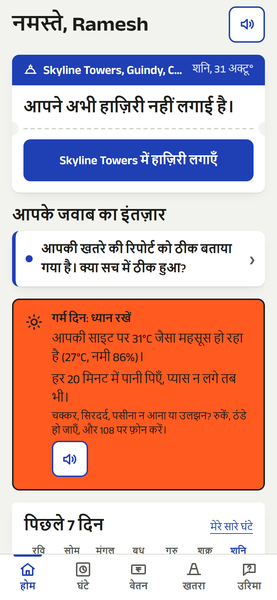
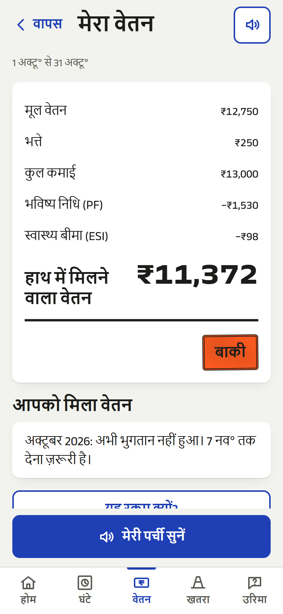
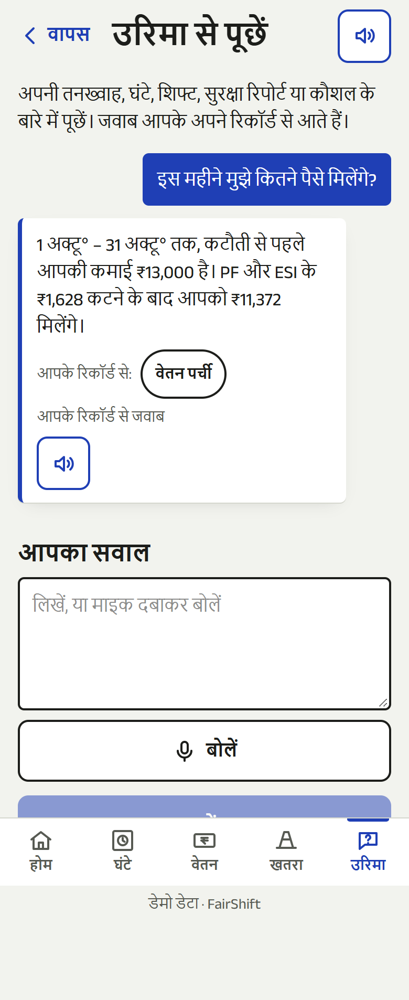
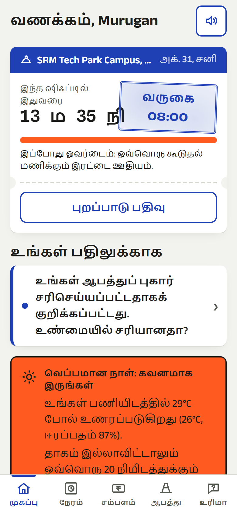
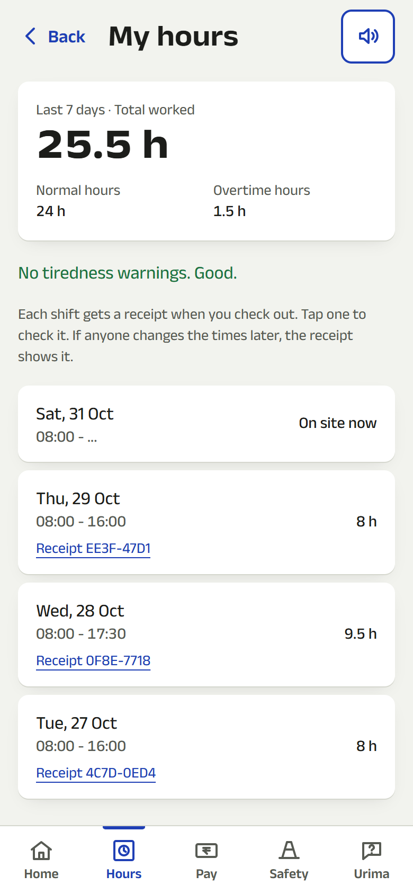
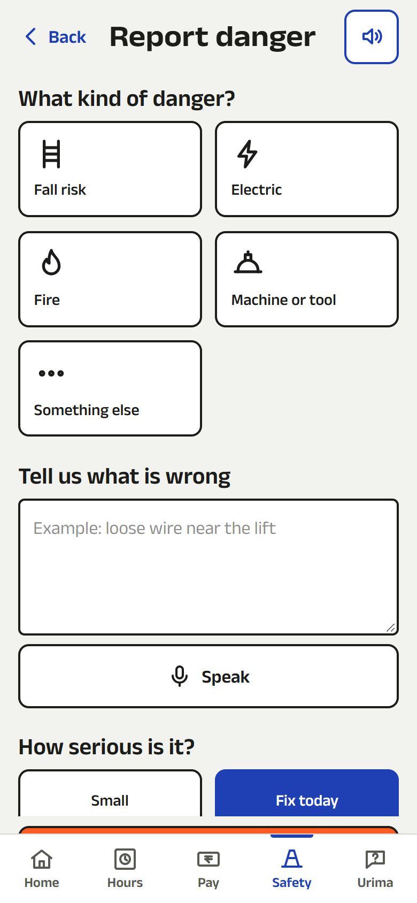
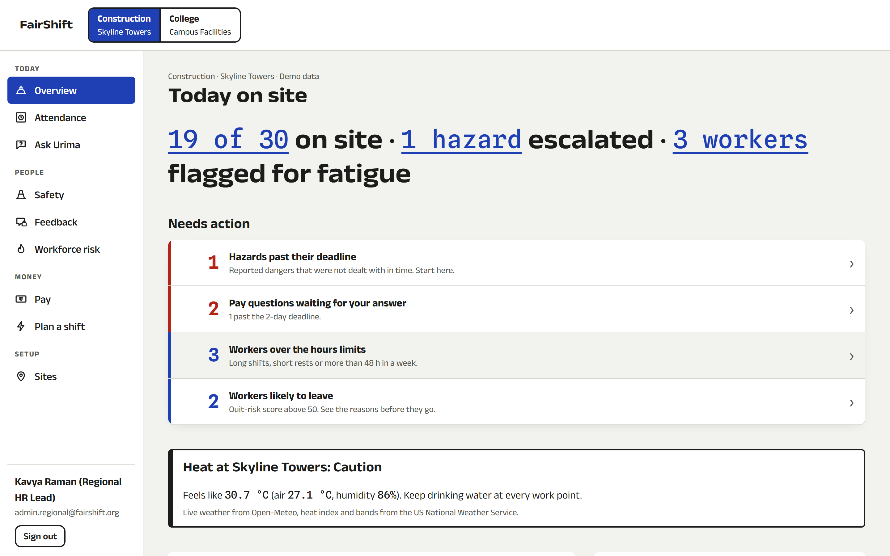
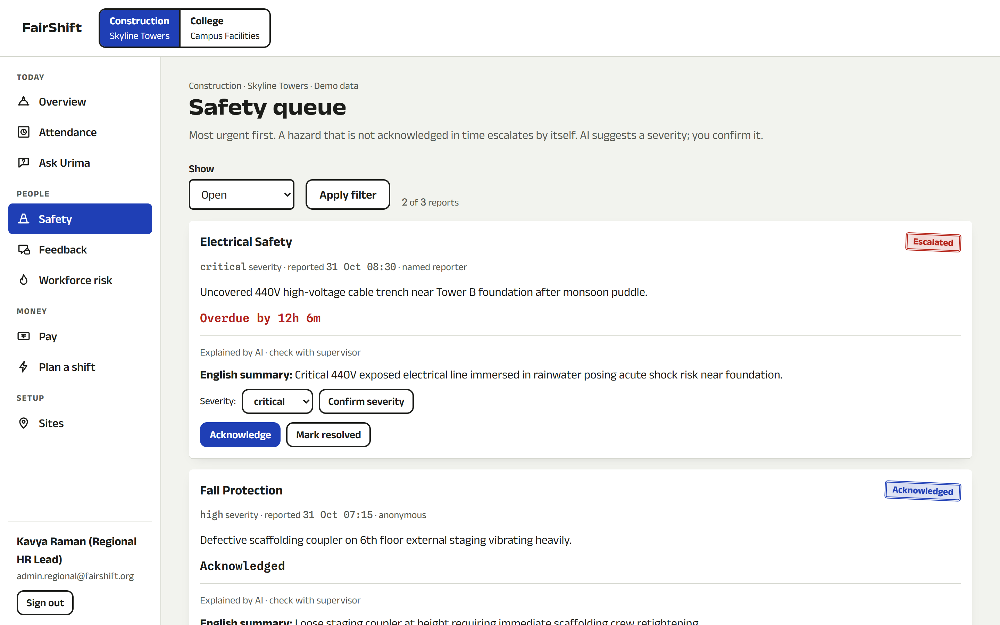
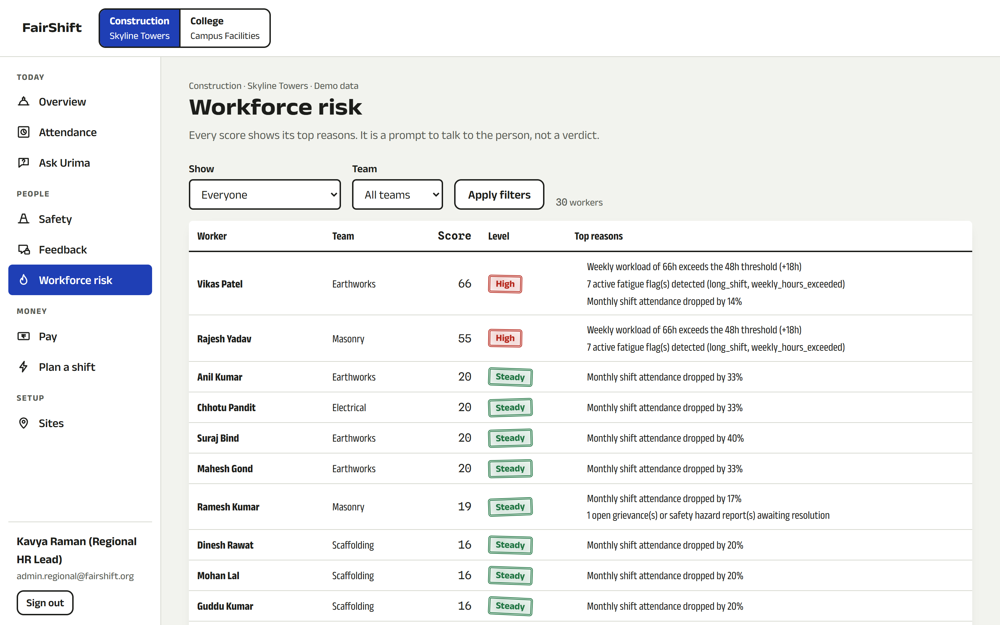
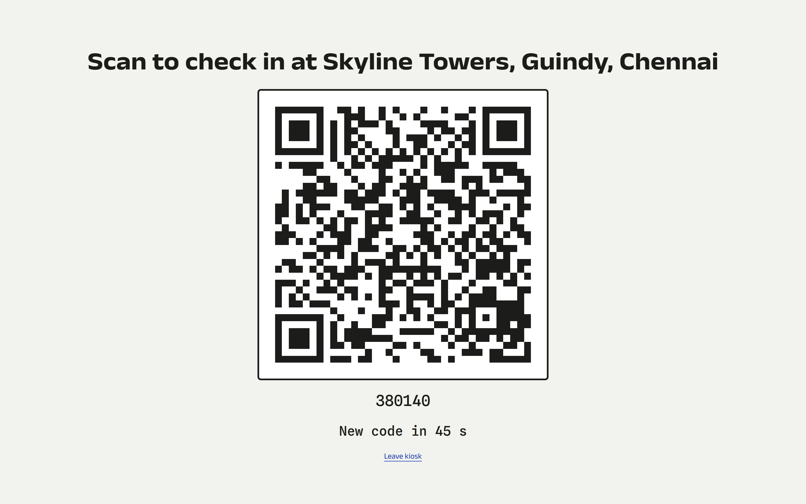

# FairShift

**Fair pay. Safe sites. A voice that counts.**

Shaurya Ojha · RA2411003011565 · SRM Institute of Science and Technology, Kattankulathur

| Live demo                                                            | Worker login                   | Supervisor login                                      |
| -------------------------------------------------------------------- | ------------------------------ | ----------------------------------------------------- |
| **[fairshift-brown.vercel.app](https://fairshift-brown.vercel.app)** | phone `9876543210`, PIN `1234` | `admin.regional@fairshift.org`, password `Admin@1234` |

The Tamil worker is `9123456789`, also with PIN `1234`. All data in the demo is generated and labelled "Demo data".

---

## 1. Problem statement

**FairShift: Decent Work Platform.** Theme: UN SDG 8, Decent Work and Economic Growth.

Large workforces in construction, colleges and schools, hospitals and factories still run on paper registers, spreadsheets and WhatsApp groups.

Workers struggle with:

- **Opaque pay calculations:** unclear salary breakdowns or uncounted overtime hours.
- **Fear of identification:** they hesitate to raise complaints or share honest feedback.
- **Unreported safety risks:** hazards are ignored until someone is injured.
- **Lost career history:** unrecorded skills force them to restart from zero.

Employers face:

- **Zero workforce visibility:** no clear view of overworked or unhappy staff.
- **High attrition risk:** they cannot spot employees likely to quit early.
- **Delayed escalation:** issues reach management only after they become severe.

Workers speak regional languages, may have limited literacy and use basic smartphones.

**The challenge:** make work fairer, safer and more transparent. Give workers clarity and a voice, and give employers actionable insight into workforce health.

**Deliverables:**

- at least 3 working features;
- two interfaces, one for workers and one for employers;
- at least two industry use cases.

---

## 2. Our solution

FairShift is a phone-first app for shift workers in Hindi, Tamil and English, plus a supervisor console, for a **construction site** and a **college campus** on one data model.

**For the worker:**

- Check in with a rotating gate QR.
- See exactly how pay was worked out, with every shift sealed in a signed receipt.
- Report a hazard by voice.
- Give feedback nobody can trace.
- If the employer does not answer a pay question in time, print a letter to the labour office.

**For the supervisor:**

- See who is on site, which hazards are overdue, who is overworked and who may leave, each with its reasons.

Every number comes from tested rule engines that follow Indian labour law (2× overtime, PF, ESI). Gemini only explains those numbers, and the app works fully offline and without any API key.

| Requirement  | FairShift                                                                                                                                                                                      |
| ------------ | ---------------------------------------------------------------------------------------------------------------------------------------------------------------------------------------------- |
| 3+ features  | 18 features, including all 8 examples in the brief: shift tracking, payslips, safety reporting, anonymous feedback, skill passport, fatigue alerts, admin dashboard, voice and local languages |
| 2 interfaces | Worker phone app (`/w`) and supervisor console (`/admin`)                                                                                                                                      |
| 2+ sectors   | Construction (Skyline Towers) and college (campus facilities) live in the demo; hospitals and factories through configuration ([use cases](src/docs/industry-use-cases.md))                    |
| Languages    | English, Hindi and Tamil; read-aloud on every worker screen, and voice input for hazard reports and Urima                                                                                      |
| Basic phones | No animation library on worker pages, an installable PWA, and check-ins, hazards and feedback that work offline and sync later                                                                 |

The full feature table, architecture, security notes and tests are in the [project README](src/README.md).

---

## 3. Tools used

| Area           | Tools                                                                                                                                              |
| -------------- | -------------------------------------------------------------------------------------------------------------------------------------------------- |
| Building       | Google Antigravity (`agy`, Gemini) running parallel subagents from written build briefs; Claude Code for planning, integration, review and testing |
| AI in the app  | Google Gemini API (`@google/genai`) with function calling, with a rule-based fallback for every AI feature                                         |
| Framework      | Next.js 16 (App Router, Server Actions, Cache Components), React 19, TypeScript (strict)                                                           |
| Data           | MongoDB Atlas, or a seeded in-memory store when no database is set                                                                                 |
| Styling        | Tailwind CSS v4 with our own design tokens ([DESIGN.md](src/DESIGN.md))                                                                            |
| Validation     | zod for every input and for the environment                                                                                                        |
| Testing        | Vitest and Testing Library: 592 tests in 77 files, 95% statement coverage                                                                          |
| Quality and CI | ESLint (zero warnings), Prettier, GitHub Actions, CodeQL, Dependabot                                                                               |
| Hosting        | Vercel; a Dockerfile is included for any container host                                                                                            |

---

## 4. How to run it

You need **Node.js 22** or later. No database, API key or account is needed.

```bash
cd src
npm ci
npm run dev
```

Open **http://localhost:3000** and sign in with the demo accounts above.

With no `.env.local`, the app:

- seeds an in-memory store with two organisations, 50 workers and three weeks of shifts;
- signs sessions with a local development secret;
- answers every AI feature with rule-based text.

**Optional services.** To use MongoDB and Gemini, copy [`src/.env.example`](src/.env.example) to `src/.env.local` and fill it in. It lists every variable with no real values:

- `MONGODB_URI` and `MONGODB_DB`
- `DATA_BACKEND`
- `SESSION_SECRET`, which is required in production
- `GEMINI_API_KEY` and `GEMINI_MODEL`
- `WEATHER_DISABLED`

| Goal                     | Command                                                                      |
| ------------------------ | ---------------------------------------------------------------------------- |
| Check it is up           | `curl http://localhost:3000/api/health`                                      |
| Every check CI runs      | `npm run verify`: format, types, lint, tests with coverage, production build |
| Production build locally | `npm run build && SESSION_SECRET=<32+ random chars> npm start`               |
| Docker                   | `docker compose up --build` (the app plus a local MongoDB)                   |

**Error handling and validation:**

- Every Server Action input and every environment variable is parsed with zod.
- Errors are typed codes, so internals never reach the browser.
- There are error boundaries, a 404 page and loading states.
- Login and reports are rate-limited.
- If MongoDB or Gemini is unreachable, the app keeps working on the in-memory data and rule-based answers.

---

## 5. Demo link

- **Live app:** https://fairshift-brown.vercel.app, deployed on Vercel with MongoDB Atlas and Gemini.
- **Demo video:** [`video/fairshift-demo.mp4`](video/fairshift-demo.mp4), 1 min 52 s: the worker app in Hindi and Tamil and the supervisor console, recorded from the running app.
- **Screenshots:** in [`screenshots/`](screenshots), all taken from the current build.

**A two-minute tour:**

1. Sign in as the Hindi worker.
2. Tap **उरिमा** and ask "इस महीने मुझे कितने पैसे मिलेंगे?".
3. Open **वेतन** (Pay) and tap read-aloud.
4. Open **घंटे** (Hours): each shift has a receipt code that anyone can verify.
5. Sign in to the console as the regional supervisor. It opens with what needs action first.

### Worker app (phone)

| Home (Hindi)                                        | Pay (Hindi)                                               | Urima, the assistant (Hindi)                                         |
| --------------------------------------------------- | --------------------------------------------------------- | -------------------------------------------------------------------- |
|  |  |  |

| Home (Tamil)                                        | Hours with receipts (English)                     | Report danger (English)                                           |
| --------------------------------------------------- | ------------------------------------------------- | ----------------------------------------------------------------- |
|  |  |  |

### Supervisor console (desktop)

| Overview: needs action first                   | Safety queue                               |
| ---------------------------------------------- | ------------------------------------------ |
|  |  |

| Workforce risk with reasons                           | Gate QR kiosk                                         |
| ----------------------------------------------------- | ----------------------------------------------------- |
|  |  |

Every other screen, in all three languages, is in [`screenshots/`](screenshots).

---

## 6. Key prompts

The full list, with what each prompt changed, is in **[prompts.md](prompts.md)**. The prompts that shaped the app most:

1. **Plan before building.**

   > "pehle plan kar, mujhe architectural decision le, and build phases ka decision le, ui ka le. then we would build it."

   This produced one Next.js app, pure rule engines behind a repository, and the "honest muster roll" design system.

2. **Build with parallel agents.**

   > "/agy ko build krne ka poora kaam dede ... usko boldena ki subagents se kaam karwa le"

   The spec became a build brief with file ownership per subagent ([AGY_TASK.md](src/docs/build/AGY_TASK.md)).

3. **Work offline.**

   > "aur aisa app bana do, ki agar offline bhi hojaye laboru, tab bhi kaam hojaye, and jaise hi net aaye, sab server pe chala jae"

   This produced an outbox that keeps each action's original time and replays it safely.

4. **Raise the weakest score.**

   > "bhai hum 2nd aaye hai. aur better karo"

   A code-quality-only brief took the score from 96.94 to **97.15, rank #1** in the online round.

5. **Finals.**

   > "i wanna win and standout. write the best code, with the best test, security, efficiency all those stuff."

   This led to typed errors, validated input, Urima, signed shift receipts, the labour-office letter and 592 tests.

---

## Folder contents

```
RA2411003011565-ShauryaOjha/
├── README.md      this file
├── prompts.md     key prompts and the build briefs given to the coding agent
├── screenshots/   25 screenshots: worker app in Hindi, Tamil and English; console; landing
├── video/         demo video (1 min 52 s)
└── src/           the full project (Next.js app, tests, docs, Dockerfile, .env.example)
```

No API keys, passwords or `.env` files are included. Only `src/.env.example`, with empty values, is committed.
