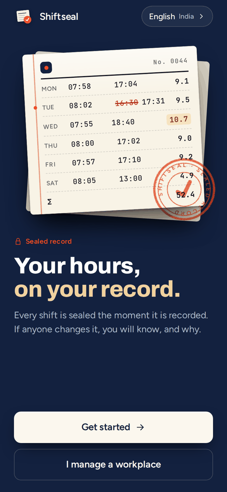
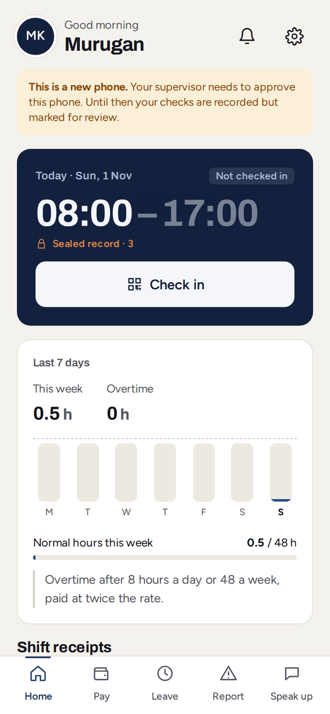
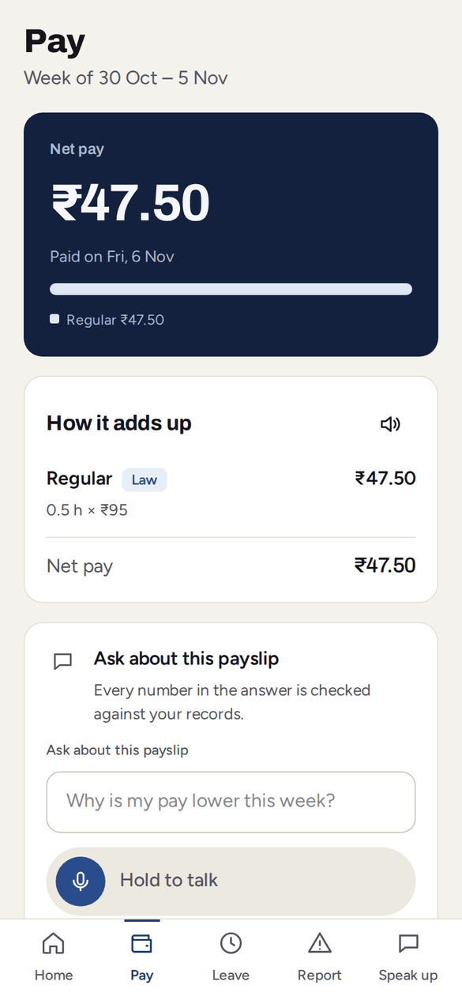
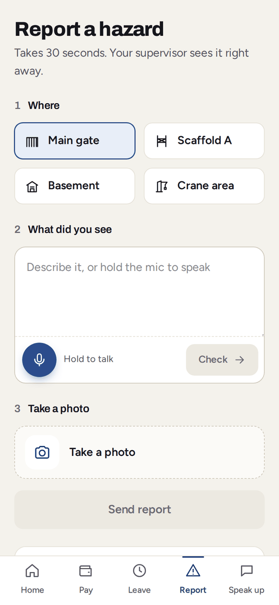
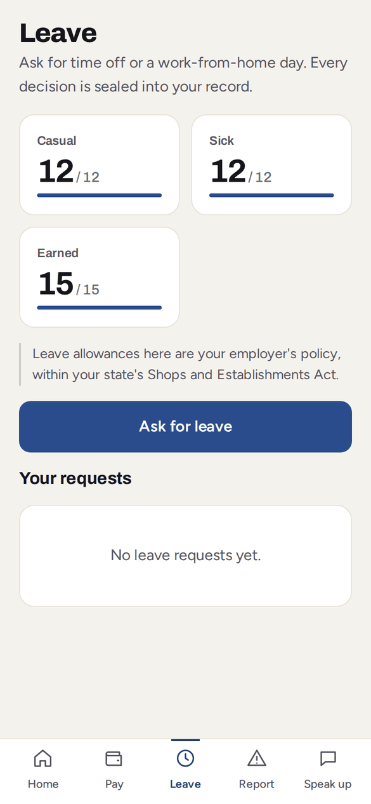
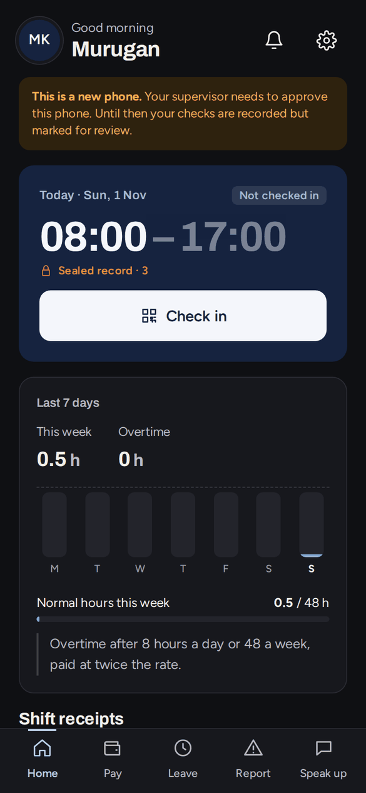
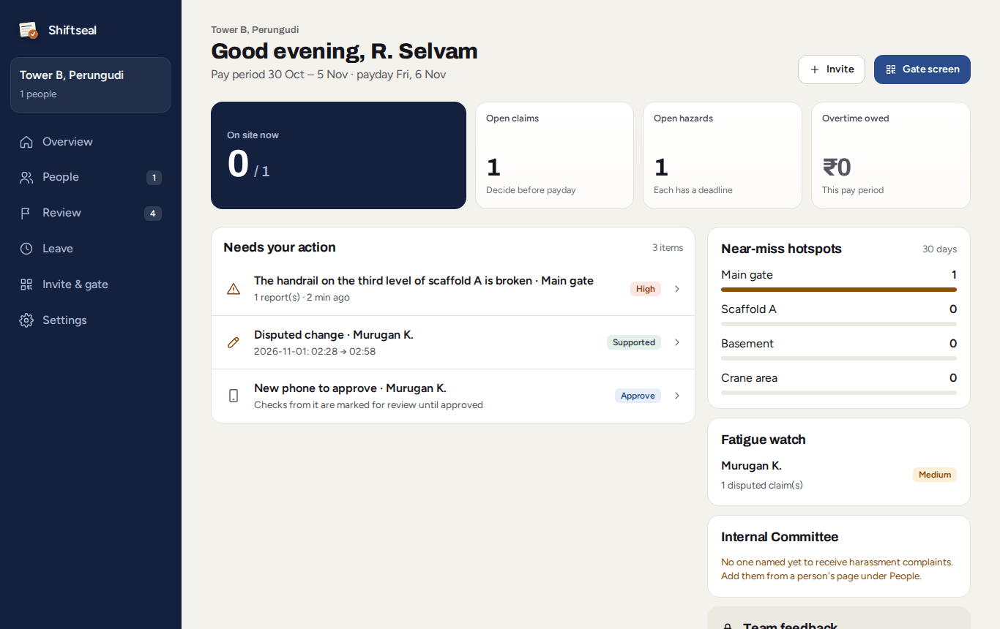
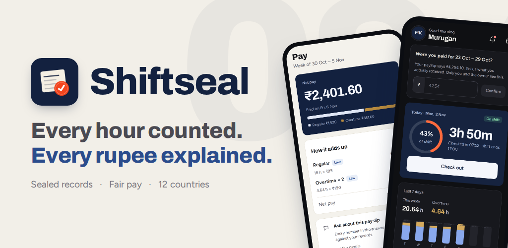

# Shiftseal: proof of work for shift workers

**RA2511033010156 · Sushil Raj** · Prompt Wars 2026 × SRM ACM Student Chapter

| | |
| --- | --- |
| **Live web app** | https://shiftseal-872210045960.asia-south1.run.app |
| **Android app (Google Play)** | https://sushilraj.dev/shiftseal/#join (join the testers' group, then install from Google Play) |
| **Project page** | https://sushilraj.dev/shiftseal/ |
| **Source (full history)** | https://github.com/SushilRaj0177/shiftseal |

## Screenshots

| Welcome | Worker home | Pay, line by line |
| --- | --- | --- |
|  |  |  |

| Report a hazard | Leave | Dark mode |
| --- | --- | --- |
|  |  |  |

**Employer dashboard**



**On Google Play**



## 1. Problem statement

**FairShift: Decent Work Platform** (UN SDG 8, Decent Work and Economic Growth). Large workforces in construction, colleges, hospitals and factories still run on paper registers, spreadsheets and WhatsApp. Workers face opaque pay and uncounted overtime, fear of raising complaints, unreported hazards and lost work history; employers have no visibility into overwork, attrition or escalating issues. The platform must work across at least two sectors, in regional languages, for limited literacy and low-end phones, with one interface for workers and one for employers.

## 2. Our solution

Shiftseal gives every worker their own tamper-evident record of each shift: check-ins are signed on the worker's phone, checked against a rotating gate QR code and the site boundary, and sealed into a hash-chained ledger nobody can quietly edit. Pay is calculated by tested rules for 12 countries and explained line by line with the law behind each line. Workers report hazards, claim overtime and give anonymous feedback by voice or text in 10 languages; Gemini understands what they say, while deterministic code decides every number. Employers get a live dashboard of who is on site, what needs a decision and every change with its reason. It covers construction, campuses, hospitals, offices and retail (including students and under-18 workers).

## 3. Tools used

- **Claude Code** (AI coding agent) to write the code from my prompts
- **Gemini on Vertex AI** inside the app: voice and text understanding, payslip questions, anonymised feedback (keyless, no API keys)
- **Google Cloud Run**, **Cloud Firestore**, **Firebase Authentication** (phone and Google sign-in), **Google Play Integrity**
- React 18, TypeScript, Vite, Express, zod, Vitest, Playwright; Android (Java WebView shell)
- Figma for the design system; Kehai QR Studio (my own tool) for the join QR code

## 4. How to run it

Requires Node.js 20.6+. No cloud account needed locally.

```bash
cd src
npm ci
cp .env.example .env      # in-memory store, developer sign-in, no keys
npm run build
npm run start:local       # http://localhost:8080
npm test                  # 182 tests
```

Choose **I manage a workplace** to create one, then open the invite code in a second browser window as a worker. Full setup, environment variables and deployment: [`src/README.md`](src/README.md), [`src/DEPLOY.md`](src/DEPLOY.md).

## 5. Demo

- Web: https://shiftseal-872210045960.asia-south1.run.app (sign in with test number +91 99999 00000, code 000000)
- Android on Google Play: https://sushilraj.dev/shiftseal/#join
- Screenshots: above

## 6. Key prompts

See [`prompts.md`](prompts.md).
