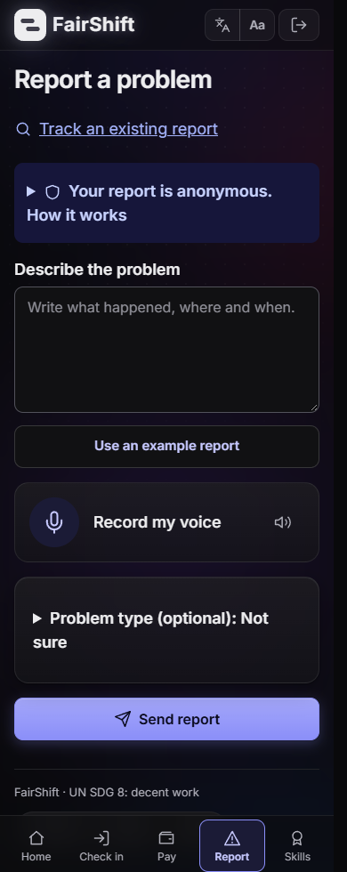
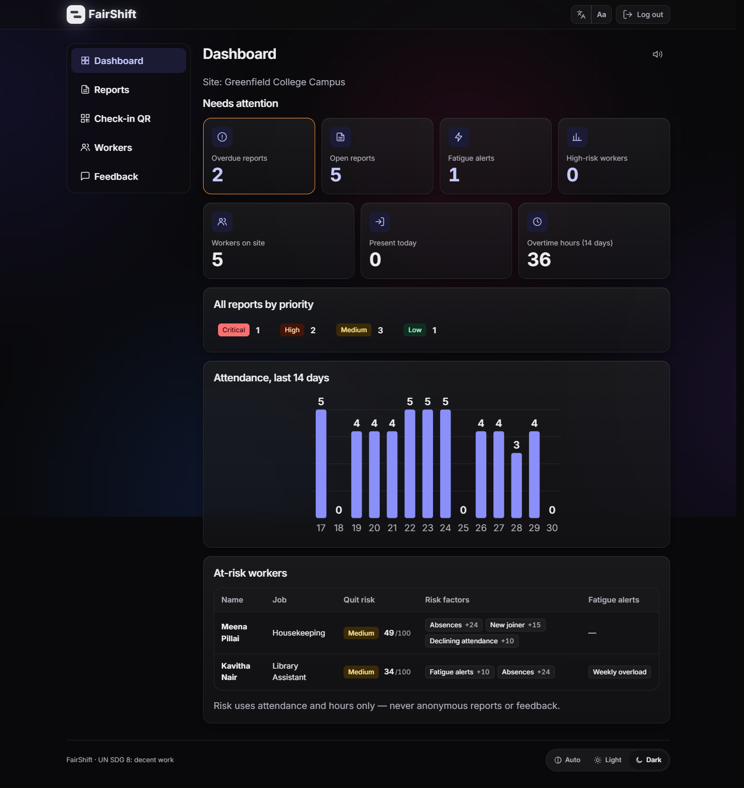

# FairShift — Decent Work Platform

**Danyael Gaina · RA2611003011138**
PromptWars 2026 × ACM SRM Student Chapter · UN SDG 8

[Live demo](https://fairshift-alpha.vercel.app/) · [Project source](src/) · [Key prompts](prompts.md) · [Technical README](src/README.md)

## Problem statement

The supplied challenge is **“FairShift: Decent Work Platform”**, with the theme **“UN SDG 8 — Decent Work and Economic Growth.”**

> Building fairer, safer, and more transparent workplaces for employee-intensive organisations.

The problem statement describes large workforces that still rely on paper registers, spreadsheets, and WhatsApp groups in construction, colleges and schools, hospitals, and factories. Its worker pain points are opaque pay calculations, fear of identification when reporting, unreported safety risks, and lost career history. Employers lack visibility into overwork and attrition, and issues reach management too late. The platform must accommodate regional languages, limited literacy, and basic smartphones.

The mission, as given:

> Make work fairer, safer, and more transparent for everyone.
> Empower workers with clarity and voice while giving employers actionable insights into workforce health.

The required deliverables are **3+ working features**, **two interfaces** for workers and employers/admins, and **2+ industry use cases**.

## My solution

FairShift gives workers a clear record of their hours, pay, reports, and skills.
A separate admin interface helps site managers review attendance, corrections, overdue reports, and fatigue signals.
English, Hindi, and Tamil interfaces include read-aloud controls, with voice or text reporting.
The same application supports construction workers paid by the day and campus staff paid monthly, using shared rules and industry configuration.

## What works

- **Attendance and pay:** QR/location check-in, completed-shift overtime, itemized payslips, a day-by-day pay calendar, and month comparisons.
- **Corrections and payment receipts:** workers request attendance/pay corrections; admins review them with reasons. Separate payment records show calculated-versus-recorded amounts, and workers can confirm or dispute receipts.
- **Anonymous safety reporting:** text or voice reports return a case code. A separate private response key lets the reporter confirm a fix or reopen the case without attaching their account identity.
- **Employer follow-up:** report priority and overdue queues, recurring hazard summaries, attendance trends, explainable fatigue and quit-risk factors, and site-wide days-off notices.
- **Skills and feedback:** a signed, shareable skill passport and anonymous feedback hidden below the minimum response threshold.

The prototype uses fictional demo workers and example payroll rules. Days-off notices affect the schedule only; pay follows recorded work. Recorded payments do not move money. Income tax is not calculated.

## Two industry use cases

| Construction site | College campus |
|---|---|
| Daily wages, gate check-in, scaffolding/PPE hazards, overtime, and long-shift fatigue | Monthly salaries, campus attendance, electrical/lab hazards, and facilities follow-up |
| Worker demo: Ravi Kumar; admin demo: Priya Raman | Worker demo: Lakshmi Iyer; admin demo: Anand Krishnan |

Select a demo persona on the landing page. The welcome tour is skippable.

## Tools used

- **Development:** Claude Code for implementation and design iteration; OpenAI Codex for review, testing, and final improvements.
- **Application:** Preact, TypeScript, Vite, Hono, Node.js, Zod, and Vitest.
- **Optional AI:** Gemini for report transcription, translation, triage, and speech synthesis. Typed reports still work with deterministic keyword triage when AI is unavailable.
- **Deployment/storage:** Vercel with Upstash Redis; an in-memory local mode and an optional Cloud Run/Firestore setup are also included.

## How to run

Use **Node.js 22.12 or later**. From the repository root:

```bash
cd students/RA2611003011138-Danyael-Gaina/src
npm ci
npm run build
npm start
```

Open **http://localhost:8080**.

No credentials are required for the local demo. It uses an in-memory store and keyword triage. For overrides, copy `.env.example` to `.env` inside `src/`, uncomment the variables you need, and keep real values private.

```bash
npm run dev           # API + Vite development server
npm run check         # typecheck, lint, and tests
npm run build:vercel  # static site and API function
```

Vercel needs a stable `SESSION_SECRET` and Redis for persistent data. Gemini is optional; voice transcription needs a configured AI service. Full setup, environment variables, architecture, and deployment instructions are in [the technical README](src/README.md).

## Validation

The submitted source was checked from a fresh copy with a clean `npm ci`:

- **504 tests passed** across 59 test files.
- Type checking and lint passed.
- The standard build and Vercel build passed.
- The built API returned a healthy response and all four demo personas without a local `.env`.

Live Gemini, Redis, and Firestore integrations are not part of the automated suite; their test coverage uses fakes. The dependency audit has no high or critical findings, with moderate transitive/tooling advisories remaining.

## Demo

[Open FairShift](https://fairshift-alpha.vercel.app/). The hosted deployment is maintained separately from this source snapshot; running `src/` locally gives the submitted version.

A short review flow: open Ravi's pay calendar, submit a safety report, then sign in as Priya to review the report queue. Use the worker's case code to track progress. New reports also provide a private key for confirming or disputing a reported fix.

## Screenshots

### Worker: report a problem



### Admin: dashboard and actions



## Key prompts

The [prompt record](prompts.md) contains selected development requests, edited for clarity while preserving their intent. Examples include multilingual onboarding, take-home pay first, reliable reporting without live AI, and a review of data persistence, atomic writes, and accessibility.

## License

The project source is provided under the [MIT license](src/LICENSE).
