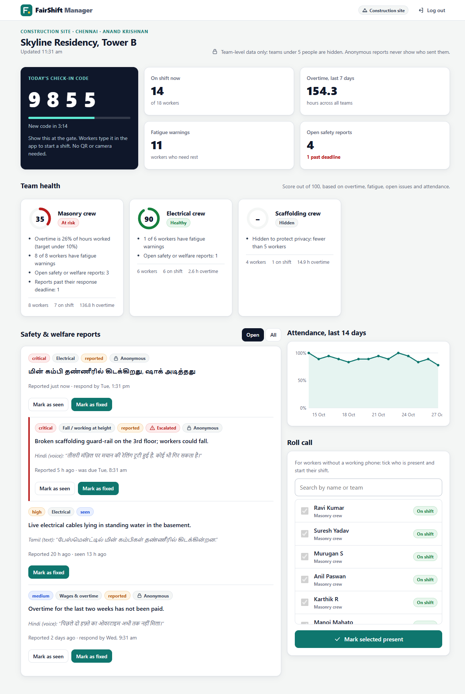
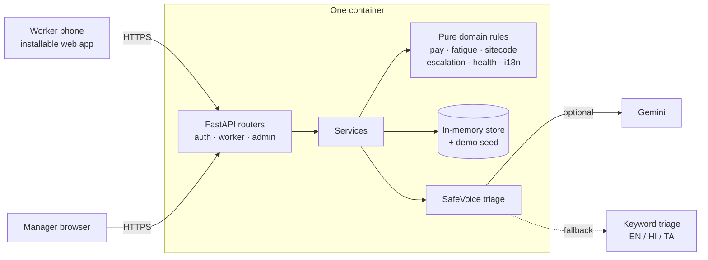
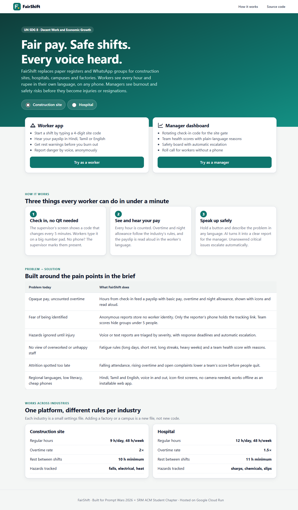
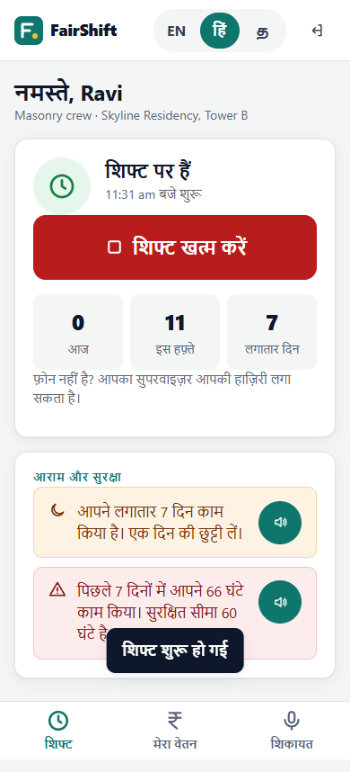
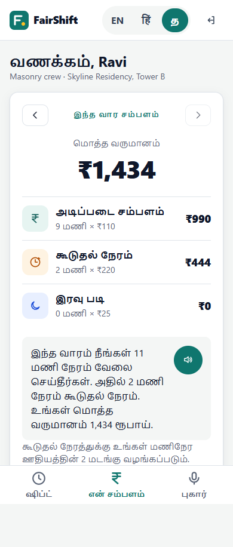

# FairShift: Decent Work Platform

**Fair pay, safe shifts and a voice for every shift worker, in their own language, on any phone.**

PromptWars 2026 × ACM SRM Student Chapter · Theme: **UN SDG 8, Decent Work and Economic Growth**

| | |
|---|---|
| **Demo link** | Not deployed yet. Runs locally in about two minutes (see [How to run it](#how-to-run-it)). |
| **Demo video** | _Add a Drive / YouTube (unlisted) link here_ |
| **Code** | [`src/`](src) |
| **Prompts** | [`prompts.md`](prompts.md) |



---

## Problem statement

> **FairShift: Decent Work Platform.** Building fairer, safer, and more transparent workplaces for employee-intensive organisations.

Large workforces in construction, colleges and schools, hospitals and factories still rely on paper registers, spreadsheets and WhatsApp groups.

- **Workers** face opaque pay calculations and uncounted overtime, fear of being identified when they complain, safety hazards ignored until someone is injured, and lost career history.
- **Employers** have no clear view of overworked or unhappy staff, cannot spot people likely to quit, and hear about issues only after they become severe.
- **Accessibility needs:** regional languages, limited literacy (voice and visual cues), and basic low-end smartphones.

**Challenge:** make work fairer, safer and more transparent; empower workers with clarity and voice while giving employers actionable insight into workforce health. The platform must work across at least two industries and provide two interfaces (worker and employer), with at least three working features.

## Our solution

FairShift is a mobile-first worker app (Hindi, Tamil, English) plus a manager dashboard, sharing one data model.
Workers check in by typing a rotating 4-digit site code (no QR or camera needed), see a payslip that is also read aloud in their language, get fatigue warnings, and report hazards by voice in any language, anonymously by default.
Gemini transcribes, translates and triages each report; a keyword fallback in three languages means no report is ever lost.
Managers see a team-level health score (0–100) for burnout and attrition risk, a safety board with automatic escalation when deadlines pass, attendance trends, and a roll call for workers without phones.
Industry rules live in JSON files, so the same app runs a construction site and a hospital today, and can support a factory or campus by adding a file.

## Features

**Worker app** (installable, works offline, about 100 KB)
- **Check-in without QR:** rotating 4-digit site code (HMAC, TOTP-style) entered on a large number pad; supervisors can mark phoneless workers present.
- **Spoken payslip:** basic pay, overtime and night allowance per industry rules, shown with icons and read aloud in Hindi, Tamil or English.
- **Fatigue guard:** flags long days, short rest between shifts, too many days in a row and heavy weeks.
- **SafeVoice reporting:** hold to speak or type; AI triage of severity and category; anonymous by default with status tracking (Sent → Seen → Fixed).

**Manager dashboard**
- **Site check-in code** with countdown, to show at the gate.
- **Workforce health score** per team with plain-language reasons; teams under 5 people are hidden to protect identities.
- **Safety & welfare board** with original-language text, response deadlines and automatic escalation.
- **Attendance trend** (14 days) and **roll call**.

**Across industries:** construction and hospital rule sets (hours, overtime multiplier, night window, minimum rest, response deadlines, hazard categories) in [`src/app/sectors/`](src/app/sectors).

## Tools used

| Area | Tools |
|---|---|
| AI in the product | Google **Gemini** (`google-genai` SDK) via Vertex AI on Google Cloud, or a Google AI Studio key elsewhere |
| AI used to build it | **Claude Code** (Anthropic) |
| Backend | Python 3.12+, FastAPI, Uvicorn, Pydantic, itsdangerous (signed session cookies) |
| Frontend | Plain HTML, CSS and JavaScript (no framework, no build step), Web Speech API, MediaRecorder, service worker |
| Quality | pytest (78 tests), ruff (lint, formatting and bandit security rules) |
| Deployment config | Dockerfile for Google Cloud Run, `render.yaml` for Render |

## Architecture



```
src/
  app/
    domain/        pure business rules: pay, fatigue, sitecode, escalation, health, i18n
    sectors/       industry rule files (construction.json, hospital.json)
    ai/triage.py   Gemini triage + multilingual keyword fallback
    api/           FastAPI routers: auth, worker, admin
    store/         in-memory store + demo seed data
    services.py    application services
    config.py      settings from environment variables
    main.py        app factory, security headers, static files
  static/          landing page, worker app, manager dashboard (HTML/CSS/JS)
  tests/           pytest suite
  docs/screenshots/
  .env.example     every environment variable, documented
  Dockerfile       container for Google Cloud Run
  render.yaml      Render blueprint
```

## How to run it

Requires **Python 3.11 or newer**.

```bash
# 1. Clone and enter the project
git clone https://github.com/Dr-M-Suchithra-lab/ACM-SRM-PromptWars-2026.git
cd ACM-SRM-PromptWars-2026
git checkout RA2611027040012-Ashish
cd students/RA2611027040012-Ashish/src

# 2. Create a virtual environment and install
python -m venv .venv
.venv\Scripts\activate             # Windows; on macOS/Linux: source .venv/bin/activate
pip install -r requirements-dev.txt

# 3. Configure (optional): every value can stay blank for the demo
cp .env.example .env               # Windows CMD: copy .env.example .env

# 4. Run (frontend and backend are served together)
uvicorn app.main:app --port 8080
```

Open <http://localhost:8080>. API docs are at <http://localhost:8080/api/docs>.

- **Seed data:** none to run by hand. 2 sites, 5 teams, 33 workers, three weeks of shift history and 7 sample reports are generated automatically on every start (`app/store/seed.py`).
- **AI triage:** add a `GEMINI_API_KEY` to `.env` to turn on Gemini. Without it, the keyword classifier handles typed reports.
- **Tests:** `pytest` (78 tests) and `ruff check .`

## Demo credentials

These are fake demo accounts created by the seed script. The landing page also has one-click **Try as a worker** and **Try as a manager** buttons.

| Role | Login |
|---|---|
| Construction worker (Ravi, Hindi) | phone `9000000001`, PIN `1234` |
| Hospital nurse (Lakshmi, Tamil) | phone `9000000019`, PIN `1234` |
| Construction site manager | `site.manager@fairshift.demo` / `demo1234` |
| Hospital manager | `hospital.manager@fairshift.demo` / `demo1234` |

**Suggested demo path:** log in as Ravi → see the fatigue warning (6 days in a row) → **Start shift** with the code from the manager dashboard → **My pay** → tap the speaker → **Report** a hazard → switch to the manager dashboard and mark it seen.

## Security and privacy

- No secrets in the code. Session and site-code secrets and the Gemini key come from environment variables; on Cloud Run, Gemini uses the service identity instead of a key.
- PINs and passwords are hashed with PBKDF2-SHA256; repeated wrong attempts lock the account for 5 minutes.
- Signed `HttpOnly`, `SameSite=Strict` session cookies; a role check on every route; managers only see their own site.
- Strict Content-Security-Policy and security headers; input validation with Pydantic; audio uploads limited by type and size.
- Anonymous reports store no worker ID; team metrics are hidden below 5 people.

## Screenshots

| Landing | Manager dashboard |
|---|---|
|  |  |

| Check-in and fatigue guard (Hindi) | Spoken payslip (Tamil) | SafeVoice report (Tamil) |
|---|---|---|
|  |  |  |

_More screenshots: add PNG files to [`screenshots/`](screenshots) and link them here._

## Key prompts

The most important prompts used to build FairShift are in [`prompts.md`](prompts.md).

## Team

Solo event.

| Name | Register number | Department / Year | Contact |
|---|---|---|---|
| Ashish | RA2611027040012 | _Fill in_ | _Fill in (optional)_ |
