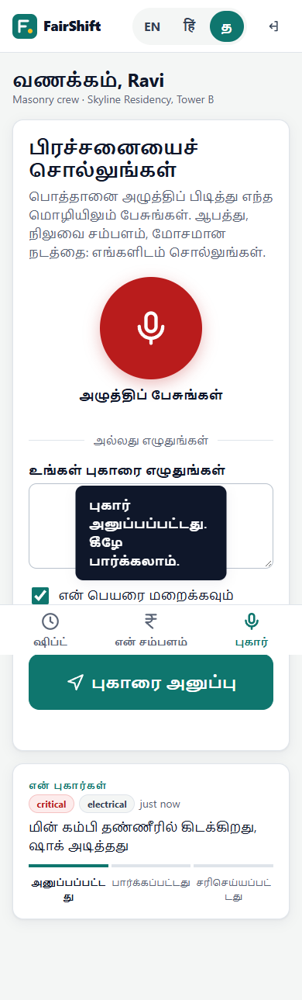
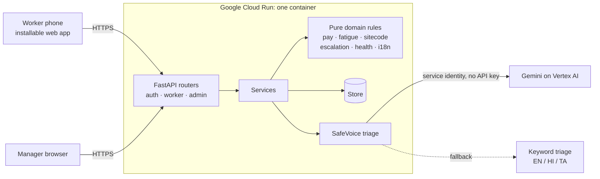

# FairShift: Decent Work Platform

**Fair pay. Safe shifts. Every voice heard.**

FairShift replaces paper registers, spreadsheets and WhatsApp groups for shift-based
workforces on construction sites, in hospitals, on campuses and in factories. Workers
see every hour and rupee in their own language, on any phone. Managers see burnout,
attrition risk and safety hazards early, before they turn into injuries or resignations.

Built for **Prompt Wars 2026 × SRM ACM Student Chapter**, theme **UN SDG 8: Decent Work
and Economic Growth**.

| | |
|---|---|
| **Live app** | Not deployed yet. Run it locally in about two minutes (see [Run locally](#run-locally)). |
| **Try it** | Open the app and click **Try as a worker** or **Try as a manager**. Demo data is preloaded. |


| Check-in and fatigue guard (Hindi) | Spoken payslip (Tamil) | SafeVoice report (Tamil) |
|---|---|---|
|  |  |  |

---

## The problem

| Who | Pain today |
|---|---|
| Workers | Unclear pay and uncounted overtime · fear of being identified when complaining · hazards ignored until someone is hurt |
| Employers | No view of overworked or unhappy staff · attrition noticed too late · issues escalate only when severe |
| Constraints | Regional languages · limited literacy · cheap smartphones (often with poor cameras) |

## The solution

Two interfaces, one shared data model:

### Worker app (mobile-first, Hindi / Tamil / English)

| Feature | What it does |
|---|---|
| **Check-in without QR** | The manager's screen shows a 4-digit code that rotates every 5 minutes (TOTP-style HMAC). Workers type it on a large number pad. No camera needed. Workers without a usable phone are marked present by the supervisor (**roll call**). Sharing location is optional. |
| **Clear, spoken payslip** | Hours become basic pay, overtime and night allowance using the industry's rules. Icon-first breakdown, plus a sentence read aloud in the worker's language. |
| **Fatigue guard** | Flags long days, too little rest between shifts, too many days in a row and heavy weeks. Each warning is spoken. |
| **SafeVoice reporting** | Hold to speak in any language, or type. Gemini transcribes, translates and triages severity and category. Anonymous by default: no worker ID is stored, and only the reporter's phone holds the tracking token. Status: Sent → Seen → Fixed. |

### Manager dashboard

| Feature | What it does |
|---|---|
| **Site check-in code** | Large rotating code with a countdown, to show at the gate. |
| **Workforce health** | A 0–100 score per team with plain-language reasons (overtime share, fatigue, open/escalated issues, attendance drop). An early warning for burnout and attrition, at **team level only**: teams under 5 people are hidden to protect identities. |
| **Safety & welfare board** | Reports by severity, with original-language text, response deadlines and **automatic escalation** when a deadline passes without acknowledgement. |
| **Attendance trend and roll call** | 14-day attendance chart. Start shifts for workers without phones. |

### Works across industries

Each industry is a JSON rule file in [`app/sectors/`](app/sectors). Adding a factory or a campus means adding a file, with no code changes.

| Rule | Construction | Hospital |
|---|---|---|
| Regular hours | 9 h/day, 48 h/week | 12 h/day, 48 h/week |
| Overtime multiplier | 2× | 1.5× |
| Night window / allowance | 22:00–06:00, ₹25/h | 21:00–07:00, ₹40/h |
| Minimum rest between shifts | 10 h | 11 h |
| Response deadline (critical) | 2 h | 1 h |
| Hazard categories | fall, electrical, heat, … | infection, chemical, slip, … |

## Architecture



- **`app/domain/`** holds pure business rules with no I/O. They are fully unit-tested.
- **`app/services.py`** combines rules and storage. The API layer stays thin.
- **`app/ai/triage.py`** calls Gemini through Vertex AI using the Cloud Run service account, so **no API key exists**. If AI is off or fails, a keyword classifier in English, Hindi and Tamil takes over, so a safety report is never lost.
- **`static/`** is plain HTML, CSS and JavaScript with no framework and no build step: about 100 KB in total, uncompressed, fast on 2G/3G and low-end phones. A service worker keeps the app shell available offline.

## Security

- No secrets in the repository. Session and site-code secrets come from environment variables (Secret Manager on Cloud Run). Vertex AI uses the service identity.
- PINs and passwords are hashed with PBKDF2-SHA256 (200k iterations). Repeated wrong attempts trigger a lockout.
- Sessions are signed cookies (`HttpOnly`, `SameSite=Strict`, `Secure` on Cloud Run).
- A role check runs on every route, and managers only ever see their own site.
- Strict Content-Security-Policy (no inline scripts), `X-Frame-Options: DENY`, `nosniff`, a Permissions-Policy, and `no-store` on API responses.
- Input validation with Pydantic. Audio uploads are limited in type and size.
- Privacy by design: anonymous reports store no worker ID, and team metrics are hidden below 5 people.
- The container runs as a non-root user.

## Accessibility and inclusivity

- Hindi, Tamil and English throughout the worker app, with text-to-speech for payslips and warnings.
- Voice input for reports, so workers don't need to read or write.
- Icon-first layout, 48–72 px touch targets, and a large on-screen number pad.
- WCAG AA colour contrast, visible focus rings, a skip link, semantic landmarks, `aria-live` status updates, keyboard-operable tabs (arrow keys) and a keyboard-operable recorder (Enter/Space), and support for reduced motion.
- No camera or QR code required. Works offline as an installable web app.

## Demo accounts

| Role | Login |
|---|---|
| Construction worker (Ravi, Hindi) | phone `9000000001`, PIN `1234` |
| Hospital nurse (Lakshmi, Tamil) | phone `9000000019`, PIN `1234` |
| Construction site manager | `site.manager@fairshift.demo` / `demo1234` |
| Hospital manager | `hospital.manager@fairshift.demo` / `demo1234` |

The landing page also has one-click demo buttons. Demo data is regenerated on every start-up. Ravi has worked 6 days straight, so the fatigue guard is visible immediately.

## Run locally

```bash
python -m venv .venv
.venv/Scripts/activate          # Windows; use `source .venv/bin/activate` on macOS/Linux
cp .env.example .env            # optional: every value can stay blank for the demo
pip install -r requirements-dev.txt
uvicorn app.main:app --reload --port 8080
```

Open <http://localhost:8080>. API docs are at `/api/docs`.

## Tests and quality

```bash
pytest          # 78 tests: domain rules + API flows (auth, privacy, check-in, reports, dashboard)
ruff check .    # lint, including bugbear and security (bandit) rules
```

## Deploy to Google Cloud Run

```bash
gcloud services enable run.googleapis.com cloudbuild.googleapis.com aiplatform.googleapis.com secretmanager.googleapis.com

# Secrets shared by all instances (sessions and site codes must match across instances)
python -c "import secrets; print(secrets.token_urlsafe(32))" | gcloud secrets create fairshift-session --data-file=-
python -c "import secrets; print(secrets.token_urlsafe(32))" | gcloud secrets create fairshift-sitecode --data-file=-

gcloud run deploy fairshift --source . --region asia-south1 --allow-unauthenticated \
  --max-instances 1 --memory 512Mi \
  --set-env-vars GOOGLE_CLOUD_PROJECT=$(gcloud config get-value project),GOOGLE_CLOUD_LOCATION=asia-south1 \
  --set-secrets SESSION_SECRET=fairshift-session:latest,SITE_CODE_SECRET=fairshift-sitecode:latest
```

The Cloud Run service account needs the **Vertex AI User** and **Secret Manager Secret
Accessor** roles.

| Variable | Default | Purpose |
|---|---|---|
| `SESSION_SECRET` | random per process | Signs login cookies |
| `SITE_CODE_SECRET` | random per process | Seeds rotating check-in codes |
| `GOOGLE_CLOUD_PROJECT` | unset | Enables Gemini triage through Vertex AI |
| `GEMINI_API_KEY` | unset | Google AI Studio key for hosts outside Google Cloud (Render, local `.env`). Not needed on Cloud Run. |
| `GEMINI_MODEL` | `gemini-3.5-flash-lite` | Model used for triage (fast: about 2 s per report) |
| `AI_ENABLED` | on when a project or key is set | Turns AI triage on or off |
| `DEMO_MODE` | `true` | One-click demo logins |

## Project structure

```
app/
  domain/        pure rules: pay, fatigue, sitecode, escalation, health, i18n
  sectors/       industry rule files (construction.json, hospital.json)
  ai/triage.py   Gemini triage + multilingual keyword fallback
  api/           FastAPI routers: auth, worker, admin
  store/         in-memory store + demo seed data
  services.py    application services
  main.py        app factory, security headers, static files
static/          landing page, worker app, manager dashboard (HTML/CSS/JS)
tests/           pytest suite
```

## Roadmap

- Firestore-backed store (the store is isolated behind one class) for persistence across restarts.
- Missed-call or SMS check-in for basic feature phones.
- Skill passport: a portable, supervisor-verified record of training and hours.
- More languages (Telugu, Kannada, Bengali, Odia) through the same i18n tables.
